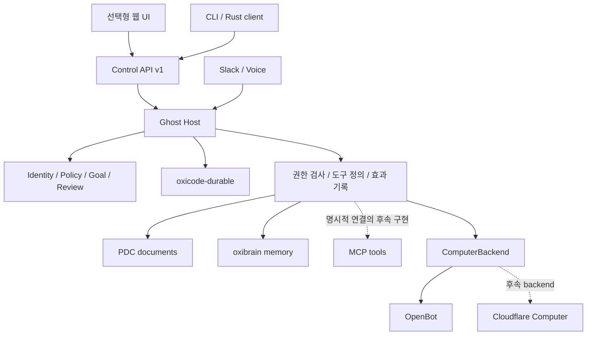

# ADR 011 — Ghost 전체 시스템 설계

2026-10-03 갱신. 이 문서는 [시스템 재평가](architecture-reassessment-2026-10-03.md), host·control·adapter 재편, [Cloudflare Computer 평가](cloudflare-computer-assessment-2026-10-03.md), UI 방향과 후속 구현 기준을 모은 **현재 설계 기준**이다. 새 기능과 모듈 배치는 이 문서를 기준으로 정한다. 이전 ADR과 평가 문서는 결정의 배경·검증 이력으로 보존한다.

**프로젝트의 목적은 Rust로 구현하는 장기 실행 에이전트의 기본 단위 Ghost를 만드는 것이다.** OpenDots는 대화·문서·검토·컴퓨터·채널을 연결하는 사용 경험의 참고점이다. 완료 기준은 기능 개수의 일치보다 Ghost의 독립성, 지속성, 권한 경계, 복구 가능성과 사람이 개입할 수 있는 흐름이다.

아래에서 ‘구현’은 현재 소스에서 확인한 구조, ‘검증’은 연결한 실행 기록, ‘후속’은 아직 완료하지 않은 목표를 뜻한다. 구현 코드의 존재만으로 실서비스 연결이나 운영 적합성을 검증했다고 보지 않는다.

기기·음성·컴퓨터·셀프 호스팅 제품 범위는 후속 [ADR 012](adr-012-cross-device-voice-self-host.md)를
함께 따른다. 제품 목표는 OpenAI dot의 기능과 완성도이며, 해당 문서는 구현 상태와 미완료 수용 조건을 구분한다.

## 목적과 기본 단위

Ghost는 UUID, 역할, 정책, 맡은 일과 실행 기록을 가진다. 대화와 모델은 Ghost가 사용하는 자원이다. 장기 실행은 호스트가 계속 실행되면서 저장된 입력·타이머·책임을 처리하고, 재시작 후 재개 가능한 작업을 복구한다는 뜻이다. 모델을 계속 호출하는 것과는 다르다.

하나의 Rust 호스트가 여러 Ghost를 운영한다. 별도 프로세스·컨테이너는 격리된 작업환경이 필요할 때 사용한다. UI의 수명은 호스트의 수명과 독립적이다.

| 개념 | 소유하는 것 | 수명과 관계 |
| --- | --- | --- |
| Ghost | UUID, 역할, 현재 권한, 책임, 기억 namespace와 활동 기록 | 여러 대화·모델·프로세스 재시작에 걸쳐 유지 |
| 책임/목표 | 목적, 완료 기준, 지시, 의존성, wake 조건, 진행 근거 | 여러 작업을 통해 수행하며 대화 하나와 동일하지 않음 |
| 대화 | 사용자·채널과의 입력, 문맥, steering/follow-up, 보존된 이력 | Ghost가 여럿 보유할 수 있음 |
| 작업/실행 시도 | 유한한 모델 실행, 도구 호출, checkpoint, 부모·자식 관계 | 한 번의 wake가 하나 이상의 작업을 만들 수 있음 |
| 도구 효과 | 외부 변경 의도, 시도, 결과, 불확실성, 확인 근거 | 실행 프로세스가 사라져도 판정 가능해야 함 |
| 컴퓨터/작업환경 | 작업 파일, backend와 remote runtime, 실행 handle | Ghost와 독립적으로 교체·중단·재연결 가능 |
| UI·채널 | 입력과 결과의 표시·전달, 사용자 결정 | Ghost의 정체성과 실행 상태를 소유하지 않음 |

현재 역할 문자열과 Ghost별 예산은 저장되어 있다. 역할 이력의 버전 관리, 책임별 예산·기한·중단 조건을 일반화하는 작업은 후속이다. 하나의 Ghost에 하나의 상주 LLM이나 OS 프로세스를 요구하지 않는다. Knock·FARM 같은 상위 제품은 이 단위를 조합하는 소비자로 둔다.

## 계층과 의존 방향



## 실제 코드 경계

| 위치 | 책임 |
| --- | --- |
| `src/domain.rs` | 정책, 목표, 검토, 위임, 사용량의 지속적인 기록 타입 |
| `src/host/` | root/profile 단일 writer, worker 감독, 타이머·목표 실행, owner 명령, 조회, 서비스 bridge, 종료 |
| `src/durable.rs` | 기존 oxicode-durable과 Ghost의 identity·filesystem 권한 연결 |
| `src/control/api.rs` | UI·CLI가 공유하는 serde 명령 계약 |
| `src/control/{server,client,metadata}.rs` | loopback HTTP, 인증, 접속 정보, CLI/Rust client |
| `src/adapters/` | 문서·기억·컴퓨터·채널 구현과 사용 불가 응답 |
| `src/workspace/` | 웹 정적 자산과 호환용 serve 함수 |
| `src/store.rs`, 기존 bounded CLI | 기존 profile·task 저장소와 오프라인 호환 경로 |
| `src/host/operations.rs` | SQLite 백업, 새 root 복원, OS 서비스 설정 생성 |

아직 한 crate 안의 모듈이다. 별도 서비스나 여러 crate를 먼저 늘리지 않는다. `Bridge`는 UI 대신 `Weak<Host>`를 사용한다. 어댑터의 상태 접근은 현재 crate 내부 인터페이스로 제한되어 있으며, 모든 어댑터를 독립 배포 가능한 plugin으로 만든 것은 아니다.

범용 모델·도구 실행, compaction, checkpoint와 child task는 기존 `oxicode-durable`을 재사용한다. Ghost가 그 위에서 identity·책임·현재 권한·업무 효과의 의미를 관리한다. UI 안에 두 번째 agent loop를 만들지 않는다. 새 실행 기능은 durable 경로에 모으고 기존 `task/run`과 `ghosts` coordinator는 호환 경계로 유지한다.

## 장기 실행·책임·복구 계약

책임은 목표와 완료 근거를 저장하고, 입력·타이머·이벤트·위임 결과·사용자 결정으로 실행을 깨운다. 한 번 깨어난 실행은 예산과 종료 조건을 가진 유한한 작업이다. 일정이 있다는 사실만으로 목표를 스스로 관리하는 에이전트가 완성되는 것은 아니다.

현재 `Goal`에는 지시, 완료 기준, 선행 목표, 선택적 이벤트 이름, 연결된 task, 실행 회차와 근거가 있다. 준비된 목표는 설정과 intent를 저장한 뒤 대화·입력을 만든다. 일반 흐름은 `ready → starting → running → review → complete`이며 실패·일시정지·취소도 구분한다. 모델의 `report_goal`은 검토할 근거를 남기고, 현재 완료 명령은 소유자의 확인 근거를 요구한다. 추후 자동 검증 가능한 책임에는 별도 verifier를 연결할 수 있으며 모든 작업을 무조건 승인 대기로 막는 방향은 아니다.

| 경계 | 유지할 계약 | 현재 구현 또는 남은 일 |
| --- | --- | --- |
| 입력 접수 | 저장한 뒤 응답, 같은 ID 재전송은 중복 실행 방지 | command receipt와 durable submission 사용 |
| 타이머 | 회차별 안정적인 ID, runtime 입력 저장 후 ACK | `schedule:<id>:<time>`; busy/uncertain 대화는 보류, downtime 회차 몰아 실행하지 않음 |
| 이벤트·의존성 | 선행 완료와 새 이벤트를 확인한 뒤 wake | Goal의 이벤트 시각·회차 저장; 일반 event cursor·소비·보존 정책은 후속 |
| 모델 실행 | 현재 정책과 요청·사용량 예산으로 admission | Ghost별 정책·보고된 사용량 집계; 책임별 예산과 실제 청구 상한 보장은 후속 |
| 검토·위임 대기 | 대기를 저장하고 다른 작업을 막지 않으며 재시작 후 재연결 | WaitingOwner와 host journal 사용; 대량·장기 대기의 메모리/슬롯 한도 검증은 후속 |
| 외부 효과 | 실행 전 intent 기록, 결과가 불명하면 `uncertain` | 전역 exactly-once를 약속하지 않음; 도구별 receipt와 reconciliation 강화 필요 |
| 프로세스 종료 | 새 실행을 멈추고 저장된 책임·작업을 보존 | 명시적 shutdown과 handler join; owned delegation 재시작 검증 존재 |
| 사용자 취소 | 부모·소유 자식에 취소 전파, 이미 발생한 효과는 별도 확인 | 취소를 외부 효과의 rollback으로 해석하지 않음 |
| worker 장애 | 영향을 받은 Ghost와 원인을 드러내고 복구 후 재개 | 자동 무한 재시도 금지; 운영 복구·감독 정책은 추가 검증 대상 |

재시작 가능한 모델/읽기 작업과 재시도하면 중복 효과를 낼 수 있는 변경을 구분한다. 타이머 일시정지는 이후 접수를 멈추는 명령이며 이미 접수한 작업 취소와 별개다. background 위임은 부모 종료 이후의 지속을 허용하는 명시적 선택이지만 권한 검사를 생략하는 선택은 아니다.

## 실행과 feature

`host`가 기본 feature다. UI·문서 파서·기억 client·WebSocket channel 없이 호스트를 실행할 수 있다.

```sh
cargo run -- --root /path/to/ghost-state serve
# 명시적인 headless 실행은 UI 포함 빌드에서도 동일하다.
cargo run -- --root /path/to/ghost-state serve --headless
```

`documents`, `memory`, `computer`, `channels`는 각각 선택할 수 있다. 예를 들어 `--features documents`로 웹 UI 없이 문서 도구를 연결할 수 있다. `workspace-ui`는 이전 사용법을 보존하는 편의 묶음으로, 현재의 웹 UI와 네 어댑터를 모두 포함한다.

```sh
cargo run --features workspace-ui -- --root /path/to/ghost-state serve
```

기본 모델은 외부 요청 없는 `mock`이다. 실제 모델·어댑터 설정과 현재 정책이 있어야 해당 기능을 실행할 수 있다. `--no-default-features`는 기존 bounded core를 빌드한다. 로컬 경로인 oxicode/oximemo/oxibrain 의존성의 배포용 고정은 별도 과제다.

## 제어와 저장 계약

실행 중인 호스트는 profile 저장소의 writer lock을 보유한다. 외부 CLI는 `control` 명령을 통해 같은 호스트로 요청한다.

```sh
ghost --root /path/to/ghost-state control snapshot
ghost --root /path/to/ghost-state control events PROFILE_UUID --after 0
ghost --root /path/to/ghost-state control send --file command.json
```

명령 파일은 기존 UI와 같은 형태다. `request_id`에는 매 명령의 UUID를 넣고, 응답을 잃었을 때 같은 명령과 같은 UUID를 다시 사용한다.

```json
{
  "request_id": "f8379dd8-8310-40ca-8122-d5ddaa596d12",
  "command": {
    "type": "create_profile",
    "name": "researcher",
    "persona": "근거를 수집하고 맡은 일의 진행을 보고한다."
  }
}
```

- API 경로는 `/api/v1/bootstrap/{nonce}`, `/api/v1/action`, `/api/v1/snapshot`, `/api/v1/events/{profile_id}/{after}`다. 명령 접수와 runtime commit 이벤트는 서로 다른 기록이다.
- root의 `.ghost-control.json`으로 localhost endpoint를 찾는다. Unix에서는 파일 권한을 0600으로 제한한다. 비밀 토큰은 URL·CLI 인자·readiness 출력에 넣지 않는다.
- client는 nonce/HMAC 응답으로 발견한 서버를 검증한 다음 bearer 인증 요청을 보낸다. 오래된 endpoint의 포트를 다른 프로세스가 점유해도 인증 토큰을 먼저 전송하지 않는다.
- 브라우저 호환 API는 cookie·CSRF·Host/Origin 검사를 유지한다. 이 프로토콜은 단일 소유자의 로컬 제어용이며 원격 multi-user 인증을 구현한 것은 아니다.
- 명령 intent를 먼저 저장하고 결과를 기록한다. 같은 ID와 payload는 저장된 결과를 돌려주며 다른 payload는 거부한다. 완료 기록이 없는 명령은 자동 재실행하지 않고 확인 대상으로 남긴다.
- `workspace.db`, profile `ghost.db`/`durable.db`, 기존 JSON 명령 이름을 유지한다. 이 리팩터링은 데이터 일괄 변환을 요구하지 않는다.

기존 `profile`, `task`, `conversation` 직접 접근 CLI는 오프라인 호환 경로다. 호스트 실행 중 제어에는 `control`을 사용한다. 아직 모든 기존 subcommand를 자동 proxy하는 방식은 아니다.

라이브러리에서는 `Host::open`이 worker를 시작한다. 로컬 명령에는 `Host::action`, 비동기 어댑터 명령에는 `Host::action_async`를 사용한다. `shutdown().await`로 worker를 정리한 후 모든 `Arc<Host>`를 놓으면 writer lock을 반환한다. 동기 `action`은 Tokio 안의 외부 어댑터 호출을 panic 대신 명시적 오류로 돌려준다.

서버는 종료 신호를 받으면 새 연결·새 명령 접수와 worker를 멈추고, 이미 시작한 요청의 결과 기록을 마친 뒤 runtime을 정리한다. **호스트 종료는 사용자의 작업 취소가 아니다.** owned delegation은 재시작 후 다시 연결할 수 있도록 남긴다. 명시적 부모 작업 취소나 권한 철회는 자식 작업으로 전달한다. 외부 효과가 불확실하면 기존 effect 복구 규칙을 적용하며 성공을 가정하지 않는다.

## 도구·권한·위임 계약

도구는 모델이 사용할 수 있는 기능의 명시적 경계다. 소유자의 설정·승인 명령과 모델 도구를 분리하고, skills·모델 인자·원격 페이지 내용이 권한을 부여하지 못하게 한다. 외부 문서·웹·기억·컴퓨터 출력은 출처가 있는 비신뢰 관찰로 다룬다.

현재 도구는 native `read_file`/`write_file`과 분석 child, 문서 조회·저장 제안, 다른 Ghost 위임, memory 검색·보존, 격리 browser/shell, 책임 보고로 나뉜다. 문서는 feature, memory와 computer는 설정·backend capability를 기준으로 노출하고, 실행 시 현재 정책·경로·Space 접근을 다시 검사한다. feature를 켠 것만으로 권한이 생기지 않는다. 기본 정책은 browser/shell/memory/voice를 끄고, 위임 허용과 파일 경로 grant는 별도로 관리한다.

모든 어댑터에 적용할 목표 계약은 다음과 같다. 현재 `ai::Tool`, `ToolPlan`, `ToolOutput`에 있는 요소와 backend별 구현을 이 기준으로 정리하되, 완성된 공통 registry가 이미 존재한다고 보지 않는다.

| 계약 항목 | 필요한 정보와 동작 |
| --- | --- |
| 식별·입력 | 도구 이름·버전, 엄격한 입력 schema, 크기·형식 제한 |
| 권한 | 대상 Ghost, 현재 capability, 경로/Space/계정 scope, 위임 제한 |
| 실행 | backend ID, deadline·취소, 출력·자원 한도 |
| 효과 | 읽기/변경 구분, effect key, replay 가능 여부, 외부 실행 handle |
| 결과 | status, 짧은 summary, 다음 가능한 행동, artifacts, receipt·provenance |
| 복구 | 상태 조회, 중복 방지, timeout/권한 철회/응답 유실의 reconciliation |

같은 Ghost의 `durable_delegate`는 파일 도구가 없는 분석 child다. 다른 Ghost에 대한 `delegate_ghost`는 독립 identity의 작업이며, 수신자의 권한과 발신 lineage의 현재 권한을 함께 제한 조건으로 삼는다. 수신자가 더 강한 권한을 가졌다는 이유만으로 발신자가 못 하는 작업을 우회할 수 없어야 한다. 현재 소스에 lineage 검사, 문서·파일·컴퓨터 권한 제한, 위임을 통한 타 Ghost private memory 사용 제한이 추가되어 있다. 이 보강의 전체 권한 행렬과 장기 철회 시나리오는 별도 통합 검증 대상이다.

## 프로토콜별 역할

| 연결 | 현재/채택 방향 | Ghost가 유지할 책임 |
| --- | --- | --- |
| UI·CLI ↔ host | 구현된 Control API v1와 공유 serde 명령 | 접수·인증·request ID·조회·오류·복구 의미 |
| host ↔ 실행 엔진 | `oxicode_sdk::durable` Rust API | identity·정책·책임과 실행 수명주기 |
| Ghost ↔ Ghost | 현재 local durable 위임; 외부 연합이 필요할 때 A2A adapter | sender 인증, 수락 범위, lineage, 취소와 결과 회수 |
| 모델 ↔ 외부 도구/데이터 | 명시적으로 등록하는 MCP client adapter가 후속 | 서버별 credential·scope·timeout과 현재 정책 재검사 |
| 외부 UI ↔ agent 표시 | 필요 시 AG-UI adapter | 장기 책임·승인·effect 상태의 원본은 host |
| 채널 ↔ host | Slack/voice adapter가 인증된 바인딩을 Ghost·대화에 연결 | inbound 중복 제거, outbound receipt, 계정·사용자 allowlist |
| host ↔ computer | 현재 `ComputerBackend`, 후속 typed HTTP/MCP gateway | backend capability, 실행 식별자, 단절·재접속·불명 결과 |

`protocol.rs`는 기존 내부 text-only 봉투이며 A2A 구현이 아니다. AG-UI·MCP·A2A를 한 번에 코어에 강제하지 않는다. 현재 모델 resolver는 전역 MCP discovery를 끈다. 새 MCP 연결은 Ghost가 선택한 서버·도구만 주입하는 방향이다.

현재 control은 로컬 단일 소유자의 bearer 인증과 route version을 갖고, 일부 payload/이벤트 타입은 엔진 타입에 연결되어 있다. 후속 wire 계약은 protocol version, request/message ID, 인증된 actor, 대상 Ghost, causation/task ID, 필요한 expected revision을 명확히 매핑한다. 모델이 전달한 sender 문자열을 인증으로 쓰지 않는다. 이벤트 보존 범위를 벗어난 cursor의 snapshot 재동기화, pagination, 엔진 타입 변경을 격리하는 DTO는 후속이다.

## 저장 원본·기억·문서

| 데이터 | 원본과 소유 | 금지할 혼동 |
| --- | --- | --- |
| identity·grant·audit·legacy task | profile의 `ghost.db` | UI 캐시를 권한의 원본으로 사용 |
| 대화·task·checkpoint·effect | profile의 `durable.db` | 모델 요약을 실행 영수증으로 사용 |
| 목표·일정·검토·위임·채널·명령 receipt | host의 `workspace.db` | 여러 DB에 하나의 원자적 transaction이 있다고 가정 |
| 장기 기억 | oxibrain adapter의 `ghost:<UUID>` namespace와 task provenance | compaction을 자동 기억 학습으로 간주하거나 타 Ghost 기억으로 대체 |
| 사용자 문서·자산 | 연결된 Space의 PDC 파일과 안정적 document ID | 모델 출력·캐시를 자동으로 사용자 문서로 승격 |
| 컴퓨터 작업 파일 | backend별 working copy·입력·산출물 | 원격 filesystem을 identity·권한 DB의 원본으로 사용 |
| UI 상태·preview | 저장 상태에서 만든 표시용 데이터 | 브라우저 상태로 진행·완료·권한을 확정 |

문서 조회는 source·ID·hash를 보존하고, 수정 제안은 owner review와 현재 source hash 검사 후 반영한다. 외부 편집이 있으면 충돌을 드러내고 덮어쓰지 않는다. Space unlink는 파일 삭제와 구분한다. 링크·embed·자산 경로와 renderer는 PDC 및 현재 Space 접근 범위를 지킨다. 검색 index와 preview는 원문을 대체하지 않는다.

이 세션에서 사용자가 명시한 계약에 따라 **새 문서는 PDC 1 Djot/HTML로 쓰고 기존 PDC 2 문서는 읽을 수 있게 유지한다.** HTML은 구조·레이아웃이 필요한 문서의 정식 경로다. 설치된 스킬의 PDC 2 권고만으로 기존 지시를 바꾸거나 일괄 변환하지 않는다. 버전 전환이 필요하면 별도 결정과 migration 검증을 기록한다. 이 설계 문서 자체는 repository documentation으로 PDC 데이터 평면 밖에 있다.

기억의 수정·삭제·보존 기간과 학습 정책은 추가 정의가 필요하다. 명시적으로 연결한 oxibrain이 없거나 응답에 실패하면 사용 불가·불명 결과를 드러내고 다른 store에 조용히 저장하지 않는다.

## 컴퓨터와 Cloudflare

`ComputerBackend`는 browser/shell/human-control/persistent-filesystem 지원 여부와 정규화된 요청을 제공한다. `Host::open_with_backend`로 구현을 주입할 수 있다. 도구 목록과 실행 시점 모두 실제 backend의 설정·지원 기능 및 현재 owner 정책을 검사한다. 컴파일 feature나 모델이 제출한 인자는 권한이 아니다.

현재 실제 구현은 기존 OpenBot 연결이다. Cloudflare Computer는 별도의 backend로 추가할 수 있으나 이번 변경에서 구현·배포·실서비스 검증하지 않았다. [평가](cloudflare-computer-assessment-2026-10-03.md)의 결론대로 durable filesystem과 원격 실행 후보로 사용하고 Ghost의 identity·정책·책임·effect 기록은 Rust 호스트에 둔다. Cloudflare 런타임 재생성과 실행 결과 유실을 Ghost 재시도와 동일시하지 않는다.

Cloudflare의 TypeScript Worker/Durable Object, 필요 시 container·FUSE·computerd는 선택형 외부 실행 서비스로 둔다. 이를 사용하기 위해 Ghost 코어를 TypeScript로 옮기거나 Node를 기본 호스트 실행 의존성으로 추가하지 않는다. 원격 서비스의 런타임·계정·배포 요구사항은 backend별로 명시한다.

Cloudflare 연결의 다음 수용 조건은 Ghost별 격리·인증, shell-only capability, execution handle과 결과 조회, timeout 후 reconciliation, runtime 교체와 파일 지속성 검증이다. browser/human-control을 지원하지 않는 backend에는 해당 도구를 노출하지 않는다.

[고정 commit 평가](cloudflare-computer-assessment-2026-10-03.md)에 근거한 채택 범위는 아래와 같다. 외부 프로젝트의 최신 상태를 이 문서 갱신에서 다시 조사한 것은 아니다.

| 활용 | 판단 | 통합 조건 |
| --- | --- | --- |
| durable filesystem과 작은 파일 작업 | 시험 도입 가치 높음 | Ghost별 workspace·인증 바인딩, 전송량·용량 측정 |
| worker shell/JavaScript와 Linux container 실행 | 선택형 실행 자원으로 활용 | backend allowlist, egress·시간·출력·비용 한도 |
| 실행 조회·취소·재접속 | Ghost effect와 연결할 표면으로 활용 | workspace/runtime/execution ID와 receipt를 지속적으로 연결 |
| Ghost identity·목표·정책·기억 소유권 | Rust host와 해당 store에 유지 | 원격 작업 디렉터리로 상태 DB·credential을 복제하지 않음 |
| GUI browser·human control | 별도 기능으로 평가 | shell/파일 실행 지원만으로 browser 기능을 광고하지 않음 |

평가한 예제는 한 workspace로 요청을 모으고 넓은 Code Mode 도구를 노출한다. 이를 그대로 여러 Ghost에게 공유시키지 않는다. 인증된 주체와 원격 workspace를 gateway에서 바인딩하고, `fs.read/list/write`와 `exec.start/status/cancel`처럼 제한 가능한 동작을 마련한다. capnweb 전체를 Rust로 다시 구현하는 일부터 시작할 필요는 없다.

원격에 전달하는 것은 선택한 입력과 working copy이며, 산출물은 hash와 출처를 확인해 가져온다. persistent file과 running process의 수명은 다르다. runtime 교체나 실행 로그 유실을 성공·미실행으로 추정하지 않으며, 불명 exec를 새로 발행하기 전에 결과를 조정한다. 현재 Rust trait은 정규화된 execute/control 경계까지 제공한다. 원격 실행 handle의 저장·cursor·재연결 및 독립 filesystem API는 Cloudflare 통합 전에 확장해야 한다.

채택 완료는 두 Ghost 격리, 응답 유실 시 중복 실행 방지, 권한 철회, runtime 교체, 파일 지속성, 작은 실제 작업의 산출물 회수, 로컬 backend 대비 cold start·비용·전송량 측정으로 판정한다. 고정한 평가 소스는 preview이므로 제품 기본 의존성으로 확정하지 않는다.

## UI 제품 방향과 사용자 흐름

첫 제품은 Rust host가 정적 자산을 제공하는 **선택형 웹 관리 UI**다. 기본 탐색 단위는 Ghost이고, Ghost 안에서 맡은 일·대화·필요한 결정·결과를 이어서 본다. UI를 닫거나 다시 연결해도 같은 저장 상태를 읽는다. 모델과 연결 설정은 사용자가 필요한 결정을 할 때 보여준다.

| 화면 | 반드시 보여줄 내용 | 사용자의 주요 행동 |
| --- | --- | --- |
| Ghost 목록·개요 | 역할, 맡은 일, 실행/대기/오류, 다음 wake, 예산 | Ghost 만들기, 선택, 상태 확인 |
| 맡은 일 | 목적·완료 기준, 지시, 의존성, 진행 근거, 대기 이유 | 맡기기, pause/resume, 취소, 완료 근거 확인 |
| 대화 | committed 메시지, 생성 중 부분 응답, task·책임 연결 | 질문, steer/follow-up, 취소, compaction, fork |
| 내 결정 대기함 | 문서 제안, 권한 요청, 질문, uncertain 효과, 미완료 receipt | 비교·승인·거절·확인 결과 기록 |
| 결과·문서 | 산출물, provenance, PDC 원문·preview, 충돌, 연결된 대화 | 읽기·편집·검토·Space 접근 관리 |
| 자원·설정 | 모델·권한·예산·일정·기억·컴퓨터·채널의 설정 및 오류 | 연결·권한 철회·human control·운영 작업 |

대표 흐름은 `Ghost 선택 → 목표와 완료 기준으로 맡기기 → 진행/대기 확인 → 필요한 결정 → 산출물과 근거 확인`이다. 재접속하면 저장된 snapshot과 commit cursor로 이어가며, 응답을 잃은 요청에는 기존 request ID를 유지한다. 연결 실패와 빈 결과, 권한 거부, 실행 실패, 불명 결과를 같은 성공 화면으로 처리하지 않는다.

현재 `workspace/index.html`, `app.js`, `workflows.js`에는 Ghost·대화·일정·권한·책임·문서·검토·위임·채널 설정과 입력 복구 화면이 있다. 목표 표의 정보구조와 모든 기능의 완성된 화면 통합을 끝냈다는 뜻은 아니다. 다음 UI 작업은 이 기능들을 일관된 탐색·결정 대기함으로 묶고, 위 대표 흐름의 접근성·작은 화면·재접속 동작을 실제 브라우저에서 검증하는 것이다.

현재 선택 대화 snapshot과 revision 비교를 활용하고, 전체 이력을 매번 전송하지 않도록 조회 한도를 발전시킨다. 장기 이력의 pagination·이벤트 보존·백프레셔를 측정한다. 화면이 커지면 TypeScript 컴포넌트 구조를 도입할 수 있지만 Node 상주 프로세스를 Ghost 실행의 필수 조건으로 만들지 않는다. 데스크톱 설치·알림·키체인이 필요해지면 동일 API 위에 native shell을 추가한다. 프런트엔드 프레임워크 교체와 완성된 디자인 시스템 결정은 이 문서로 확정하지 않는다.

## 운영·배포·호환성

상주 서비스의 조건에는 graceful shutdown 외에 백업·복원·worker 복구·예산·상태 관찰·저장량 증가 관리가 포함된다. 운영 기능은 모델 도구와 분리된 owner 명령이다. 로그에는 접수·task/effect·원격 실행의 상관관계를 남기고 credential을 넣지 않는다.

현재 소스의 `host/operations.rs`에는 SQLite backup API를 사용한 백업, hash/integrity를 확인하는 새 root 복원, `launchd`/`systemd` 서비스 설정 생성이 추가되어 있다. 다음 제약을 설계 계약으로 유지한다.

- 백업은 실행 DB별 snapshot이다. 여러 DB를 한 시각에 원자적으로 복사했다고 주장하지 않는다. cross-store intent·receipt 복구와 함께 검증한다.
- 외부 Space 문서는 host DB 백업에 자동 포함하지 않는다. 별도 백업 대상 목록과 일관성 범위를 보고한다.
- 복원은 새 디렉터리만 대상으로 하며 기존 root를 덮어쓰지 않는다. 복원 후 pending/uncertain 작업은 정상 복구 규칙을 따른다.
- 서비스 설정 생성과 OS 설치·활성화를 구분한다. 현재 `service-spec`은 검토할 파일을 생성하는 경로다.
- 일일 요청·보고 토큰·보고 비용은 host admission의 기준이다. 중단된 호출이나 음성·원격 컴퓨터의 실제 청구를 완전히 보장하는 결제 상한은 아니다.
- 로컬 경로 의존성의 commit 고정·패키징, OS/CPU 빌드, 실제 프로바이더와 컴퓨터 연결, 장시간 부하·데이터 크기·복원 훈련은 릴리스 전에 검증한다.

기존 `workspace.db`, profile DB와 receipt payload는 보존한다. root/profile writer lock을 우회하지 않고, 실행 중인 호스트는 control로 제어한다. legacy 저장 데이터·PDC 파일의 자동 전환이나 삭제는 이번 설계의 일부가 아니다. 외부 프로토콜과 여러 사용자의 호스팅은 현재 로컬 신뢰 경계를 대체하는 별도 설계가 필요하다.

## 구현 상태와 남은 검증

2026-10-03 소스 확인 기준이다. 아래 ‘소스 있음’은 뒤의 기존 테스트 기록에 그 기능의 모든 변경이 포함되었다는 의미가 아니다.

| 영역 | 현재 확인한 상태 | 남은 완료 조건 |
| --- | --- | --- |
| headless host·공통 control·선택형 adapters | 구조 분리와 기본 실행 경로 구현, checkpoint 검증 있음 | 지속 운영·데이터 규모, 엔진 wire 의존 완화 |
| 책임·일정·이벤트·위임 | 저장/dispatch/owner 확인과 재시작·취소 회귀 검증 있음 | 일반 wake/event 계약, 권한 행렬·예산·장기 대기 통합 검증 |
| 문서·기억·채널 | PDC/oxibrain/Slack/voice 소스와 UI 연결 존재 | 최신 병행 변경의 통합 검증, 계정 연결과 실서비스 시나리오 |
| 컴퓨터 | typed backend 경계, OpenBot 구현, 권한/capability 단위 검증 | 실제 backend 중단·재접속·receipt 회수 |
| Cloudflare | 고정 소스 평가, 교체 경계, 도입 수용 기준 | gateway/backend 구현·별도 배포·격리·비용 실험 |
| 웹 UI | 기존 UI를 control client로 유지, 추가 workflows 존재 | 목표 정보구조·결정 대기함·접근성·반응형·시각 검증 |
| 백업·복원·서비스 설정 | 병행 작업의 소스 추가 확인 | snapshot 간 정합성, 복원 훈련, 실제 서비스 운영 |
| 외부 표준 | control v1 구현, 내부 위임 사용 | 선택형 MCP/AG-UI/A2A adapter와 명시적 호환 검증 |

## 개발 순서와 수용 기준

| 우선순위 | 작업 | 완료를 판정할 시나리오 |
| --- | --- | --- |
| 1 | 현재 구조와 병행 기능 통합 안정화 | UI 없는 두 Ghost, live CLI 제어, 중복 접수·재시작·종료·취소·권한 철회가 일관됨 |
| 2 | 장기 책임·대기·효과 복구 계약 강화 | 승인 지연과 프로세스 종료 중에도 진행·근거를 복원하고 불명 효과를 중복 실행하지 않음 |
| 3 | 실제 컴퓨터 backend 한 가지 완성, Cloudflare 소규모 비교 | 입력 → 실행 → 단절/취소 → 재접속 → 산출물/영수증 확인을 끝까지 수행 |
| 4 | Ghost 중심 UI의 수직 흐름 완성 | 맡기기 → 진행 확인 → 필요한 결정 → 결과 확인을 실제 브라우저에서 완료 |
| 5 | 운영·연결·배포 확대 | 백업 복원·장시간 부하·OS 서비스·고정 의존성 릴리스와 추가 backend/프로토콜의 같은 계약 테스트 |

범용 plugin marketplace, 즉각적인 multi-crate/마이크로서비스 분리, 모든 Ghost의 전용 컨테이너, 기본 Cloudflare 종속, OpenDots와의 전면 기능 동등성, 전체 UI 교체는 선행 조건으로 두지 않는다. 첫 검증 가능한 단위를 완성한 다음 실제 필요한 확장을 추가한다.

## 검증 근거와 문서 관리

이번 갱신은 설계 문서 반영이다. 실행 코드와 테스트를 새로 수행한 결과를 추가하지 않는다. 아래 숫자는 이전 구조 변경 checkpoint의 기록이다.

검증 실행에서 기본 `cargo test --offline`은 **67 passed**, UI 포함 `cargo test --offline --features workspace-ui`는 **74 passed**였고 실패·무시·컴파일 경고는 없었다. minimal, documents, memory, computer, channels, ui-fixtures의 독립 feature 빌드 6개도 `--all-targets` 검사를 통과했다. 이 숫자는 두 실행의 각각의 테스트 수이며 합산한 고유 테스트 수가 아니다.

실제 결과와 소스 hash는 [구조 변경 검증 기록](evidence/host-architecture-2026-10-03.json)에 기록했다. 같은 폴더의 다른 작업이 추가 기능을 병행한다. 최종 검증 중 문서 adapter와 owner actions의 추가 편집이 관찰되었으므로 이 기록은 해당 실행 시점의 근거이며 이후 통합 변경까지 검증했다고 의미하지 않는다.
