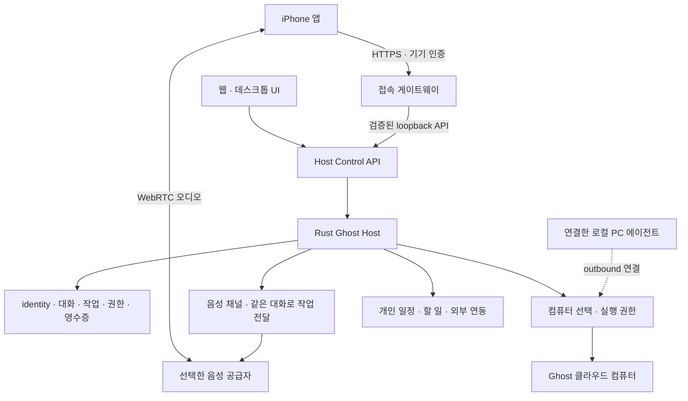

# ADR 012 — OpenAI dot를 목표로 하는 기기·음성·컴퓨터·운영 구조

2026-10-03. 사용자가 정한 제품 목표는 **OpenAI dot의 기능과 완성도**다.
CopilotKit/OpenDots는 구현 참고 자료다. [ADR 011](adr-011-ghost-host-control.md)의
Rust host·control·adapter 구조 위에 이 문서의 제품 범위와 수용 기준을 추가한다.
이 문서는 전면 기능 동등성이나 실서비스 검증 완료를 선언하지 않는다.

사용자가 이번 대화에서 확정한 우선순위는 **iPhone 먼저, 앱 안에서 Ghost와 통화**다.
일반 전화번호 발신·수신, Android 동시 출시, 앱스토어 배포는 이번 선행 구현에 포함하지 않는다.
개인 사용을 우선하고, 처음부터 다중 고객 SaaS 운영을 요구하지 않는다.

## 기준 제품과 완료의 의미

공식 dot 문서에서 확인한 기준은 다음과 같다. 모바일·데스크톱에서 같은 dot에 접근하고,
음성 통화 후에도 맡긴 일이 이어진다. dot의 클라우드 컴퓨터와 연결한 개인 컴퓨터는
서로 다른 실행 환경이며 로그인 세션도 분리된다. 클라우드 작업은 개인 기기가 꺼져도
이어지고, 사용자는 컴퓨터를 열어 제어를 인수하고 돌려줄 수 있다.
dot가 먼저 거는 통화는 해당 문서에서 출시 후 계획으로 구분한다.
[음성·채널](https://learn.chatgpt.com/docs/dots/channels),
[컴퓨터·앱](https://learn.chatgpt.com/docs/dots/computers-and-apps).

Ghost의 완료 기준은 메뉴의 개수보다 실제 흐름이다.

1. iPhone에서 말을 걸고 일을 맡긴다.
2. 같은 Ghost·대화·권한·기억으로 서버가 일을 진행한다.
3. 클라우드 PC 또는 명시적으로 연결한 내 PC에서 필요한 작업을 한다.
4. 승인이 필요하면 휴대폰에서 근거와 대상 환경을 보고 결정한다.
5. 통화 종료·앱 종료·PC 오프라인·서버 재시작 후에도 상태를 정확히 이어간다.
6. 결과와 산출물, 비용, 실행 위치, 실패 이유를 UI에서 확인한다.

## 전체 구조

실선의 host·기존 음성·OpenBot·신규 iPhone/gateway 경로에는 코드가 있다.
컴퓨터 router·로컬 PC 에이전트는 후속 구현이다. 현재 단일 `ComputerBackend`를
두 종류의 PC 연결 완료로 해석하면 안 된다.

서버는 항상 켜 둘 Mac mini 또는 개인 서버가 맡는다. iPhone은 실행 엔진을
상주시킬 필요가 없다. 서버를 내 노트북에서 실행하면 노트북이 꺼질 때 서버도
꺼지므로, 이를 클라우드 상시 실행이라고 표시하지 않는다.

## 음성 통화

현재 Rust `channels_impl.rs`의 WebRTC SDP 교환, `voice_start`, `voice_event`,
`voice_work`, `voice_end`와 저장된 통화 상태를 재사용한다. 모바일에 별도 Ghost나
별도 작업 큐를 만들지 않는다. 음성 모델의 `delegate_work`는 기존 durable
conversation으로 들어가고 결과를 기다린다. 통화 종료는 그 작업을 취소하지 않는다.

iPhone 구현은 네이티브 SwiftUI 앱 안에서 WebKit의 WebRTC를 사용한다.
`WKWebView`는 미디어 권한과 origin을 검사하는 작은 음성 전용 화면이다.
일반 채팅 UI를 웹뷰로 포장하는 구조가 아니다. 키체인의 기기 키는 네이티브
URLSession에만 전달하며 음성 페이지의 JavaScript에는 전달하지 않는다.
브리지는 고정된 Ghost·대화에 묶인 통화 시작/종료·전사·작업 접수·결과 조회만 허용한다.

현재 앱은 **전경 통화**다. 앱을 벗어나면 마이크와 재생을 닫고 서버 종료를 요청한다.
서버 응답이 유실되면 성공으로 처리하지 않고 진행 중 화면에서 통화 상태를 확인한다.
기존 서버의 5분 통화 제한도 표시·종료 처리에 반영한다. 실제 계정으로 오디오 지연,
한국어 인식, 끼어들기, Bluetooth, 셀룰러 전환을 검증하기 전에는 완성 통화로 판정하지 않는다.

다음 단계는 서버 sideband가 전사·도구 이벤트를 처리하도록 옮기는 것이다.
그 뒤 네이티브 WebRTC 오디오·AVAudioSession·CallKit을 연결해 잠금 화면/통화 중단/이어폰
전환을 검증한다. 수신 통화가 필요해지면 APNs/PushKit과 CallKit을 도입한다.
일반 작업 알림에 VoIP push를 사용하지 않는다.
[OpenAI 서버 제어](https://developers.openai.com/api/docs/guides/voice-server-controls),
[Apple CallKit](https://developer.apple.com/documentation/callkit),
[PushKit 수신 통화](https://developer.apple.com/documentation/pushkit/responding-to-voip-notifications-from-pushkit).

OpenAI 음성 API는 하나의 adapter다. 셀프 호스팅은 Ghost 데이터·실행·접속 서버를
직접 운영한다는 의미이며, 현재 음성 추론까지 로컬에서 처리된다는 뜻은 아니다.
완전 로컬 음성은 STT·대화 모델·TTS adapter와 지연·취소 계약을 따로 검증해야 한다.

## iPhone과 웹 UI

| 화면 | 필요한 동작 | 이번 iPhone 구현 |
| --- | --- | --- |
| 연결 | HTTPS 서버 선택, 기기 인증, 연결 철회 | 키체인 저장, 기기별 서버 철회, 로컬 연결 해제 |
| Ghost 목록 | 같은 identity와 실제 상태 | 서버 목록 조회 |
| 대화 | 대화 전환, 메시지, 새 대화, 재시도 | 구현; 전경에서 주기적 snapshot 갱신 |
| 음성 | 시작, 음소거, 전사, 종료, 작업 연결 | 전경 WebRTC 경로 구현; 실기기/공급자 미검증 |
| 진행 중 | 작업 결과, 승인, 위임 관계, 취소 | 작업·통화·불명 요청 표시; 승인/위임 조작은 후속 |
| 컴퓨터 | 클라우드/내 PC 선택, 상태, 화면, 인수/반환 | 현재 backend 설정 표시만 구현 |
| 알림 | 완료·실패·승인 필요만 알림 | APNs 및 알림 선호 설정 후속 |

공통 API에 각 클라이언트의 네이티브 표현을 붙인다. 서버 API 키나 Rust 저장소를
휴대폰에 복사하지 않는다. 실패한 명령은 먼저 기기에 저장한 동일 `request_id`로
사용자가 다시 확인한다. 앱 재시작 뒤 자동 재전송하지 않는다. 서버의 불명 기록을
확인한 뒤 로컬 요청 기록을 닫는 동작을 따로 제공한다.

장기적으로 snapshot polling을 cursor 기반 이벤트와 필요한 대화별 조회로 바꾼다.
웹과 iPhone이 동시에 명령을 내릴 때 revision 충돌을 명시하고, 승인 대상 내용이
바뀌면 이전 승인을 적용하지 않아야 한다. 문서 편집을 모바일에 추가할 때도
Portable Document Contract와 기존 문서 adapter를 사용한다. 이번 변경은 문서
원본 형식을 추가하거나 변환하지 않는다.

## 클라우드 PC와 내 PC

클라우드 PC는 Ghost용 격리 환경이다. 개인 PC는 사용자가 명시적으로 등록한 기기다.
Ghost가 제어하는 서버 자체의 셸을 로컬 PC adapter 대신 무조건 열어 주지 않는다.

다음 코드는 구현된 API 명세가 아니라 후속 router에 필요한 계약이다.

| 개체 | 필수 정보 |
| --- | --- |
| Computer | `computer_id`, `kind: cloud/local`, 이름, OS, backend, 연결 상태, 실제 capability |
| Binding | `ghost_id`, `computer_id`, 허용 도구/경로, policy revision, 만료/철회 |
| Execution | `execution_id`, parent task, 대상 computer, 요청 hash, attempt, receipt, 결과 상태 |
| Control lease | computer, `human/agent`, 소유자, epoch, 만료, 마지막 heartbeat |

로컬 PC 에이전트는 서버로 outbound TLS 연결을 맺는다. 사용자의 PC에 공인 포트를
열지 않는다. 초기 pairing은 사용자 확인 후 단기 코드/기기 키로 수행하고, 서버의
Ghost 권한과 PC 자체의 OS 권한을 함께 검사한다. macOS Accessibility/Screen Recording,
파일 접근과 실행 권한을 기능별로 보고한다. 숨은 관리자 권한 상승은 하지 않는다.

실행 ID와 영수증은 PC에도 저장한다. 응답 유실 뒤 같은 작업을 다시 실행하는 대신
먼저 영수증을 조회한다. 결과를 알 수 없으면 `uncertain`으로 남긴다. PC가 꺼졌다는
이유로 클라우드 PC에 같은 변경 작업을 자동 복제하지 않는다. 세션·파일·로그인이
달라지는 환경 전환은 사용자가 확인할 수 있어야 한다.

직접 제어 인수는 화면상의 버튼만 바꾸는 기능이 아니다. 원자적인 lease 전환과
epoch 검사로 진행 중인 에이전트 입력을 차단한다. 사람이 로그인하는 동안
비밀번호를 대화나 모델의 캡처에 기록하지 않는다. 제어 반환 후 새로운 화면 상태를
읽고, 이전 화면의 좌표/요소 reference를 재사용하지 않는다.

기존 OpenBot의 browser/shell/human-control을 클라우드 backend 1호로 연결한다.
Cloudflare Computer는 파일·실행용 선택형 backend 후보이며, 실제 제공하지 않는
화면 제어 기능을 UI에 표시하지 않는다. 이전 [평가](cloudflare-computer-assessment-2026-10-03.md)를
따르며 이 문서는 새 배포를 수행하지 않는다.

## 셀프 호스팅과 보안 경계

첫 지원 단위는 소유자 한 명, writer 한 개, 중앙 host 한 개다. 여러 기기가 같은
SQLite 폴더를 동기화해서 열면 안 된다. 동기화는 API로 하고 DB는 host만 소유한다.

신규 `apps/ghost-gateway`는 외부 접속에 필요한 선택형 Node 서비스다. Rust 기본
호스트에 Node 의존성을 추가하지 않는다. TLS reverse proxy → loopback gateway →
인증된 loopback Rust API 순서다. 브라우저 개발 서버를 인터넷에 공개하지 않는다.
이번 gateway는 기존 웹 패키지의 host discovery 검증 코드를 import한다. 따라서
현재 배포에는 두 경로가 함께 필요하다. 추후 공통 transport 패키지로 이동할 수 있다.

서버 소유자는 기기마다 무작위 키를 발급한다. 서버에는 키의 SHA-256 digest만
저장하고 파일은 owner-only로 제한한다. 요청마다 registry를 다시 확인하므로 철회에
재시작이 필요 없다. 현재 기기 키는 **전체 owner 권한**이다. Ghost별 부분 권한,
다중 사용자, Passkey/OIDC, QR pairing은 후속이며 현재 제공한다고 표시하지 않는다.

정적 음성 화면에는 키가 없고, gateway는 URL·헤더를 임의로 전달하는 proxy가 아니다.
허용한 snapshot/action/events만 전달한다. API는 HTTP redirect를 따르지 않는다.
호스트 재시작 뒤 새 discovery를 검증하고 새 host token을 사용한다.

운영에 필요한 항목은 TLS 갱신, 서비스 자동 재시작, SIGTERM drain, 저장소 권한,
공급자 키 보관, 일관된 백업/복원, 디스크 용량·오류·불명 effect 관측이다.
준비한 [운영 안내와 예시](../deploy/self-host/README.md)를 따른다. Linux용 빌드와
컨테이너는 아직 검증하지 않았다. Cargo의 로컬 경로 의존성을 공급/고정하기 전에는
어디서나 빌드되는 Docker 이미지를 제공한다고 주장하지 않는다.

## 다른 세션과 통합

현재 대화에서 세션을 읽어 확인한 작업은 다음과 같다. 메시지 전송이나 새 세션
생성은 하지 않았다. 각 세션의 작업은 공유 폴더에서 계속 변할 수 있다.

| 세션 | 확인한 작업 | 이번 변경과의 경계 |
| --- | --- | --- |
| Reassess Ghost system paradigm | host/control/adapter 분리 | 기존 구조 유지, 서비스 SIGTERM 종료 보완 |
| Analyze the OpenDots project | 최소 Ghost, 복구, 문서, 음성, 협업 프로토콜 | 음성 owner actions와 durable 작업 재사용 |
| Ghost UI 구조 재검토 | `apps/ghost-ui`, 협업 화면과 아이콘 | 기존 화면 파일 변경 없음; mobile API 구조 공유 |
| 고스트에 개인용 연동 기능 추가 | 할 일·일정·MCP 연동 | planner/integrations 수정 없음; 같은 host에 연결 |

## 구현 순서와 수용 기준

| 단계 | 작업 | 통과 조건 |
| --- | --- | --- |
| 1 | 이번 iPhone·gateway·운영 경계 | 빌드, 인증/철회, 실제 mock host 왕복, 재시작/중복 방지 |
| 2 | 실제 iPhone 전경 통화 | 마이크 권한, 양방향 오디오, 한국어 전사, 도구 결과 발화, 통화 후 작업 지속 |
| 3 | 클라우드 PC UI | 화면 열기, 로그인 인수/반환, 작업/화면 일치, 연결 유실 뒤 영수증 확인 |
| 4 | 로컬 PC 에이전트와 router | 등록/철회, cloud/local 명시 선택, 오프라인 처리, 권한·lease 경합 검증 |
| 5 | 모바일 제품 기능 | 승인·위임·취소·문서 결과·필요한 푸시, 데스크톱과 같은 상태 |
| 6 | 네이티브 통화 완성 | 잠금/백그라운드, 이어폰, 오디오 interruption, Wi-Fi↔셀룰러, 재접속 |
| 7 | 운영 완성도 | 매일 사용, 서버 재부팅, 백업 복원, 키 철회, 비용/오류 관측과 회귀 시나리오 |

각 단계는 실제 입력→효과→결과→실패 복구의 증거로 판정한다. fixture 통과만으로
외부 계정·실기기·클라우드 컴퓨터가 연결됐다고 표시하지 않는다.
