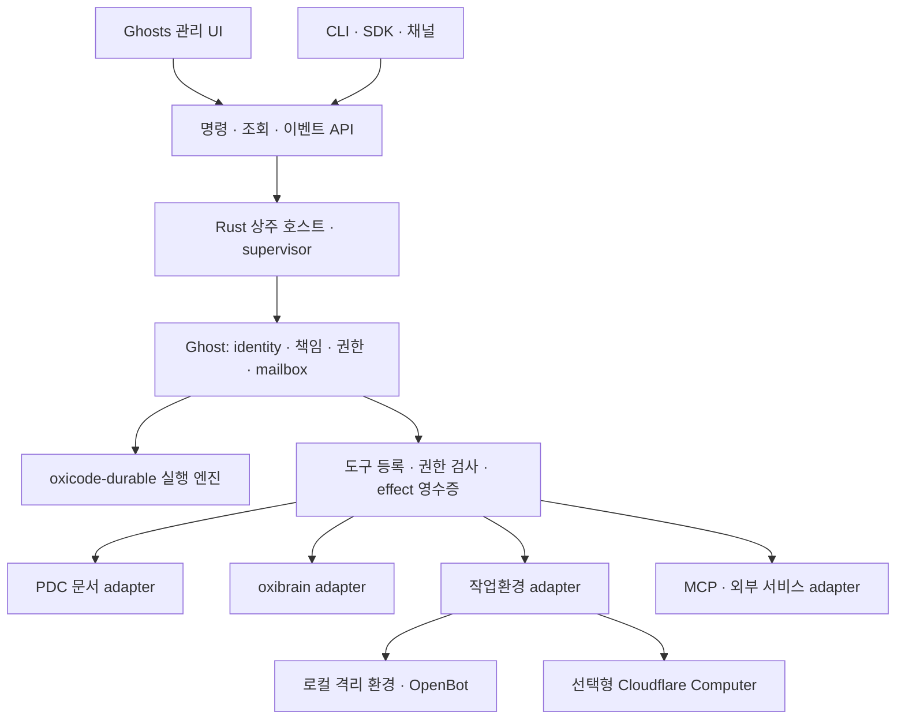

# Ghost 시스템 재평가 — 2026-10-03

이 평가 뒤 host·control·adapter 분리를 구현했다. 논의한 개념·실행·도구·프로토콜·저장·UI·운영·Cloudflare 도입 기준은 [전체 시스템 설계 — ADR 011](adr-011-ghost-host-control.md)에 통합했다. 현재 설계는 그 문서를, 구조 변경 검증은 [실행 기록](evidence/host-architecture-2026-10-03.json)을 따른다. 아래의 기존 코드 관찰과 테스트 실패 기록은 평가 시점의 이력이다.

사용자가 정리한 목적을 기준으로 한 구조 제안이다. Ghost는 **Rust로 구현하는 장기 실행 에이전트의 기본 단위**이고, 여러 Ghost를 사용하는 제품·도구·프로토콜·UI가 그 위에 놓인다. 이번 문서는 구현 완료나 기존 데이터의 전환을 선언하지 않는다.

**제품의 중심을 Ghost의 지속성에 둔다.** Ghost의 UUID, 맡은 일, 권한, 기억의 소유 관계는 대화창·모델·실행 프로세스가 바뀌어도 유지되어야 한다. 장기 실행은 계속 LLM을 호출한다는 뜻이 아니다. 필요할 때 깨어나고, 대기 상태를 저장하며, 중단된 일을 판단 가능한 상태로 복구하는 능력이다.

[CopilotKit/OpenDots](https://github.com/CopilotKit/OpenDots)는 대화·Spaces·검토·컴퓨터·채널을 함께 제공하는 사용자 경험 참고점이다. 공식 README도 초기 템플릿임을 밝히고, 반복 일정과 완전한 목표/이벤트 체계를 구분한다. 따라서 OpenDots 기능 수를 Ghost의 완료 기준으로 삼는 것은 적절하지 않다. 여기서 참고할 것은 사용 흐름이며, Ghost의 완료 기준은 독립 실행과 복구 계약이다.

**기본 개념을 분리한다.**

| 개념 | 소유하는 것 | 수명 |
| --- | --- | --- |
| Ghost | UUID, 버전 있는 역할 설정, 권한, 책임, 기억 namespace | 대화·모델·프로세스보다 길다 |
| 책임/목표 | 목적, 완료 조건, 중단 조건, 예산, 깨울 조건, 증거 | 여러 대화와 실행에 걸친다 |
| 대화 | 사용자·채널과의 상호작용 및 문맥 | Ghost의 여러 활동 중 하나 |
| 작업/시도 | 유한한 실행, 체크포인트, 도구 호출과 결과 | 재시도마다 시도 ID를 구분한다 |
| 컴퓨터/작업환경 | 파일, 실행 환경, 연결 상태, backend 식별자 | 교체·재연결 가능하다 |
| UI | 저장된 상태의 표시와 사용자 명령 | 닫혀도 Ghost가 존재한다 |

하나의 Rust 호스트가 여러 Ghost를 운영하는 구성이 초기 기본값으로 충분하다. Ghost마다 OS 프로세스·컨테이너·LLM을 하나씩 상주시킬 필요는 없다. 실행 자원은 공유하되 논리적 소유권을 유지하고, 외부 코드·브라우저의 격리는 별도 실행환경에서 제공한다.

**권장 의존 방향은 다음과 같다.** 아래 이름은 논리적 모듈 경계이며 즉시 별도 저장소나 마이크로서비스로 분리하자는 제안이 아니다.

| 계층 | 책임 | 현재 코드에서 정리할 위치 |
| --- | --- | --- |
| Ghost 도메인 | identity, responsibility, 정책, 메시지 소유권, 예산 의미 | `store.rs`, `workspace/services.rs`, `workspace/actions.rs`의 도메인 부분 |
| 실행 엔진 | 모델/도구 실행, checkpoint, cancellation, compaction, child task | `durable.rs`와 기존 `oxicode-durable` 재사용 |
| 상주 호스트 | single writer, worker supervision, wakeup, 일정/이벤트 dispatch, shutdown | `workspace/mod.rs`, `workspace/scheduler.rs`에서 UI와 분리 |
| adapter | provider, 파일, 문서, 기억, 컴퓨터, 외부 도구 | 현재 workspace 하위의 서비스들을 명시적 의존성으로 주입 |
| 제어 API | CLI/UI가 공유하는 command/query/event, 인증, revision | 현재 private `Action`/`Command`와 HTTP projection을 공개 계약으로 정리 |
| 제품 UI | 여러 Ghost의 작업·대화·검토·산출물 관리 | `workspace/index.html`, `app.js`, 스타일 |

공통 실행 엔진을 Ghost 안에서 다시 구현할 필요는 없다. `oxicode-durable`은 범용 실행을 담당하고 Ghost가 정체성·책임·현재 권한·업무 효과의 의미를 소유한다. 공개 API에는 엔진 내부 타입을 그대로 노출하지 않아서 엔진 업데이트가 클라이언트 프로토콜 변경으로 직결되지 않게 한다.

**현재 구현에서 유지할 기반과 바꿀 경계.**

- 유지: profile UUID와 별도 SQLite, single writer, inbox 중복 방지, effect 실행 전 기록, 불명 결과의 `uncertain`, 현재 권한 재검사, durable conversation과 compaction. 이 기반은 프로젝트의 목적에 맞는다.
- 정리: `Cargo.toml`의 기본 feature는 여전히 초기 task 경로이고, 상주 실행과 일정·정책·문서·기억·컴퓨터는 `workspace-ui`를 통해 묶여 있다. 장기 실행을 제품의 주경로로 정하고 headless host를 UI feature 없이 구성할 수 있어야 한다.
- 정리: legacy `task/run`, legacy `ghosts` coordinator, durable conversation과 workspace delegation이 병존한다. 각 경로를 계속 확장하면 취소·복구·권한의 의미가 갈라진다. 새 개발은 durable 경로로 모으고 legacy 명령은 호환 경계로 유지한다. 저장 데이터를 무단 변환하지 않는다.
- 정리: `Bridge { workspace: Weak<Workspace> }`를 통해 도구·예산·위임이 제품 workspace에 접근한다. headless host가 소유한 작은 서비스 인터페이스로 의존 방향을 바꾸는 것이 첫 구조 작업이다.
- 정리: 현재 CLI는 저장소를 직접 열고 serve는 profile writer lock을 보유한다. 상주 상태에서 CLI도 같은 호스트에 명령을 보내야 한다. 서로 독립적으로 writer를 여는 방식으로 동시 제어를 해결하지 않는다.
- 확인: 문서·기억·컴퓨터·목표·교차 profile 위임 코드는 이미 존재하거나 평가 중 추가되었다. 과거 ADR의 “미구현” 목록만 보고 다시 만들지 않는다. 컴파일·접근 가능한 사용자 흐름·복구 검증·실서비스 검증을 각각 구분한다.

**장기 실행의 핵심 계약.** 책임은 목적·완료 증거·예산·기한·wake 조건을 저장하고, 한 번 깨어났을 때는 유한한 실행을 만든다. 완료 판정은 책임별 검증 방식에 따른다. 모든 종료를 사용자 승인으로 막을 필요는 없으며, 도구 권한이나 외부 효과 검토가 필요한 경우에만 해당 결정을 기다린다.

1. 입력을 저장한 후 접수 응답을 보낸다. 재전송은 기존 접수 결과로 돌아간다.
2. 타이머·외부 이벤트·다른 Ghost의 결과·사용자 결정이 같은 durable mailbox로 들어온다. 이벤트의 중복 제거, 소비 위치, downtime 처리 기준을 저장한다.
3. 실행할 때 현재 권한과 예산을 확인한다. 미리 광고한 도구나 과거 승인이 현재 권한을 대체하지 않는다.
4. owner/child/event를 기다리는 작업은 대기를 저장하고 실행 슬롯을 반환한다. 여러 승인 대기가 다른 대화의 실행 슬롯을 모두 점유하지 않도록 한다.
5. 재시작 후 재개할 수 있는 일과 결과를 확인해야 하는 일을 구분한다. 네트워크 timeout이나 취소 응답이 외부 효과의 부재를 증명하지는 않는다.
6. 장애가 난 worker를 감독하고, 저장소·credential·backend별 실패 상태와 복구 절차를 노출한다. OS 자동 시작, graceful shutdown, 백업/복구, 데이터 증가 한도까지 장기 실행 검증에 포함한다.

**도구는 부차적이지만 명시적인 제품 계약이다.** 등록된 도구마다 이름/버전, 입력 schema, 요구 권한, 실행 backend, deadline, 출력 한도, 효과 분류, 재시도/결과 조회 방법을 둔다. 단순 읽기, 중복 방지 가능한 변경, 결과가 불명해질 수 있는 외부 실행을 구분한다. 응답은 기존 `ToolOutput`의 status/summary/next_actions/artifacts를 발전시키고 backend receipt와 provenance를 붙인다.

동일 Ghost의 분석 child와 다른 Ghost에 대한 위임도 구분한다. 다른 Ghost는 독립 주체이므로 자기 권한으로 수락·거절하고, 발신자가 정한 위임 범위도 함께 제한 조건으로 적용한다. 수신 Ghost가 강한 권한을 가진다는 이유만으로 제한된 발신 작업이 그 권한을 사용할 수 있어서는 안 된다. 대기·취소·결과 회수는 같은 task lineage와 영수증 체계를 따른다.

처음부터 범용 plugin marketplace를 만들기보다 native 도구, 명시적으로 연결한 MCP, 컴퓨터 backend를 같은 등록 경계에 넣는다. 거대한 `match`문이나 임의 코드 실행 하나에 모든 권한 의미를 숨기지 않는다. skills는 작업 지침을 제공하고, 실제 권한은 호스트가 검사한다.

**프로토콜은 역할별로 재사용한다.**

| 연결 | 권장 방향 | Ghost가 별도로 책임질 것 |
| --- | --- | --- |
| CLI/UI ↔ host | 공유 Rust 명령 타입 + 인증된 loopback HTTP, revision 기반 이벤트/조회 | 접수 영속성, request ID, 재연결, 오류와 복구 의미 |
| UI ↔ agent 표시 | 필요할 때 AG-UI adapter | 장기 책임·effect·승인 상태의 원본은 Ghost |
| agent ↔ 도구/데이터 | MCP client adapter | 서버별 권한·비밀·실행 의존성·현재 정책 검사 |
| Ghost ↔ Ghost | 우선 local durable mailbox; 외부 연합이 필요할 때 A2A adapter | sender 인증, 수락 정책, 중복 제거, lineage, 취소/결과 회수 |
| agent ↔ computer | backend capability와 execution handle | 재접속, runtime 교체, 효과 영수증, 불명 결과 조정 |

[AG-UI](https://docs.ag-ui.com/introduction)는 agent와 사용자 앱 사이의 이벤트를, [MCP](https://modelcontextprotocol.io/docs/2026-07-28/learn/architecture)는 외부 도구·데이터 연결을, [A2A](https://a2a-protocol.org/latest/topics/key-concepts/)는 외부 agent의 task/message/artifact 교환을 다룬다. 이 역할 분리를 사용하되 세 가지를 한 번에 도입하는 것은 우선순위가 아니다. 먼저 Ghost 자체의 command/event 의미를 고정한다. 현재 `protocol.rs`의 text-only 내부 봉투를 표준 준수 구현이라고 부르지 않는다.

제어 봉투에 필요한 최소 정보는 version, request/message ID, 인증된 actor, 대상 Ghost, task/causation ID, 필요한 expected revision이다. 모델이 넣은 sender 문자열을 인증으로 취급하지 않는다. 이벤트 cursor는 commit된 상태를 가리키고, cursor가 보존 범위를 벗어나면 snapshot 재동기화를 요구한다.

**기억·문서·실행 상태는 각각 원본을 정한다.**

- 실행 DB: 입력, 시도, checkpoint, effect, 결정, 감사 기록. 모델 대화 요약은 복구 가능한 문맥 projection이다.
- 기억: Ghost별 namespace, 출처, 저장 이유, 수정/삭제 정책. oxibrain은 검색·기억 adapter로 재사용한다. 대화를 압축했다는 사실만으로 장기 기억이 생기지는 않는다.
- 사용자 문서: PDC 파일과 안정적인 document ID가 원본이다. workspace DB에는 접근 설정과 참조를 둔다. 일반 모델 output, 로그, 보고서, 캐시는 자동으로 사용자 문서가 되지 않는다.
- 작업환경 파일: 도구가 사용하는 working copy와 임시 산출물. 승인된 문서 반영은 PDC adapter의 source hash/충돌 검사와 별도로 수행한다.

이 세션의 사용자 AGENTS는 새 문서에 PDC 1 Djot/HTML을 명시하고, 설치된 개인 스킬은 PDC 2 Markdown/HTML을 설명한다. 사용자 지시를 우선하므로 이번 평가가 PDC 2 쓰기 전환을 승인하지 않는다. 현재 `documents.rs`도 PDC 1 write/PDC 2 read를 설명한다. 제품 지원 버전과 corpus revision을 후속 문서 계약에서 명시하고, 기존 파일을 자동 변환하지 않는다. 이번 설계 문서는 repository documentation이므로 PDC 데이터 평면에 속하지 않는다.

**UI는 Ghost 운영을 이해하고 개입하는 화면으로 발전시킨다.** 브라우저를 닫아도 작업은 계속되고, 다시 열면 저장된 상태에서 이어진다. UI를 뒤로 미루기만 하면 승인·복구·위임을 실제로 사용할 수 있는지 검증할 수 없으므로, 얇은 관리 UI는 초기부터 함께 유지한다.

권장 화면의 중심은 다음과 같다.

| 화면 | 사용자가 확인하거나 결정하는 것 |
| --- | --- |
| Ghost 목록/개요 | 누구에게 무엇을 맡겼는지, 현재 상태, 다음 wakeup, 예산 |
| 맡은 일 | 목표·완료 조건·진행·대기 이유·의존성·증거 |
| 대화 | 현재 Ghost/책임에 질문하고 진행 중 지시하기 |
| 내 결정 대기함 | 승인, 질문, 문서 검토, 불명 결과 확인을 한곳에서 처리 |
| 결과/문서 | 작업 산출물, 출처, 변경 diff, 사용자 문서 참조 |
| 자원/설정 | 모델, 도구, 컴퓨터, 기억, 일정, 권한과 연결 상태 |

첫 배포 형태로 **Rust host가 정적 자산을 제공하는 웹 관리 UI**를 권장한다. 현재 UI를 출발점으로 사용하고 API를 먼저 분리한다. 화면이 커지면 TypeScript 기반 컴포넌트 구조를 도입하되, 프런트엔드 빌드 도구가 Ghost 실행의 필수 Node 프로세스가 될 필요는 없다. 데스크톱 설치/알림/키체인 경험이 필요해지면 같은 API 위에 native shell을 둔다. 별도 agent loop를 UI 프로세스 안에 복제하지 않는다.

현재 저장된 `evidence/workspace-ui.jpg`와 검토한 프런트엔드는 Ghost 목록·대화·작업·일정 중심이다. 화면의 미감보다 책임·검토·복구·backend 상태를 끝까지 연결하는 것이 다음 UI 우선순위다. 조회는 선택한 Ghost/대화의 제한된 projection과 revision을 사용하고, 전체 이력을 매번 전송하는 방식의 증가 비용을 측정한다. 평가 중 선택 조회/변경 감지 API와 이를 사용하는 프런트엔드 코드가 추가된 것은 이 방향과 맞다. 해당 변경의 실제 브라우저 동작과 장기 데이터 규모 검증은 이번에 수행하지 않았다.

**개발 순서를 다시 잡는다.**

| 순서 | 결과물 | 완료를 판정하는 실제 시나리오 |
| --- | --- | --- |
| 1 | 현재 변경을 안정화하고 headless host를 UI에서 분리 | UI feature 없이 두 Ghost가 실행되고 CLI로 접수/취소/조회된다 |
| 2 | 책임·wakeup·대기·재개·effect 계약 통일 | 프로세스 강제 종료, 입력 재전송, 승인 지연, 권한 철회에도 상태/효과가 중복되지 않는다 |
| 3 | 공통 도구/컴퓨터 adapter 계약과 한 가지 실제 backend | 작은 실제 작업 하나를 실행→중단→재접속→결과 확인까지 완료한다 |
| 4 | 관리 UI의 수직 흐름 완성 | 맡기기→상태 확인→필요한 결정→산출물 확인이 같은 저장 상태로 이어진다 |
| 5 | 추가 backend·외부 채널·배포 확대 | 첫 backend와 같은 계약 테스트, 장시간 운영, 백업 복원, release dependency 재현성 |

Cloudflare Computer는 3단계의 선택형 backend 후보로 평가한다. 구체적인 채택 범위와 실험 조건은 [별도 평가](cloudflare-computer-assessment-2026-10-03.md)에 정리했다. OpenDots와 Cloudflare Computer 중 하나를 시스템 전체의 정답으로 고르는 구조는 필요하지 않다.

**검증 범위와 편집 중인 코드.** 평가 중 `src/workspace/mod.rs` 등은 다른 작업에 의해 계속 변경되었다. 초기에 보이지 않던 목표 dispatch와 선택 snapshot, profile 시작 경로 수정이 이후 읽기에서 확인되었다. 따라서 초기 관찰을 최종 코드의 결함으로 확정하지 않는다.

- `cargo test --offline --test acceptance --test collaboration -j1`: 24 + 19 = **43 passed**. 이는 초기 core와 legacy collaboration의 해당 테스트 결과다. [실행 로그](evidence/paradigm-core-2026-10-03.log)
- 첫 `cargo check --offline --features workspace-ui --all-targets -j1`: `tests/durable.rs`의 `GhostHost` struct 생성 3곳이 새 private `services` 필드와 맞지 않아 실패했다.
- 첫 workspace HTTP 수용 테스트: 새 profile 생성 요청에서 timeout으로 실패했다. 당시 `start_worker`가 이미 보유한 workspace mutex를 다시 잠그는 경로가 있었고, 이후 소스에서 concurrency를 인자로 받도록 변경되었다. [당시 실행 로그](evidence/paradigm-workspace-2026-10-03.log)
- 수정 후 같은 workspace HTTP 테스트는 **1 passed**였다. [재검사 로그](evidence/paradigm-workspace-recheck-2026-10-03.log)
- 마지막 `workspace-ui --all-targets` 검사에도 위 durable 테스트의 컴파일 오류 3곳은 남아 있었다. [검사 로그](evidence/paradigm-check-final-2026-10-03.log)
- 명령·결과·최종 관찰 소스 hash는 [검증 기록](evidence/paradigm-verification-2026-10-03.json)에 남겼다. 편집 중인 소스여서 이 hash를 모든 테스트가 사용한 고정 revision이라고 주장하지 않는다. 실 provider·Cloudflare 배포·장시간 운영은 이번 평가에서 검증하지 않았다.

기존 테스트와 보존된 작업은 계속 활용한다. 다음 완료 기준은 OpenDots의 화면 수가 아니라, **모델·화면·작업환경을 바꿔도 같은 Ghost가 맡은 일을 정확한 상태로 이어갈 수 있는가**다.
