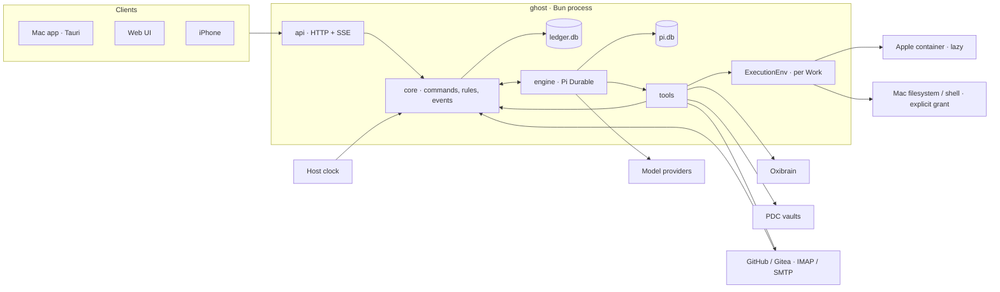
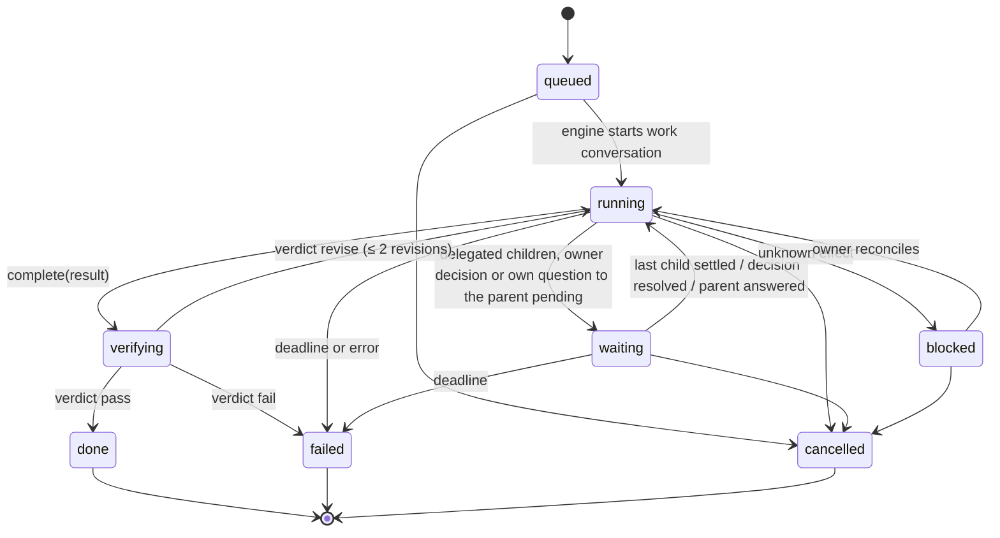

# Ghost architecture

Ghost is one Bun process. It owns one state root, runs every Ghost's conversations on Pi Durable, and serves the Mac app, the web UI and the iPhone over one HTTP API.



## Principles

1. **One process, one language.** Host, conversation engine and device API run in one Bun process. Types are shared with the UI through `packages/ghost-contract`.
2. **Two domain stores, one Host per root.** `ledger.db` holds Ghosts, work, decisions and effects; Pi Durable owns conversations and tasks in `pi.db`. Before either store opens, the Host holds a SQLite exclusive transaction on `lock.db` for its lifetime. Root aliases share the same lock; process death releases it without a stale-PID override. The lock contains no domain state. Artifacts, provider secrets, config and disposable model catalogs remain separate files.
3. **Every model wake has a durable identity.** Owner messages, child results, owner decisions, schedule fires, admitted activity runs and review feedback are Pi submissions to a conversation with a deterministic `requestId`. Pi's request-ID idempotency removes duplicate wakes after a crash. There is no outbox, mailbox or delivery-receipt table. Activity-root results remain passive Work history and notifications, not new direct model turns.
4. **Capability by construction.** Conversation kind, the Ghost's current tool allow-list, the Work/activity scope and integration grants intersect. Project Spaces need no per-Ghost access setup: every active Ghost can read and propose changes, while document writes retain owner review. Work file/shell execution also checks its explicit target and the current owner PC grant. A direct conversation cannot acquire a Work environment; a work conversation cannot create root work. Tools authorize from the current ledger on every execution, never from model arguments or a cached configuration.
5. **Effects are journaled, never replayed.** A tool with an external effect records `pending` before I/O and `done` after. On restart, `pending` becomes `unknown`, the work blocks and the owner reconciles. Pi's own tool tasks are `replay: "unsafe"` for these tools, so an interrupted call returns an interrupted result instead of running twice. Owner API journals retain the same replay guards but do not participate in Ghost-tool mutation exclusion; a waiting tool approval cannot prevent credential revocation, document saves or sandbox control.
6. **Reads are free; commands have durable identities.** Read endpoints are never journaled. Synchronous command mutations, events and the success receipt commit together; engine follow-ups start only after that commit. Async commands reserve their principal and command digest before I/O, then use Pi admission IDs, recoverable decision follow-ups or the effect journal. An unknown external result is not a success receipt and is never repeated automatically. Pending request identities are not pruned; completed receipts are retained for 30 days. Receipts contain small outcomes, never command bodies or credentials.
7. **Plain tables, one change feed.** Every ledger mutation appends an `events` row in the same transaction. Clients get a snapshot, then the event stream. No event sourcing, no generic key-value table.

## Repository layout

```
package.json               Bun workspace root
packages/ghost-contract/   entity, command and event schemas (TypeBox) + TS types
apps/ghost-host/           the ghost process
  src/main.ts              CLI: serve | import | backup | doctor
  src/config.ts            typed config: state root, ports, providers, sandbox, memory, vaults
  src/ledger/              bun:sqlite schema, migrations, repositories, events
  src/core/                commands → rules → ledger writes → engine effects
  src/engine/              Pi harness, agent instructions, conversation kinds
  src/tools/               model tools grouped by capability
  src/sandbox/             ExecutionEnv: Apple container, explicit PC, confined workspace
  src/integrations/        oxibrain, pdc, browser, source connections, push, providers
  src/api/                 Bun.serve routes, auth, pairing, SSE
  src/import/              one-shot importer from a legacy state root
  test/                    bun test
apps/ghost-ui/             React web UI, served by the host and embedded by the Mac app
apps/ghost-desktop/        Tauri shell
apps/ghost-ios/            SwiftUI app
apps/ghost-voice-server/   unchanged follow-up scope
docs/
```

## Domain

| Concept | Meaning |
| --- | --- |
| Ghost | A durable bot: name, persona, look, model and up to three fallback models, tool allow-list, skills and memory space. The default Ghost is the entry point and may configure other non-default Ghosts only from direct conversations. A retired Ghost can be deleted by the owner: it leaves every list and picker, and its row stays as a tombstone (`deletedAt`) so past Works keep their assignee. |
| Conversation | A Pi conversation bound to one Ghost. Kinds: `direct` (owner ↔ Ghost), `work` (a Ghost executing one Work), `review` (an independent reviewer judging one Work). |
| Work | 맡긴 일. A node in a tree. A root is created from an owner request or an owner-approved Activity rule; a child is a delegation to another Ghost. It has a brief, acceptance, deadline, conversation, result and verdict, plus immutable execution target and optional narrowed Activity scope. |
| Decision | Something only the owner can settle: approve an effect (a host command, a browser action or a card fill), answer a question (including a vault secure form or a browser handoff), accept a result, approve a document proposal, reconcile an unknown effect. |
| Effect | One external side effect of a tool call (shell, file write, publish, browser mutation, memory write, document proposal). |
| Artifact | Published bytes, addressed by SHA-256, attached to a Work result. Avatar images are artifacts too. |
| Schedule | A timed submission into a conversation (wake, follow-up, reminder the owner asked for). |
| AutonomyPlan | A Ghost's self-directed drive: on/off, the next time it looks at its work, why, the project Spaces it watches, its last wake and today's count. Kept in `settings` (`autonomy:<ghostId>`), not a table. |
| Activity | An owner-approved standing rule for one Ghost: schedule, PR changes or mail; task instructions, tools, execution, limits, reply policy and notification mode. |
| ActivityRun | Durable source/admission identity, linked Work, status, deduplication and follow-up state. Oversized mail is an explicit skipped run, never a successful analysis. |
| Connection | Owner-configured GitHub/Gitea or IMAP/SMTP endpoint and credential epoch; secrets stay outside the ledger. |
| Notification | Something the owner should see: decision needed, Work finished or failed. Pushed to devices. |
| Device | A paired iPhone; it runs the same web UI with its paired token and has owner-equivalent capability except device management: only the owner starts pairing, renames devices or revokes *other* devices, while a device may revoke itself. Its alert preferences live in the `settings` table keyed per device and filter only its own pushes. |
| Space | A project backed by a registered PDC document vault. Every active Ghost may list/read its documents and propose edits; saving a proposal still requires the owner's existing review decision. |
| Avatar | A named sprite design whose image is an artifact; a Ghost's look is an avatar plus colors. |
| Sandbox | A Work's confined workspace and optional lazy Apple VM. Ghost-level controls manage that Ghost's environments; PC cwd is never deleted by sandbox cleanup. |

### Work state machine



- Cancelling a Work cancels its live descendants first and aborts their conversations.
- `revise` re-submits the verdict feedback into the same work conversation: reasons, the reviewer's evidence and the scope the revision must stay inside.
- A settled child submits its result and revision history to the bound parent. An ordinary owner-requested root reports to its origin direct conversation. An Activity root records its result and notification without starting another model turn; otherwise a scoped container Activity could regain a direct conversation's broader PC authority.
- A child asks its delegating Ghost first: `ask_parent` stores a `work_questions` row and submits the question to the parent's work conversation; the child waits until the parent calls `answer_child`. Only the parent escalates to the owner with `ask_owner`.
- The owner can edit a live Work (brief, acceptance, deadline). An edit bumps `revision` and is submitted to the work conversation as steering.

### Verification

`complete` moves a Work to `verifying`. The verdict comes from the first applicable source:

1. **Checks.** If the acceptance spec has deterministic `checks` (`artifact_sha256`, `artifact_contains`, `command_exit_zero`, `command_stdout`), the host evaluates them against reopened artifact bytes and recorded effect results. A root Work's checks come only from the owner and decide the verdict. A child's checks come from the Ghost that delegated it and gate review: failing checks revise the child without a review conversation, passing checks continue to review.
2. **Review.** Otherwise (or after a child's checks pass) a `review` conversation judges the result with read-only artifact and effect tools and returns `pass | revise | fail` with reasons, optional evidence and an optional revision scope. The reviewer is the one the spec names (a Ghost or a model); for a delegated child without one, it is the Ghost that delegated it.
3. **Owner.** A root Work without checks or a reviewer opens an `accept_result` decision.

A completion claim alone never accepts a Work.

`complete.artifacts` explicitly lists the exact published filenames (`[]` for no files). Scratch files and filenames mentioned only in prose are not attached automatically. Reviewers start with `evidence_read {}` for the bound Work's recorded reads; optional `child_work_id` may name only its descendants. Recorded observations are paged and bounded, not fetched again from external sources.

### Self-directed drive

Owner decision 2026-11-10: Ghosts are always on. A fixed timetable is not autonomy; each Ghost decides when it looks at its work again and what to do then.

- Every active Ghost holds the fixed direct-conversation tool `plan_next {after_minutes | at, intent, watch_space_ids?}`. It records the Ghost's next look (10 minutes to 14 days ahead) and the Spaces whose new commits should wake it earlier. The main Ghost may plan another non-default Ghost (`ghost_id`) and switch a teammate's drive (`ghost_update.self_directed`); the owner switches any Ghost in its settings (`autonomy.set`). Plans live in `settings` keys `autonomy:<ghostId>`, appear in the snapshot as `autonomy` and change through `autonomy` events, so older releases ignore them.
- `core/autonomy.ts` ticks every minute. A due plan, or a watched Space whose Git position (read from `.git` files, never by running Git) moved, prepares `[Autonomous wake]` for the Ghost's direct conversation with `origin: "schedule"`. The wake is first recorded in the plan (`pending`: request id `autonomy:<ghost>:<wake number>:<time>`, text and new positions) and only then submitted; a pending wake found later — after a crash — is resubmitted with the same id, so Pi admits it at most once. Every plan write is synchronous and bumps a revision: a switch-off or a new plan made while a wake was prepared or admitted is never undone, and a plan the Ghost makes during its wake replaces the fallback. The wake carries the plan and who set it, Work settled since the last wake, new commit subjects, pending owner decisions, the Ghost's live Work and, for the main Ghost, every teammate's plan.
- The Ghost decides: research, a document proposal, a self-started Work for itself or a teammate (`work_create` `initiative: true`, judged by the starting Ghost, the main Ghost or a model review instead of an owner acceptance), a message to the owner, or nothing. When the run ends, its final non-empty reply is a `message` notification (the speak-first path) unless it is exactly `[quiet]`; narration before tools never notifies, owner input during the run cancels it, and the UI hides `[quiet]` replies. Ending without a new plan leaves the Host's fallback: look again 24 hours after admission.
- Bounds keep a cheap-model team cheap: at most 12 self-directed wakes per Ghost per local day of admission (the next due plan moves to the next day), at most two running at once across the team (busy self-directed conversations keep their slots across a restart), watched-project wakes at most hourly, a busy direct conversation is never interrupted, and first plans are spread over two hours. A refused submission (no model or credential) retries six hours later unless the Ghost planned meanwhile.

### Standing activities

- The Host's cheap scheduler checks clocks and source metadata. It starts a fresh bounded Work only for a due schedule, a new source version or an admitted next check. There is no generic trigger queue or second execution engine.
- Admission atomically records a deterministic ActivityRun and Work. Retries find the same run; a source cursor advances only after every returned item is admitted or durably accounted for. Daily/concurrent limits defer remaining items without losing them. Waiting roots occupy concurrent slots; each run's whole delegation tree is bounded to 16 Work nodes.
- Clock/deadline processing and source I/O use separate lanes. One slow poll cannot hold scheduled wakes or Work deadlines. `tickSources` owns its shared source lane; callers must not wrap it in that same lane.
- `activity_next_check` permits one owner-policy-bounded future check, expressed as relative seconds or an absolute timestamp. The Host computes relative time; a follow-up carries the reason/baseline into a fresh Work. Rules and pending checks persist across restart.
- Pausing prevents new runs; stopping also cancels live descendants and processes. Rule/account authority changes invalidate obsolete run trees. Three consecutive genuine failures pause the rule and notify once. Successful no-change reports may be quiet only when the run tree performed no mutation; failures and meaningful changes remain visible.
- PR polling reads bounded metadata; `activity_read` fetches the bound diff/comments. Pagination refuses incomplete coverage beyond its safety cap instead of silently skipping records. IMAP uses read-only mailbox access and `BODY.PEEK`; mail above 2 MiB is recorded as skipped with an owner notice, without downloading its body or charging a model run.
- `activity_action` can only comment on the bound PR or reply to the source message's mailbox. Its deny/approval/allow policy covers those connector replies, not arbitrary browser or PC actions. Approval presents the recipient/target and full bounded body; uncertain POST/SMTP outcomes are not replayed. Browser/vault retain their independent grants and approval rules.
- Account credentials are mode-0600 files under `secrets/connections/`; ledger/events contain metadata and credential epochs, never values. Endpoint/credential replacement first disconnects old authority and cancels obsolete runs. Name-only account changes preserve authority and cursors. Source text is untrusted user/tool data, never static system instructions.

The design follows the useful boundary in [Manus automations](https://manus.im/docs/automations.md): explicit sources, conditions, schedules, test runs, history and pause. [Manus cloud computers vs Studio](https://manus.im/docs/introduction/quickstart.md) also separates remote execution from deliberate local-PC access. Neither requires one permanently running VM or an always-prompting model per Ghost.


### Restart

Every follow-up after a ledger commit is idempotent, and startup replays whatever a crash may have cut off:

- `pending` effects become `unknown`; their Work blocks and its conversation stops until the owner reconciles.
- Resolved decisions without a recorded follow-up are followed up again (answers, verdicts, effect notices). An approved document write is itself a journaled effect, so it is never written twice.
- Settled Work without a recorded report reports again (deterministic request id, deterministic notification id).
- A running Work whose conversation is idle gets one wake, keyed by the Work's last change, so repeated restarts do not stack wakes.
- Schedules submit before they advance.
- Tools that create rows (`work_create`, `delegate`, `schedule_create`, `ask_owner`, `ask_parent`, `document_propose`, `vault_request`, `browser_propose`, `browser_handoff`) derive the row id from the tool call, so a call Pi replays finds its row. Parent questions and answers that were recorded but not yet submitted are submitted again with their deterministic request ids.

## Stores

### `ledger.db`

`bun:sqlite`, WAL, `synchronous = FULL`, `PRAGMA user_version` migrations. Ledger writes are synchronous; a write never awaits. That makes the process the single serialized writer without a global mutex.

| Table | Key | Notes |
| --- | --- | --- |
| `ghosts` | `id` | name, persona, look, model, tools (explicit allow-list), is_default (one), state, direct_conversation_id |
| `conversations` | `id` | ghost_id, kind, work_id, title, model, busy; `pi_conversation_id` maps to Pi |
| `works` | `id` | parent_id, root_id, ghost_id, origin_conversation_id, conversation_id, brief, acceptance, state, revision, revisions_used, idle_nudges, deadline_at, result, verdict, reason, revise_history (internal; migration 6), timestamps |
| `work_questions` | `id` | work_id, parent_work_id, question, answer, state (`pending` / `answered` / `cancelled`), submission markers; migration 6 |
| `decisions` | `id` | kind, ghost_id, conversation_id, work_id, effect_id, title, detail, options, proposal, state, answer |
| `effects` | `id`; unique `(conversation_id, call_id)` | work_id, tool, summary, input_digest, state, result |
| `artifacts` | `(digest, work_id, name)` | media_type, size |
| `schedules` | `id` | ghost_id, conversation_id, prompt, spec, next_at, state |
| `connections` | `id` | validated account metadata/credential epoch JSON; migration 7 |
| `activities` | `id` | validated standing-rule, cursor, defer/failure and follow-up JSON; migration 7 |
| `activity_runs` | `id`; unique `(activity_id, source_key)` | Work link and durable run/deduplication state; migration 7 |
| `notifications` | `id` | kind, ghost/conversation/work/decision refs, title, body, read_at, pushed_at |
| `devices` | `id` | name, token_hash, push token, revoked_at; unused grants column retained for previous-release readability |
| `pairings` | `code_hash` | name, expires_at, device_id; unused grants column retained for previous-release readability |
| `spaces` | `id` | name, path; unused grants column retained for previous-release readability, always written as `'[]'` and ignored on read |
| `avatars` | `id` | name, description, image_digest, design |
| `providers` | `id` | kind, name, base_url, models (keys live in `secrets/`) |
| `settings` | `key` | default model, review model, `device.alerts:<deviceId>` mute preferences |
| `requests` | `id` | principal, command digest, state (`pending` / `done`), small outcome; migration 5 |
| `events` | `seq` | change event JSON; retained 7 days |

### Files under the state root

```
ledger.db  pi.db
lock.db                      kernel-held ownership lock, not a domain store or backup input
artifacts/sha256/ab/<digest>
secrets/<provider>.json      0600
vault/key  vault/vault.db    Ghost vault: 0600 key, AES-256-GCM secret fields, outside the ledger and its events
sources/sources.db           snapshots of pages web_read returned (citable [S-…] ids), outside the ledger; reads stay unjournaled
worktrees/<ghost_id>/<work_id>   per-Work git worktrees (branch ghost/<work_id>) for `execution.worktree`; never removed by the Host
browser/                     agent-browser HOME (per-Ghost login state, encrypted with browser/key), config, downloads
sandboxes/<ghost_id>/<work_id>/workspace   private staging / container mount; never the unrestricted PC cwd
host.json                    port + owner token for local clients, 0600
config.json                  optional: publicOrigin, uiDir, sandbox, memory, apns, reach, skills, mac, browser
```

## Engine

- One `Harness` over `pi.db` (`openNodeSqliteStorage`, works under Bun).
- Agent per conversation (`configure`): model and thinking level (conversation → reviewer → Ghost → default), `instructions` = persona + kind instructions, extensions by kind:

| Kind | Extensions |
| --- | --- |
| `direct` | `ghost.direct`: root Work/schedule management and owner questions; `ghost.autonomy`: `plan_next`; `ghost.activities`: `activity_propose`; interactive UI, memory, documents, web, browser, vault, skills and guarded Mac probes as granted; `ghost.main` only for the active default Ghost |
| `work` | `ghost.work`: file/shell/publish, scoped delegation, explicit completion, owner/parent questions, child answers and status; optional memory, document reads, web, browser, vault, skills and guarded Mac probes; `ghost.activities` only for bound Activity runs |
| `review` | `ghost.review`: `evidence_read`, `artifact_read`, `effect_list`, `verdict`; `ghost.sources` (`source_list`, `source_check`) when web research is installed |

- Execution is selected per Work, not a permanent container per Ghost. Apple VM creation is lazy; the guest sees only its Work directory at `/workspace` and its shell has no network. Host-mediated web/browser/source tools retain their own grants. Explicit container execution never falls back to the PC; without the Apple driver, confined file/API work remains possible but shell returns unavailable. Legacy implicit local execution is for tests/dev.
- PC execution requires the owner's separate `Ghost.hostExecution` grant and `Work.execution: { kind: "host", cwd }`. It is unrestricted filesystem/shell access as the Host's OS user, not a cwd jail, a network sandbox or an approval firewall; it can read local credentials if OS permissions permit. Environment scrubbing does not change that boundary. Keep untrusted workloads in containers. OS/TCC permissions still apply; this feature does not mount desktop GUI control.
- With `execution.worktree: true` the cwd must be a git repository with a commit: on first use the Host adds `<root>/worktrees/<ghost>/<work>` on branch `ghost/<work>` (a delegated child starts from its parent's branch) and that worktree becomes the file/shell cwd, so the owner's checkout is not edited by default. The shell stays unrestricted. The owner merges or deletes the branch; the Host never removes a worktree.
- Host mutations share one queue (a worktree Work has its own queue per worktree) and recheck live authority before and after waiting and before spawning. Revocation/cancellation aborts active process trees, not just future tools. Per-Work staging remains separate for artifacts/delegation/browser transfers. Shutdown closes Host environment admission and aborts tracked processes before draining core lanes.
- A work conversation that goes idle with live children, a pending decision or its own pending question to the parent becomes `waiting`; when a child settles, its outcome (and its files under `inputs/<child-id>/`) is submitted to the parent. Idle without any of them gets one reminder, then the Work fails.
- A work conversation whose Ghost holds `delegate` gets the active peer Ghosts in its instructions when it is configured, since `ghost_list` runs only in direct conversations: name, id, first persona line and a capability tag (resolved model, `image` when that model accepts images, `web`, `host`). Creating, changing or deleting a Ghost re-opens the live work conversations of Ghosts that hold `delegate`, so the roster stays current. A Work cannot delegate to its own Ghost. `delegate` may name a reviewer Ghost (`reviewer_ghost_id`), which then judges the child with its own model, and may give the child deterministic `checks`; without a reviewer the delegating Ghost reviews. A child reports its result when it settles; mid-Work, the only channel is the child's `ask_parent` question and the parent's `answer_child`.
- Model fallback: each Ghost has up to three `fallbacks`. Pi retries a failed generation itself; when the run still ends in an error assistant message caused by a retryable error, rate limit, quota, overload, network failure or a missing credential, and the conversation's model came from the Ghost or the default (not a conversation override or an explicit review model), the engine reconfigures that conversation with the next fallback whose provider has a credential and re-arms Pi's generation task over the committed context in the same transaction. No input is re-submitted, no request id is reused and completed tool tasks are never replayed. A conversation-scoped `ghost.fallback` document records the handled error entry so a restart does not continue it twice. Invalid requests and context overflow never fall back. The next turn starts at the primary model again. Each switch is logged as `fallback: <conversation> <from> -> <to> (<reason>)`; Pi's transcript records the serving provider/model per assistant message.
- Web research (`ghost.web`, config `reach.executable`): `web_search`, `web_read` and `reach` run the owner's read-only `agent-reach` CLI on the host by argv (no shell), with a minimal environment, a deadline, an output cap and at most four children at once. `reach` accepts only catalogued channel actions, never management commands (setup, add, login, update, …). URLs must be http(s) and must not name or resolve to loopback, private, link-local, CGNAT or `*.ts.net`/`*.local` hosts. Results are marked as untrusted evidence. Reads are never journaled. Each page `web_read` returns is also stored in `<root>/sources/sources.db` (URL, title, sha256, the first 512 KiB of text) under an id `S-<10 hex>` derived from URL and content; results carry `[S-…]`. `source_list`/`source_check` (in `ghost.sources`, shown only to Ghosts holding `web_read`, and to every reviewer) list the reads and check a quote against the snapshot, and the deterministic check `artifact_citations` fails an artifact that cites no source, cites an id never read, or puts a quote before `[S-…]` that is not in that snapshot.
- Skills (`ghost.skills`, config `skills.roots`): a Ghost's `skills` list names skill directories (with `SKILL.md`) under the configured roots. Their bodies are appended to direct and work instructions in the Ghost's order, bounded per skill and in total, after a line saying they were written for other harnesses; a missing skill is marked unavailable. `skill_read` lists or reads files inside a listed skill only (text, bounded, no path or symlink escape). `GET /api/skills` gives every principal the catalog for the settings picker.
- Mac operations (`ghost.host`, config `mac: { roots, watch }`; the existing `host` key stays the API bind address): read-only probes `host_status`, `host_services`, `host_disk_scan`, `host_disk_usage`, `host_list`, `host_read`, `host_nodes` run on the Mac itself with Macfra's guards. Disk probes may also measure the cache dirs; `host_list`/`host_read` stay inside configured roots, refuse symlinks below the root, secret and private paths, and redact sensitive text. `host_command_propose` immediately runs strictly allowlisted read-only argv without an effect or decision: filesystem inspection, bounded process/system facts, `plutil -p`, `launchctl list/print` and Git read commands (HTTPS-only `ls-remote`). Its inspection cwd and path operands resolve inside the owner's home, including logs, LaunchAgents and backup mirrors; secret/private paths and symlink escapes are refused, recursive probes prune sensitive names, and Git scrubs inherited `GIT_*` environment, disables global/system configuration, credential helpers, hooks, fsmonitor, filters, pagers, external diff/textconv and non-HTTPS transports. Existing Ghost grants work unchanged because the tool name is unchanged. Other commands retain individual approval: an absolute allowlisted program without shells/interpreters and a cwd inside configured roots, a journaled pending effect, an `approve_effect` decision and a 24 h expiry. Both paths run without a shell, in their own process group with a 90 s deadline, bounded output and redaction. Ghosts inspect facts directly and batch owner questions, proposing only changes. Host tools are never in a new Ghost's default allow-list; the owner, a paired device or the main Ghost (with an owner notification) grants or revokes them. When `mac.watch` names a Ghost, `ghost serve` (never one-shot CLI commands) runs a watcher after the core has started: it samples status, services and nodes every few minutes without model calls. An issue is admitted after two consecutive samples (critical disk at once), again only after it cleared and came back and six hours passed; one sample's admitted issues, deduplicated by volume, become a single submission into that Ghost's direct conversation, plus one full review a day. State is persisted before each submission; a refused submission (no model or credential) is dropped without stopping sampling. This replaces Macfra's resident agent.
- Oxibrain holds an exclusive store lock for the life of its `admin serve --stdio` child, and every Ghost shares one store. All memory operations go through one queue; each child is reaped (SIGTERM, SIGKILL after 2 s) before the next starts, so parallel `memory_search` calls in one turn run one after another instead of failing on the lock.
- Effect journaling wraps every tool that changes the outside world (`write`, `edit`, `bash`, `publish_artifact`, `memory_retain`, browser actions and secret fills).
- Browser (`ghost.browser`, config `browser: { executable, chrome?, idleTimeoutMinutes? }`): the installed agent-browser CLI drives Google Chrome on the host by argv, one session per conversation, login state saved per Ghost (`--restore ghost-<id>`, encrypted) under `<root>/browser` with its own `HOME` and an explicit config, so the owner's agent-browser state and plugins are never read. Chrome's traffic goes through a host-owned egress proxy that resolves each destination and refuses loopback, private, link-local, CGNAT, ULA and tailnet/local names, then connects to the checked address, so page-issued requests cannot bypass it; a host init script removes the WebRTC constructors in every frame because WebRTC traffic does not go through an HTTP proxy. Reads (`browser_open`, `browser_snapshot`, `browser_screenshot`, `browser_read`, scroll, wait, tab list) are not journaled; clicks, fills, typing, key presses, selections, uploads and downloads are effects. `browser_propose` (purchases, payments, sending, deleting, legal submissions) and every card-field fill wait for an `approve_effect`; the host acts only after approval and only if the page is still the proposed one. On a checkout or payment step (host-read page facts) every click needs `browser_propose`, whose approval binds the merchant and total the host read. `browser_handoff` asks a live `question`: the owner works the headless session from any paired device through `GET /api/browser/handoffs/:id/frame` and `POST …/control`, or opens it as a visible Mac window with `POST …/window`; the next browser call after the answer continues headless (closing such a window first). Uploads and downloads stay inside the Work workspace.
- Vault (`ghost.vault`; no config): items (`login`, `card`, `contact`, `secret`) live in `<root>/vault/vault.db` with every secret field encrypted under `<root>/vault/key`; origins follow Shade's https-only canonical form, generated passwords and CSV import follow Shade's rules, replaced secrets keep encrypted history, and each item lists the Ghosts allowed to use it. No API or tool returns a secret value: Ghosts see metadata (`vault_list`), ask the owner with `vault_request` (a `question` whose `proposal.secureForm` the app answers through `POST /api/vault/requests/:decisionId`; the ordinary answer path refuses it), create logins with `vault_generate_login`, and fill fields with `browser_fill_secret`, which passes the value to the page over stdin after checking that the page origin is the item's origin or one of its exact `extraOrigins` (for sites whose login form is on another host). Backups copy the vault store with its key.
- Providers: any configured provider with a credential runs any conversation with every tool the Ghost holds. There are no privacy tiers or local-only routes (owner decision, 2026-11-07).
- Owner message attachments are rendered from immutable artifact bytes before Pi admission; Pi stores the exact input for replay. Magic-byte-verified PNG/JPEG/GIF/WebP become image content parts (4 MiB per image, 8 MiB total per message). UTF-8 text (`text/*`, JSON, or text/source filename extensions) is inlined with its filename in a fenced block (first 100 KiB per file, 200 KiB total per message). Stored sizes are checked before image reads; text reads fetch only the bounded prefix. Omitted or truncated content gets an explicit model-visible reason beside its digest reference. Model input capabilities use the same effective catalog as execution: refreshed metadata, then the SDK's offline seed; unknown manual ids default to text-only. Pi retains image parts in history while pi-ai downgrades them to an omission note for text-only model requests. Transcripts hide the model-only attachment block and retain separate attachment references.
- `message.send` and `work.create` accept optional `spaceIds` (up to eight distinct existing Spaces). Direct, home and hand-off composers share `#` project suggestions and removable chips. A project page opens the main Ghost's conversation with its chip, or a hand-off using the existing recipient picker. The host resolves project names/ids and prepends a short `document_list`/`document_read` instruction to model input; owner-visible message text stays exact. Project references and visible text live alongside attachments in Pi submission-origin metadata, so transcript chips survive renames, deletion and restart. Root Work briefs persist the same context preface, requiring no ledger migration.
- Pi checks an existing submission before resolving its project references: retrying an admitted message still succeeds after a mentioned Space is deleted, while a new request rejects missing Spaces. Companion drafts prune deleted Spaces from both visible chips and outgoing ids.
- OpenAI providers retain API-key authentication. A stored ChatGPT OAuth credential switches the same provider/model IDs to pi-ai's Codex Responses API at the fixed `https://chatgpt.com/backend-api` endpoint. Tokens never go to a configured custom URL.
- Provider device-code login is ephemeral (15 minutes, restart requires a new attempt); credentials persist in `secrets/` as canonical API-key or OAuth JSON. Legacy `{apiKey}` files remain readable. pi-ai refreshes OAuth under the store's per-provider in-process lock and persists rotated tokens; owner replacement/deletion invalidates an in-flight publication. One Host per state root remains required.
- The CLI registers pi-ai's bundled OAuth flows before startup so the standalone Bun executable can resolve login and refresh implementations without external JavaScript files.
- Standard provider models refresh from [models.dev](https://models.dev/api.json), matched to the configured official endpoint (Z.AI Coding Plan and generic API stay separate). Tool-capable text-chat models appear automatically in settings and Pi's execution registry; image input, reasoning, context and output limits travel together. Deprecated discoveries are excluded, but stored ids remain usable. Custom endpoints and OpenAI-compatible servers keep manual model entry. Refreshes never change the selected default, Ghost models, fallbacks, stored manual entries or credentials.
- Anthropic-compatible adapters translate declared `reasoningEfforts` and `reasoningToggle` into adaptive-thinking requests. If thinking cannot be disabled, the wire request uses the lowest declared effort rather than sending an unsupported `disabled` value; stored owner choices stay unchanged. Toggle-only models send no tunable effort. This follows the [MiniMax Anthropic protocol](https://platform.minimax.io/docs/api-reference/text-anthropic-api), without model-id branches.
- The Host checks catalog freshness at startup and hourly, fetching after six hours. Validated metadata is atomically cached in `<root>/models.json`; failed refreshes retain the last good snapshot and a missing cache uses the bundled SDK seed. Catalog listing reads memory, never waits for network and sends no credentials to models.dev. Settings events rebuild the registry and refresh clients without replaying conversations.
- ChatGPT OAuth discovers models from the fixed `https://chatgpt.com/backend-api/codex/models` endpoint using that provider's OAuth credential. Only model metadata is accepted, never upstream prompts or tools. `<root>/codex-models.json` binds cached entries to a hashed account identity; account replacement/logout invalidates the in-memory list and stale in-flight results cannot publish. Expired credentials retain the same-account cache until ordinary SDK token refresh and a later catalog check. The SDK's Codex list is the offline seed; API-only models never become subscription options merely because models.dev lists them.
- Owner settings expose effective `models`, original `configuredModels`, manual-only `manualModelIds`, and `automaticModels` without rewriting provider rows. Optional `authType` (`api_key` or `oauth`) and `hasCredential` come from the secret store and are not persisted. Ordinary provider edits retain credentials and saved entries; refreshed catalog metadata is authoritative for known ids.

### Agent settings and management

- Each Ghost stores an explicit `tools` allow-list. New Ghosts start with every selectable tool except host tools (`DEFAULT_GHOST_TOOLS`); established Ghosts kept the list from migration 3 and gain later tools only when granted; `[]` disables all optional tools. Unknown names and duplicates are rejected.
- The engine configures Pi's explicit tool selection as well as its named extensions. Pi re-resolves extensions from the registry by name; filtering a copied extension's `tools` array does not restrict a model request.
- Owners edit role instructions and tool permissions in **설정 → 팀 → Ghost 설정**, also reachable from the Ghost's conversation profile. Project access needs no separate setup; selecting a tool does not enable an unavailable integration.
- Unsaved owner tool toggles are applied to the latest observed allow-list, preserving concurrent changes to untouched tools.
- `ask_owner`, `ask_parent`, `answer_child`, `complete`, `work_status`, `evidence_read`, `artifact_read`, `effect_list` and `verdict` remain fixed lifecycle/safety tools in their existing conversation kinds.
- Only the active default Ghost's direct conversations receive `ghost_inspect`/`ghost_update`, rechecked on execution. They may configure another non-default Ghost's settings, including its tool allow-list with host tools and direct PC execution (owner decision 2026-11-09: the owner should not have to hand-configure teammates). Every PC-execution or host-tool grant creates a `message` notification naming the Ghost and the grant. The caller/default designation, credentials and sandbox controls remain owner controls.
- `ghost.delete` (owner or paired device) accepts a retired, non-default Ghost with no live Work and no pending decision. It removes its schedules, then sets `deletedAt`. Deleted Ghosts are never opened, listed, delegated to or edited again.
- Permission changes refresh live conversations; execution also checks the current ledger permissions so a stale configured tool cannot bypass revocation. Work/review conversations never receive Ghost-management authority, including work assigned to the default Ghost.
- Tool permissions control which actions are exposed, not sandbox syscall permissions: allowing `bash` can still read/write files inside the existing sandbox boundary even when `write` is disabled.
- `present_ui` is a fixed, replay-safe response-format capability in direct conversations,
  not an optional action grant. It validates bounded `ghost-ui/1` data and returns JSON
  through the ordinary Pi tool-result journal. Work/review execution is refused even
  for a stale registration. It writes no ledger rows, files, effects or extra stores.
  Web/Mac widgets submit their visible input as ordinary `message.send` commands;
  existing request-ID receipts prevent duplicate wakes on retry. Static HTML has no
  script, navigation, network or privileged bridge. Text-only clients retain a concise
  ordinary assistant conclusion.

## API

`Bun.serve` on one port. Principals:

- **Owner**: bearer token from `host.json`. Used by the Mac app and the web UI.
- **Device**: bearer token issued at pairing. It hosts the same web UI as the owner and has owner-equivalent capability (owner decision, 2026-11-09): every Ghost, conversation, Work, decision, schedule, activity, connection, space, provider setting, artifact and other device, including ones created after pairing, and every command except device management. Only the owner may send `device.pairing_start` or `device.update`, or `device.revoke` another device; a device may revoke itself. Revocation closes its stream and invalidates its token. The device-management exception is not a containment boundary: a device can grant PC execution, and PC execution runs with the owner's OS account (including `host.json`), so revocation stops the device but does not undo what it already ran.

| Route | Purpose |
| --- | --- |
| `GET /api/state` | snapshot: ghosts, works (live + recent), decisions, notifications, conversations, settings |
| `GET /api/conversations/:id?before=&limit=` | transcript page (from Pi entries) |
| `GET /api/works/:id` | Work detail: tree, effects, artifacts, verdict |
| `GET /api/artifacts/:digest` | artifact bytes; every authenticated principal reads any stored digest |
| `POST /api/artifacts` | raw bytes from any authenticated principal, up to 20 MiB; `Content-Type` is the media type, `X-Ghost-File-Name` is a percent-encoded UTF-8 filename (1–256 characters); returns `201` with an `ArtifactRef` JSON object (`digest`, `name`, `mediaType`, `size`). Invalid metadata returns `400`; oversized uploads return `413`, both with the standard `invalid` error envelope. Uploads need no Work row; unregistered digest reads use `application/octet-stream`. |
| `GET /api/events?after=seq` | SSE: ledger events + live conversation deltas |
| `POST /api/commands` | `{ requestId, command }`, command is a contract union (`message.send`, `work.create`, `work.update`, `work.cancel`, `decision.resolve`, `ghost.create`, `ghost.update`, `schedule.*`, `device.*`, `settings.*`, …) |
| `POST /api/pairing/claim` | device pairing with a one-time code |
| `GET /api/providers/catalog` | provider presets and cached model metadata for every principal; public API catalogs are not account-verified, account-specific Codex models appear in settings |
| `POST /api/providers/:id/oauth` | ChatGPT device-code login, available to the owner and paired devices; a pending attempt is reused |
| `GET /api/providers/:id/oauth` | login status, verification URL and device code; never tokens |
| `DELETE /api/providers/:id/oauth` | cancel a pending login, not an existing credential |
| `GET/POST /api/vault/items`, `PATCH/DELETE /api/vault/items/:id`, `POST /api/vault/import`, `POST /api/vault/requests/:decisionId` | vault management and secure-form answers for every principal; values are accepted, never returned ([details](agent-capabilities.md#owner-api-vault)) |
| `GET /` | web UI |

`space.create` registers `{ name, path }`; `space.update` changes `{ spaceId, name? }`. Neither accepts Ghost grants. `document.save` is the owner's direct save; `document_propose` remains direct-only, opens `document_review` and writes only after approval. `document_spaces`, `document_list` and `document_read` are available in both direct and Work conversations, subject to the ordinary tool allow-list and Activity scope.

## Import

`ghost import --from <legacy-root>` reads a pre-Bun state root without modifying it and writes a fresh state root:

- Ghost identities (registry, profiles, display names, avatars, default Ghost).
- Conversations and their turn history as Pi user/assistant entries.
- Goals/Works as terminal Works with their results, verdicts and artifacts.
- Devices, grants, provider settings and credentials, schedules.

It writes a loss report of everything it did not carry over. PDC vaults are referenced, never rewritten.

## Removed

| Removed | Why |
| --- | --- |
| Rust crate, legacy profile runtime, OMP worker/guest runtime, `apps/ghost-omp` | replaced by the single process; execution is Pi only |
| Host↔Pi JSONL + HTTP callback bridge, outbox/inbox/mailbox, delivery receipts | Pi runs in-process; wakes are submissions |
| `apps/ghost-gateway` | device API is part of the host API |
| Goal vs Work split, assignments, selected tasks, work waits, work contexts | one Work tree |
| Routing, orchestration plans, collaboration coordinator, three verifier paths | delegation is a child Work; one verification order |
| Planner, CalDAV, Google planner, Slack channel, incidents feed, integrations proposal surface | outside current product scope |
| Model-driven bot candidate/evaluation pipeline | Ghosts are created and edited by the owner |
| `workspace_objects` key-value store, command response ledger | plain tables; reads are not journaled |
| Voice routes (transcribe, synthesize, WebRTC media relay) | follow-up scope; `apps/ghost-voice-server` stays and gets a host route when voice is accepted |
| Memory publication ledger, source review screens, Work-memory profiles | memory is Oxibrain search/recall/retain per Ghost; source correction happens in Oxibrain |
