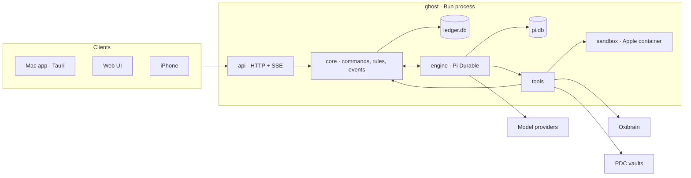
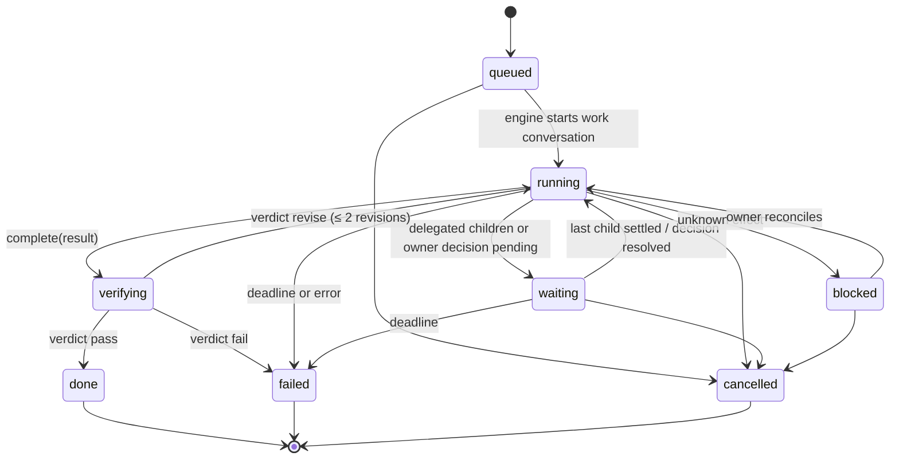

# Ghost architecture

Ghost is one Bun process. It owns one state root, runs every Ghost's conversations on Pi Durable, and serves the Mac app, the web UI and the iPhone over one HTTP API.



## Principles

1. **One process, one language.** Host, conversation engine and device API run in one Bun process. Types are shared with the UI through `packages/ghost-contract`.
2. **Two domain stores, one Host per root.** `ledger.db` holds Ghosts, work, decisions and effects; Pi Durable owns conversations and tasks in `pi.db`. Before either store opens, the Host holds a SQLite exclusive transaction on `lock.db` for its lifetime. Root aliases share the same lock; process death releases it without a stale-PID override. The lock contains no domain state. Artifacts, provider secrets, config and disposable model catalogs remain separate files.
3. **Everything that wakes a Ghost is a submission.** Owner messages, child results, owner decisions, schedule fires and review feedback are Pi submissions to a conversation with a deterministic `requestId`. Pi's request-ID idempotency removes duplicate wakes after a crash. There is no outbox, mailbox or delivery-receipt table.
4. **Capability by construction.** A conversation's kind bounds its tools; each Ghost's explicit tool allow-list narrows that set, and integration/document grants still apply. Beyond the tool list, the owner's per-Ghost permissions (`GhostPermissions`, since 2026-11-09) decide what those tools may reach: sandbox network, mounted host folders and resources, Mac commands without approval and which program classes, document writes without review, and whether an unknown effect blocks. Defaults are the conservative behaviour; only the owner widens them (`ghost.permissions_update`), never a Ghost, the main one included. A widened permission removes the question, not the record: every granted action is still a journaled effect. A direct conversation cannot touch a sandbox; a work conversation cannot create root work. Tools resolve and authorize their current scope from the ledger on every execution, never from model arguments or a cached configuration.
5. **Effects are journaled, never replayed.** A tool with an external effect records `pending` before I/O and `done` after. On restart, `pending` becomes `unknown`, the work blocks and the owner reconciles — or, for a Ghost the owner set to `effects.unknown: continue`, the unknown stays on record, the Ghost is told and carries on; the effect still never runs again. Pi's own tool tasks are `replay: "unsafe"` for these tools, so an interrupted call returns an interrupted result instead of running twice. Owner API journals retain the same replay guards but do not participate in Ghost-tool mutation exclusion; a waiting tool approval cannot prevent credential revocation, document saves or sandbox control.
6. **Reads are free; commands have durable identities.** Read endpoints are never journaled. Synchronous command mutations, events and the success receipt commit together; engine follow-ups start only after that commit. Async commands reserve their principal and command digest before I/O, then use Pi admission IDs, recoverable decision follow-ups or the effect journal. An unknown external result is not a success receipt and is never repeated automatically. Pending request identities are not pruned; completed receipts are retained for 30 days. Receipts contain small outcomes, never command bodies or credentials.
7. **Plain tables, one change feed.** Every ledger mutation appends an `events` row in the same transaction. Clients get a snapshot, then the event stream. No event sourcing, no generic key-value table.

## Repository layout

```
package.json               Bun workspace root
packages/ghost-contract/   entity, command and event schemas (TypeBox) + TS types
apps/ghost-host/           the ghost process
  src/main.ts              CLI: serve | import | backup | doctor
  src/config.ts            typed config: state root, ports, providers, sandbox, memory, vaults
  src/ledger/              bun:sqlite schema, migrations, repositories, events
  src/core/                commands → rules → ledger writes → engine effects
  src/engine/              Pi harness, agent instructions, conversation kinds
  src/tools/               model tools grouped by capability
  src/sandbox/             ExecutionEnv: Apple container, local directory (tests/dev)
  src/integrations/        oxibrain, pdc, push (APNs), providers
  src/api/                 Bun.serve routes, auth, pairing, SSE
  src/import/              one-shot importer from a legacy state root
  test/                    bun test
apps/ghost-ui/             React web UI, served by the host and embedded by the Mac app
apps/ghost-desktop/        Tauri shell
apps/ghost-ios/            SwiftUI app
apps/ghost-voice-server/   unchanged follow-up scope
docs/
```

## Domain

| Concept | Meaning |
| --- | --- |
| Ghost | A durable bot: name, persona, look, model and up to three fallback models, tool allow-list, owner-set permissions, skills, memory space and document grants. The default Ghost is the entry point and may configure other non-default Ghosts only from direct conversations. A retired Ghost can be deleted by the owner: it leaves every list and picker, and its row stays as a tombstone (`deletedAt`) so past Works keep their assignee. |
| Conversation | A Pi conversation bound to one Ghost. Kinds: `direct` (owner ↔ Ghost), `work` (a Ghost executing one Work), `review` (an independent reviewer judging one Work). |
| Work | 맡긴 일. A node in a tree. A root Work is created only from an owner request in a direct conversation (or by the owner in the UI). A child Work is a delegation to another Ghost. Each Work has an assignee, a brief, an acceptance spec, a deadline, a work conversation, a state, a result and a verdict. |
| Decision | Something only the owner can settle: approve an effect (a host command proposal), answer a question, accept a result, approve a document proposal, reconcile an unknown effect. |
| Effect | One external side effect of a tool call (shell, file write, publish, browser mutation, memory write, document proposal). |
| Artifact | Published bytes, addressed by SHA-256, attached to a Work result. Avatar images are artifacts too. |
| Schedule | A timed submission into a conversation (wake, follow-up, reminder the owner asked for). |
| Notification | Something the owner should see: decision needed, Work finished or failed. Pushed to devices. |
| Device | A paired iPhone; it sees every Ghost and may send only device commands. Its alert preferences live in the `settings` table keyed per device and filter only its own pushes. |
| Space | A PDC document vault registered with the host; Ghosts get read or propose grants. |
| Avatar | A named sprite design whose image is an artifact; a Ghost's look is an avatar plus colors. |
| Sandbox | A Ghost's Apple container computer. The owner can stop or reset it. |

### Work state machine



- Cancelling a Work cancels its live descendants first and aborts their conversations.
- `revise` re-submits the verdict feedback into the same work conversation.
- When a child settles, the parent's work conversation receives a submission with the child's result. When a root Work settles, the origin direct conversation receives a report submission.
- The owner can edit a live Work (brief, acceptance, deadline). An edit bumps `revision` and is submitted to the work conversation as steering.

### Verification

`complete` moves a Work to `verifying`. The verdict comes from the first applicable source:

1. **Checks.** If the acceptance spec has deterministic `checks` (`artifact_sha256`, `artifact_contains`, `command_exit_zero`, `command_stdout`), the host evaluates them against reopened artifact bytes and recorded effect results. Checks come only from owner-authored specs, never from a model.
2. **Review.** Otherwise a `review` conversation judges the result with read-only artifact and effect tools and returns `pass | revise | fail` with reasons. The reviewer is the one the spec names (a Ghost or a model); for a delegated child without one, it is the Ghost that delegated it.
3. **Owner.** A root Work without checks or a reviewer opens an `accept_result` decision only when its acceptance names the owner (`owner` absent or true). A Ghost's `work_create` sets `owner: false` unless the owner asked to check the result (`owner_accepts`); such a Work is reviewed like a child (the default Ghost, or another active Ghost, under the review model) and the owner is notified of the outcome. If that review cannot start (no model or credential), it falls back to the owner. Since 2026-11-09: owner acceptance had stopped every Work at its end.

A completion claim alone never accepts a Work.

### Restart

Every follow-up after a ledger commit is idempotent, and startup replays whatever a crash may have cut off:

- `pending` effects become `unknown`; their Work blocks and its conversation stops until the owner reconciles (unless the Ghost's permissions say `continue`: then the Ghost is told and later effects proceed).
- Resolved decisions without a recorded follow-up are followed up again (answers, verdicts, effect notices). An approved document write is itself a journaled effect, so it is never written twice.
- Settled Work without a recorded report reports again (deterministic request id, deterministic notification id).
- A running Work whose conversation is idle gets one wake, keyed by the Work's last change, so repeated restarts do not stack wakes.
- Schedules submit before they advance.
- `ask_owner` may carry a `default` and `wait_minutes` (30 when omitted, at most a day), kept in the question's proposal. The scheduler tick answers a still-pending question with its default once the wait ends; the follow-up tells the Ghost it proceeded on its own assumption. An owner reply before the tick wins.
- Tools that create rows (`work_create`, `delegate`, `schedule_create`, `ask_owner`, `document_propose`) derive the row id from the tool call, so a call Pi replays finds its row.

## Stores

### `ledger.db`

`bun:sqlite`, WAL, `synchronous = FULL`, `PRAGMA user_version` migrations. Ledger writes are synchronous; a write never awaits. That makes the process the single serialized writer without a global mutex.

| Table | Key | Notes |
| --- | --- | --- |
| `ghosts` | `id` | name, persona, look, model, tools (explicit allow-list), is_default (one), state, direct_conversation_id |
| `conversations` | `id` | ghost_id, kind, work_id, title, model, busy; `pi_conversation_id` maps to Pi |
| `works` | `id` | parent_id, root_id, ghost_id, origin_conversation_id, conversation_id, brief, acceptance, state, revision, revisions_used, idle_nudges, deadline_at, result, verdict, reason, timestamps |
| `decisions` | `id` | kind, ghost_id, conversation_id, work_id, effect_id, title, detail, options, proposal, state, answer |
| `effects` | `id`; unique `(conversation_id, call_id)` | work_id, tool, summary, input_digest, state, result |
| `artifacts` | `(digest, work_id, name)` | media_type, size |
| `schedules` | `id` | ghost_id, conversation_id, prompt, spec, next_at, state |
| `notifications` | `id` | kind, ghost/conversation/work/decision refs, title, body, read_at, pushed_at |
| `devices` | `id` | name, token_hash, push token, revoked_at; unused grants column retained for previous-release readability |
| `pairings` | `code_hash` | name, expires_at, device_id; unused grants column retained for previous-release readability |
| `spaces` | `id` | name, path, grants (Ghost + read/propose) |
| `avatars` | `id` | name, description, image_digest, design |
| `providers` | `id` | kind, name, base_url, models (keys live in `secrets/`) |
| `settings` | `key` | default model, review model, `device.alerts:<deviceId>` mute preferences, `ghost.permissions:<ghostId>` owner grants (absent = defaults; no schema change, so a previous release still opens the ledger) |
| `requests` | `id` | principal, command digest, state (`pending` / `done`), small outcome; migration 5 |
| `events` | `seq` | change event JSON; retained 7 days |

### Files under the state root

```
ledger.db  pi.db
lock.db                      kernel-held ownership lock, not a domain store or backup input
artifacts/sha256/ab/<digest>
secrets/<provider>.json      0600
sandboxes/<ghost_id>/<work_id>/workspace
host.json                    port + owner token for local clients, 0600
config.json                  optional: publicOrigin, uiDir, sandbox, memory, apns, reach, skills, mac, browser
browser/                     agent-browser config, Shade plugin wrapper, per-Ghost profiles, one-shot login grants (docs/browser.md)
```

## Engine

- One `Harness` over `pi.db` (`openNodeSqliteStorage`, works under Bun).
- Agent per conversation (`configure`): model and thinking level (conversation → reviewer → Ghost → default), `instructions` = persona + kind instructions, extensions by kind:

| Kind | Extensions |
| --- | --- |
| `direct` | `ghost.direct`: `work_create`, `work_list`, `work_inspect`, `work_update`, `work_cancel`, `ask_owner`, `schedule_create`, `schedule_list`, `schedule_cancel`, `ghost_list`; `ghost.interactive`: `present_ui`; `ghost.memory`; `ghost.documents`; `ghost.web`; `ghost.skills`; `ghost.host`; `ghost.browser`; `ghost.main` (`ghost_inspect`, `ghost_update`) for the active default Ghost only |
| `work` | `ghost.work`: `read`, `write`, `edit`, `bash` (over the sandbox env), `publish_artifact`, `delegate`, `complete`, `ask_owner`, `work_status`; `ghost.memory` (work scope); `ghost.web`; `ghost.skills`; `ghost.host`; `ghost.browser` |
| `review` | `ghost.review`: `artifact_read`, `effect_list`, `run_check` (commands over the Work's files in a read-only review container; not journaled), `verdict` |

- The sandbox `ExecutionEnv` for a work conversation is built from the Work's row: Apple container with the Work's directory mounted at `/workspace`; by default no network, 2 CPUs and 2 GiB. The owner may grant network, up to eight host folders mounted at the same absolute path (read-only or read-write; never one overlapping the state root) and resources; grants are read at every container start, and a running container started with other grants is restarted at the Work's next command unless another of its commands is still running. A review conversation gets its own container over the same files with everything read-only. Local-directory env exists for tests and development.
- Container lifecycle (2026-11-09): one container per Work, started at its first command, trusted as running without another `container ls` until a command fails, and started single-flight. The scheduler's sweep (at most once a minute) deletes this state root's containers whose Work settled or is unknown (a failed `release`, a crash before it), stopped ones, and running ones with no command for 30 minutes; the next command starts a fresh container over the same workspace, so only `/tmp` and background processes are lost. A container is never deleted while one of its commands runs. Work directories are removed 30 days after the Work settled, except a failed root Work, which can be resumed. Only names derived from this state root's `sandboxes/` directories are touched, because a development Host on the same Mac shares the container namespace.
- A work conversation that goes idle with live children or a pending decision becomes `waiting`; when a child settles, its outcome (and its files under `inputs/<child-id>/`) is submitted to the parent. Idle without either gets one reminder, then the Work fails.
- A work conversation whose Ghost holds `delegate` gets the active peer Ghosts in its instructions when it is configured, since `ghost_list` runs only in direct conversations: name, id, first persona line and a capability tag (resolved model, `image` when that model accepts images, `web`, `host`). Creating, changing or deleting a Ghost re-opens the live work conversations of Ghosts that hold `delegate`, so the roster stays current. A Work cannot delegate to its own Ghost. `delegate` may name a reviewer Ghost (`reviewer_ghost_id`), which then judges the child with its own model; without one the delegating Ghost reviews. Delegation is one-shot: a child reports back only when it settles; there is no peer messaging channel mid-Work.
- Model fallback: each Ghost has up to three `fallbacks`. Pi retries a failed generation itself; when the run still ends in an error assistant message caused by a retryable error, rate limit, quota, overload, network failure or a missing credential, and the conversation's model came from the Ghost or the default (not a conversation override or an explicit review model), the engine reconfigures that conversation with the next fallback whose provider has a credential and re-arms Pi's generation task over the committed context in the same transaction. No input is re-submitted, no request id is reused and completed tool tasks are never replayed. A conversation-scoped `ghost.fallback` document records the handled error entry so a restart does not continue it twice. Invalid requests and context overflow never fall back. The next turn starts at the primary model again. Each switch is logged as `fallback: <conversation> <from> -> <to> (<reason>)`; Pi's transcript records the serving provider/model per assistant message.
- Web research (`ghost.web`, config `reach.executable`): `web_search`, `web_read` and `reach` run the owner's read-only `agent-reach` CLI on the host by argv (no shell), with a minimal environment, a deadline, an output cap and at most four children at once. `reach` accepts only catalogued channel actions, never management commands (setup, add, login, update, …). URLs must be http(s) and must not name or resolve to loopback, private, link-local, CGNAT or `*.ts.net`/`*.local` hosts. Results are marked as untrusted evidence. Reads are never journaled.
- Skills (`ghost.skills`, config `skills.roots`): a Ghost's `skills` list names skill directories (with `SKILL.md`) under the configured roots. Their bodies are appended to direct and work instructions in the Ghost's order, bounded per skill and in total, after a line saying they were written for other harnesses; a missing skill is marked unavailable. `skill_read` lists or reads files inside a listed skill only (text, bounded, no path or symlink escape). `GET /api/skills` gives the owner the catalog for the settings picker.
- Mac operations (`ghost.host`, config `mac: { roots, watch }`; the existing `host` key stays the API bind address): read-only probes `host_status`, `host_services`, `host_disk_scan`, `host_disk_usage`, `host_list`, `host_read`, `host_nodes` run on the Mac itself with Macfra's guards. Disk probes may also measure the cache dirs; `host_list`/`host_read` stay inside the configured roots, refuse symlinks below the root, secret and private paths, and redact sensitive text. `host_command_propose` validates an absolute, allowlisted program and a cwd inside the roots; shells and interpreters (and their shell-syntax arguments) and privileged/remote programs are refused unless the owner granted them. By default it journals a pending effect and opens an `approve_effect` decision; the host runs it only after approval and refuses proposals older than 24 h. With `host.approval: never` it runs at once as one journaled effect and returns the output. Either way it runs without a shell, in its own process group with a 90 s limit. Host tools are never in a new Ghost's default allow-list and only the owner grants or revokes them. When `mac.watch` names a Ghost, `ghost serve` (never one-shot CLI commands) runs a watcher after the core has started: it samples status, services and nodes every few minutes without model calls. An issue is admitted after two consecutive samples (critical disk at once), again only after it cleared and came back and six hours passed; one sample's admitted issues, deduplicated by volume, become a single submission into that Ghost's direct conversation, plus one full review a day. State is persisted before each submission; a refused submission (no model or credential) is dropped without stopping sampling. This replaces Macfra's resident agent.
- Oxibrain holds an exclusive store lock for the life of its `admin serve --stdio` child, and every Ghost shares one store. All memory operations go through one queue; each child is reaped (SIGTERM, SIGKILL after 2 s) before the next starts, so parallel `memory_search` calls in one turn run one after another instead of failing on the lock.
- Browser (`ghost.browser`, config `browser: { executable, shade? }`, since 2026-11-09): the owner's `agent-browser` on the Mac, one browser per Ghost over that Ghost's sign-in profile and one labelled tab per conversation, serialized per Ghost. Opening, snapshots, text and screenshots are reads; `browser_act` is a journaled effect whose target is recorded as role, name and position and found again before it runs; a declared or name-implied commit (pay, send, book, publish, account) is an `approve_effect` with the page's screenshot unless the owner set `browser.commit: never`. `browser_login` signs in only with Shade items the owner listed for the Ghost, through agent-browser's credential plugin and a one-shot grant file, so the password never reaches the model. Never in a new Ghost's default allow-list. See [browser](browser.md).
- Effect journaling wraps every tool that changes the outside world (`write`, `edit`, `bash`, `publish_artifact`, `memory_retain`, `browser_act`, `browser_login`).
- Providers: any configured provider with a credential runs any conversation with every tool the Ghost holds. There are no privacy tiers or local-only routes (owner decision, 2026-11-07).
- Owner message attachments are rendered from immutable artifact bytes before Pi admission; Pi stores the exact input for replay. Magic-byte-verified PNG/JPEG/GIF/WebP become image content parts (4 MiB per image, 8 MiB total per message). UTF-8 text (`text/*`, JSON, or text/source filename extensions) is inlined with its filename in a fenced block (first 100 KiB per file, 200 KiB total per message). Stored sizes are checked before image reads; text reads fetch only the bounded prefix. Omitted or truncated content gets an explicit model-visible reason beside its digest reference. Model input capabilities use the same effective catalog as execution: refreshed metadata, then the SDK's offline seed; unknown manual ids default to text-only. Pi retains image parts in history while pi-ai downgrades them to an omission note for text-only model requests. Transcripts hide the model-only attachment block and retain separate attachment references.
- OpenAI providers retain API-key authentication. A stored ChatGPT OAuth credential switches the same provider/model IDs to pi-ai's Codex Responses API at the fixed `https://chatgpt.com/backend-api` endpoint. Tokens never go to a configured custom URL.
- Owner-only device-code login is ephemeral (15 minutes, restart requires a new attempt); credentials persist in `secrets/` as canonical API-key or OAuth JSON. Legacy `{apiKey}` files remain readable. pi-ai refreshes OAuth under the store's per-provider in-process lock and persists rotated tokens; owner replacement/deletion invalidates an in-flight publication. One Host per state root remains required.
- The CLI registers pi-ai's bundled OAuth flows before startup so the standalone Bun executable can resolve login and refresh implementations without external JavaScript files.
- Standard provider models refresh from [models.dev](https://models.dev/api.json), matched to the configured official endpoint (Z.AI Coding Plan and generic API stay separate). Tool-capable text-chat models appear automatically in settings and Pi's execution registry; image input, reasoning, context and output limits travel together. Deprecated discoveries are excluded, but stored ids remain usable. Custom endpoints and OpenAI-compatible servers keep manual model entry. Refreshes never change the selected default, Ghost models, fallbacks, stored manual entries or credentials.
- Anthropic-compatible adapters translate declared `reasoningEfforts` and `reasoningToggle` into adaptive-thinking requests. If thinking cannot be disabled, the wire request uses the lowest declared effort rather than sending an unsupported `disabled` value; stored owner choices stay unchanged. Toggle-only models send no tunable effort. This follows the [MiniMax Anthropic protocol](https://platform.minimax.io/docs/api-reference/text-anthropic-api), without model-id branches.
- The Host checks catalog freshness at startup and hourly, fetching after six hours. Validated metadata is atomically cached in `<root>/models.json`; failed refreshes retain the last good snapshot and a missing cache uses the bundled SDK seed. Catalog listing reads memory, never waits for network and sends no credentials to models.dev. Settings events rebuild the registry and refresh clients without replaying conversations.
- ChatGPT OAuth discovers models from the fixed `https://chatgpt.com/backend-api/codex/models` endpoint using that provider's OAuth credential. Only model metadata is accepted, never upstream prompts or tools. `<root>/codex-models.json` binds cached entries to a hashed account identity; account replacement/logout invalidates the in-memory list and stale in-flight results cannot publish. Expired credentials retain the same-account cache until ordinary SDK token refresh and a later catalog check. The SDK's Codex list is the offline seed; API-only models never become subscription options merely because models.dev lists them.
- Owner settings expose effective `models`, original `configuredModels`, manual-only `manualModelIds`, and `automaticModels` without rewriting provider rows. Optional `authType` (`api_key` or `oauth`) and `hasCredential` come from the secret store, never reach devices, and are not persisted. Ordinary provider edits retain credentials and saved entries; refreshed catalog metadata is authoritative for known ids.

### Agent settings and management

- Each Ghost stores an explicit `tools` allow-list. New Ghosts start with every selectable tool except host tools (`DEFAULT_GHOST_TOOLS`); established Ghosts kept the list from migration 3 and gain later tools only when granted; `[]` disables all optional tools. Unknown names and duplicates are rejected.
- The engine configures Pi's explicit tool selection as well as its named extensions. Pi re-resolves extensions from the registry by name; filtering a copied extension's `tools` array does not restrict a model request.
- Owners edit role instructions and tool permissions in **설정 → 팀 → Ghost 설정**, also reachable from the Ghost's conversation profile. Selecting a tool never grants a document Space or enables an unavailable integration.
- Unsaved owner tool toggles are applied to the latest observed allow-list, preserving concurrent changes to untouched tools.
- `ask_owner`, `complete`, `work_status`, `artifact_read`, `effect_list` and `verdict` remain fixed lifecycle/safety tools in their existing conversation kinds.
- Only the currently active default Ghost's direct conversations receive `ghost_inspect` and `ghost_update`. Every execution rechecks the current designation. These tools inspect/update another non-default Ghost's name, persona, model, fallbacks, skills, look, state and optional tools. They cannot change the caller, the default designation, host tools, document grants, credentials or sandbox controls, and cannot touch a deleted Ghost. Owners retain those controls.
- `ghost.delete` (owner only) accepts a retired, non-default Ghost with no live Work and no pending decision. It removes its schedules and every Space grant naming it, then sets `deletedAt`. Deleted Ghosts are never opened, listed, delegated to or edited again.
- Permission changes refresh live conversations; execution also checks the current ledger permissions so a stale configured tool cannot bypass revocation. Work/review conversations never receive Ghost-management authority, including work assigned to the default Ghost.
- Tool permissions control which actions are exposed, not sandbox syscall permissions: allowing `bash` can still read/write files inside the existing sandbox boundary even when `write` is disabled.
- `present_ui` is a fixed, replay-safe response-format capability in direct conversations,
  not an optional action grant. It validates bounded `ghost-ui/1` data and returns JSON
  through the ordinary Pi tool-result journal. Work/review execution is refused even
  for a stale registration. It writes no ledger rows, files, effects or extra stores.
  Web/Mac widgets submit their visible input as ordinary `message.send` commands;
  existing request-ID receipts prevent duplicate wakes on retry. Static HTML has no
  script, navigation, network or privileged bridge. Text-only clients retain a concise
  ordinary assistant conclusion.

## API

`Bun.serve` on one port. Principals:

- **Owner**: bearer token from `host.json`. Used by the Mac app and the web UI.
- **Device**: bearer token issued at pairing. It sees every Ghost, conversation, Work, decision and notification, including Ghosts created after pairing, but may send only `DEVICE_COMMANDS`. Schedules, Spaces, provider settings/credentials and other devices remain owner-only. Revocation closes its stream and invalidates its token.

| Route | Purpose |
| --- | --- |
| `GET /api/state` | snapshot: ghosts, works (live + recent), decisions, notifications, conversations, settings |
| `GET /api/conversations/:id?before=&limit=` | transcript page (from Pi entries) |
| `GET /api/works/:id` | Work detail: tree, effects, artifacts, verdict |
| `GET /api/artifacts/:digest` | artifact bytes; the owner can read any stored digest, a device any Work artifact or avatar image |
| `POST /api/artifacts` | owner-only raw bytes, up to 20 MiB; `Content-Type` is the media type, `X-Ghost-File-Name` is a percent-encoded UTF-8 filename (1–256 characters); returns `201` with an `ArtifactRef` JSON object (`digest`, `name`, `mediaType`, `size`). Invalid metadata returns `400`; oversized uploads return `413`, both with the standard `invalid` error envelope. Uploads need no Work row; unregistered digest reads use `application/octet-stream`. |
| `GET /api/events?after=seq` | SSE: ledger events + live conversation deltas |
| `POST /api/commands` | `{ requestId, command }`, command is a contract union (`message.send`, `work.create`, `work.update`, `work.cancel`, `decision.resolve`, `ghost.create`, `ghost.update`, `schedule.*`, `device.*`, `settings.*`, …) |
| `POST /api/pairing/claim` | device pairing with a one-time code |
| `GET /api/providers/catalog` | owner-only provider presets and cached model metadata; public API catalogs are not account-verified, account-specific Codex models appear in settings |
| `POST /api/providers/:id/oauth` | owner-only ChatGPT device-code login; a pending attempt is reused |
| `GET /api/providers/:id/oauth` | owner-only login status, verification URL and device code; never tokens |
| `DELETE /api/providers/:id/oauth` | cancel a pending login, not an existing credential |
| `GET /` | web UI |

## Import

`ghost import --from <legacy-root>` reads a pre-Bun state root without modifying it and writes a fresh state root:

- Ghost identities (registry, profiles, display names, avatars, default Ghost).
- Conversations and their turn history as Pi user/assistant entries.
- Goals/Works as terminal Works with their results, verdicts and artifacts.
- Devices, grants, provider settings and credentials, schedules.

It writes a loss report of everything it did not carry over. PDC vaults are referenced, never rewritten.

## Removed

| Removed | Why |
| --- | --- |
| Rust crate, legacy profile runtime, OMP worker/guest runtime, `apps/ghost-omp` | replaced by the single process; execution is Pi only |
| Host↔Pi JSONL + HTTP callback bridge, outbox/inbox/mailbox, delivery receipts | Pi runs in-process; wakes are submissions |
| `apps/ghost-gateway` | device API is part of the host API |
| Goal vs Work split, assignments, selected tasks, work waits, work contexts | one Work tree |
| Routing, orchestration plans, collaboration coordinator, three verifier paths | delegation is a child Work; one verification order |
| Planner, CalDAV, Google planner, Slack channel, incidents feed, integrations proposal surface | outside current product scope |
| Model-driven bot candidate/evaluation pipeline | Ghosts are created and edited by the owner |
| `workspace_objects` key-value store, command response ledger | plain tables; reads are not journaled |
| Voice routes (transcribe, synthesize, WebRTC media relay) | follow-up scope; `apps/ghost-voice-server` stays and gets a host route when voice is accepted |
| Memory publication ledger, source review screens, Work-memory profiles | memory is Oxibrain search/recall/retain per Ghost; source correction happens in Oxibrain |
