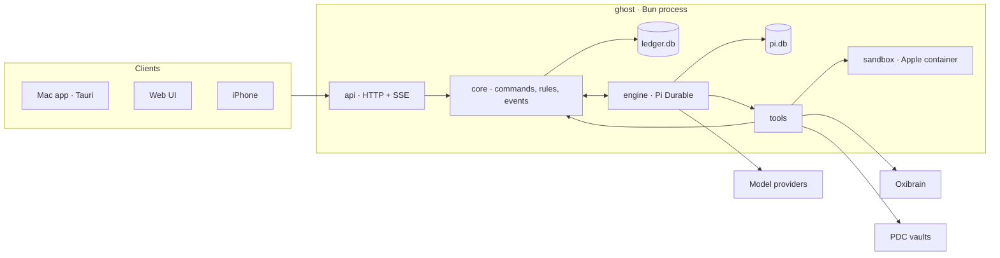
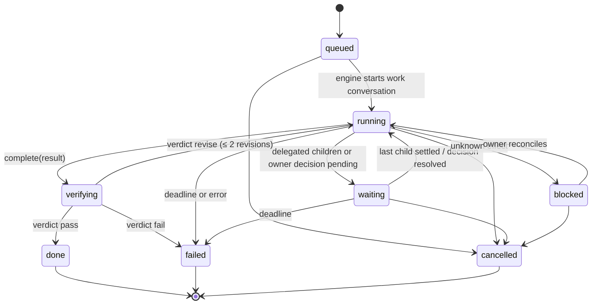

# Ghost architecture

Ghost is one Bun process. It owns one state root, runs every Ghost's conversations on Pi Durable, and serves the Mac app, the web UI and the iPhone over one HTTP API.



## Principles

1. **One process, one language.** Host, conversation engine and device API run in one Bun process. Types are shared with the UI through `packages/ghost-contract`.
2. **Two stores, each with one writer.** `ledger.db` holds what Ghost knows about Ghosts, work, decisions and effects. `pi.db` holds conversations and their durable tasks, owned by Pi Durable. Nothing else is persisted except content-addressed artifacts, provider secrets and config.
3. **Everything that wakes a Ghost is a submission.** Owner messages, child results, owner decisions, schedule fires and review feedback are Pi submissions to a conversation with a deterministic `requestId`. Pi's request-ID idempotency removes duplicate wakes after a crash. There is no outbox, mailbox or delivery-receipt table.
4. **Capability by construction.** A conversation's kind bounds its tools; each Ghost's explicit tool allow-list narrows that set, and integration/document grants still apply. A direct conversation cannot touch a sandbox; a work conversation cannot create root work. Tools resolve and authorize their current scope from the ledger on every execution, never from model arguments or a cached configuration.
5. **Effects are journaled, never replayed.** A tool with an external effect records `pending` before I/O and `done` after. On restart, `pending` becomes `unknown`, the work blocks and the owner reconciles. Pi's own tool tasks are `replay: "unsafe"` for these tools, so an interrupted call returns an interrupted result instead of running twice.
6. **Reads are free.** Read endpoints are never journaled. Only mutating commands carry a request ID, and the receipt stores the outcome reference, not the response body.
7. **Plain tables, one change feed.** Every ledger mutation appends an `events` row in the same transaction. Clients get a snapshot, then the event stream. No event sourcing, no generic key-value table.

## Repository layout

```
package.json               Bun workspace root
packages/ghost-contract/   entity, command and event schemas (TypeBox) + TS types
apps/ghost-host/           the ghost process
  src/main.ts              CLI: serve | import | backup | doctor
  src/config.ts            typed config: state root, ports, providers, sandbox, memory, vaults
  src/ledger/              bun:sqlite schema, migrations, repositories, events
  src/core/                commands → rules → ledger writes → engine effects
  src/engine/              Pi harness, agent instructions, conversation kinds
  src/tools/               model tools grouped by capability
  src/sandbox/             ExecutionEnv: Apple container, local directory (tests/dev)
  src/integrations/        oxibrain, pdc, push (APNs), providers
  src/api/                 Bun.serve routes, auth, pairing, SSE
  src/import/              one-shot importer from a legacy state root
  test/                    bun test
apps/ghost-ui/             React web UI, served by the host and embedded by the Mac app
apps/ghost-desktop/        Tauri shell
apps/ghost-ios/            SwiftUI app
apps/ghost-voice-server/   unchanged follow-up scope
docs/
```

## Domain

| Concept | Meaning |
| --- | --- |
| Ghost | A durable bot: name, persona, look, model, tool allow-list, memory space and document grants. The default Ghost is the entry point and may configure other non-default Ghosts only from direct conversations. |
| Conversation | A Pi conversation bound to one Ghost. Kinds: `direct` (owner ↔ Ghost), `work` (a Ghost executing one Work), `review` (an independent reviewer judging one Work). |
| Work | 맡긴 일. A node in a tree. A root Work is created only from an owner request in a direct conversation (or by the owner in the UI). A child Work is a delegation to another Ghost. Each Work has an assignee, a brief, an acceptance spec, a deadline, a work conversation, a state, a result and a verdict. |
| Decision | Something only the owner can settle: approve an effect (browser mutation), answer a question, accept a result, approve a document proposal, reconcile an unknown effect. |
| Effect | One external side effect of a tool call (shell, file write, publish, browser mutation, memory write, document proposal). |
| Artifact | Published bytes, addressed by SHA-256, attached to a Work result. Avatar images are artifacts too. |
| Schedule | A timed submission into a conversation (wake, follow-up, reminder the owner asked for). |
| Notification | Something the owner should see: decision needed, Work finished or failed. Pushed to devices. |
| Device | A paired iPhone with explicit Ghost/conversation grants. |
| Space | A PDC document vault registered with the host; Ghosts get read or propose grants. |
| Avatar | A named sprite design whose image is an artifact; a Ghost's look is an avatar plus colors. |
| Sandbox | A Ghost's Apple container computer. The owner can stop or reset it. |

### Work state machine



- Cancelling a Work cancels its live descendants first and aborts their conversations.
- `revise` re-submits the verdict feedback into the same work conversation.
- When a child settles, the parent's work conversation receives a submission with the child's result. When a root Work settles, the origin direct conversation receives a report submission.
- The owner can edit a live Work (brief, acceptance, deadline). An edit bumps `revision` and is submitted to the work conversation as steering.

### Verification

`complete` moves a Work to `verifying`. The verdict comes from the first applicable source:

1. **Checks.** If the acceptance spec has deterministic `checks` (`artifact_sha256`, `artifact_contains`, `command_exit_zero`, `command_stdout`), the host evaluates them against reopened artifact bytes and recorded effect results. Checks come only from owner-authored specs, never from a model.
2. **Review.** Otherwise a `review` conversation judges the result with read-only artifact and effect tools and returns `pass | revise | fail` with reasons. The reviewer is the one the spec names (a Ghost or a model); for a delegated child without one, it is the Ghost that delegated it.
3. **Owner.** A root Work without checks or a reviewer opens an `accept_result` decision.

A completion claim alone never accepts a Work.

### Restart

Every follow-up after a ledger commit is idempotent, and startup replays whatever a crash may have cut off:

- `pending` effects become `unknown`; their Work blocks and its conversation stops until the owner reconciles.
- Resolved decisions without a recorded follow-up are followed up again (answers, verdicts, effect notices). An approved document write is itself a journaled effect, so it is never written twice.
- Settled Work without a recorded report reports again (deterministic request id, deterministic notification id).
- A running Work whose conversation is idle gets one wake, keyed by the Work's last change, so repeated restarts do not stack wakes.
- Schedules submit before they advance.
- Tools that create rows (`work_create`, `delegate`, `schedule_create`, `ask_owner`, `document_propose`) derive the row id from the tool call, so a call Pi replays finds its row.

## Stores

### `ledger.db`

`bun:sqlite`, WAL, `synchronous = FULL`, `PRAGMA user_version` migrations. Ledger writes are synchronous; a write never awaits. That makes the process the single serialized writer without a global mutex.

| Table | Key | Notes |
| --- | --- | --- |
| `ghosts` | `id` | name, persona, look, model, tools (explicit allow-list), is_default (one), state, direct_conversation_id |
| `conversations` | `id` | ghost_id, kind, work_id, title, model, busy; `pi_conversation_id` maps to Pi |
| `works` | `id` | parent_id, root_id, ghost_id, origin_conversation_id, conversation_id, brief, acceptance, state, revision, revisions_used, idle_nudges, deadline_at, result, verdict, reason, timestamps |
| `decisions` | `id` | kind, ghost_id, conversation_id, work_id, effect_id, title, detail, options, proposal, state, answer |
| `effects` | `id`; unique `(conversation_id, call_id)` | work_id, tool, summary, input_digest, state, result |
| `artifacts` | `(digest, work_id, name)` | media_type, size |
| `schedules` | `id` | ghost_id, conversation_id, prompt, spec, next_at, state |
| `notifications` | `id` | kind, ghost/conversation/work/decision refs, title, body, read_at, pushed_at |
| `devices` | `id` | name, token_hash, grants, push token, revoked_at |
| `pairings` | `code_hash` | name, grants, expires_at, device_id |
| `spaces` | `id` | name, path, grants (Ghost + read/propose) |
| `avatars` | `id` | name, description, image_digest, design |
| `providers` | `id` | kind, name, base_url, models (keys live in `secrets/`) |
| `settings` | `key` | default model, review model |
| `requests` | `id` | principal, command digest, small outcome |
| `events` | `seq` | change event JSON; retained 7 days |

### Files under the state root

```
ledger.db  pi.db
artifacts/sha256/ab/<digest>
secrets/<provider>.json      0600
sandboxes/<ghost_id>/<work_id>/workspace
host.json                    port + owner token for local clients, 0600
config.json                  optional: publicOrigin, uiDir, sandbox, memory, apns
```

## Engine

- One `Harness` over `pi.db` (`openNodeSqliteStorage`, works under Bun).
- Agent per conversation (`configure`): model and thinking level (conversation → reviewer → Ghost → default), `instructions` = persona + kind instructions, extensions by kind:

| Kind | Extensions |
| --- | --- |
| `direct` | `ghost.direct`: `work_create`, `work_list`, `work_inspect`, `work_update`, `work_cancel`, `ask_owner`, `schedule_create`, `schedule_list`, `schedule_cancel`, `ghost_list`; `ghost.interactive`: `present_ui`; `ghost.memory`; `ghost.documents`; `ghost.main` (`ghost_inspect`, `ghost_update`) for the active default Ghost only |
| `work` | `ghost.work`: `read`, `write`, `edit`, `bash` (over the sandbox env), `publish_artifact`, `delegate`, `complete`, `ask_owner`, `work_status`; `ghost.memory` (work scope) |
| `review` | `ghost.review`: `artifact_read`, `effect_list`, `verdict` |

- The sandbox `ExecutionEnv` for a work conversation is built from the Work's row: Apple container with only the Work's directory mounted at `/workspace`, no network. Local-directory env exists for tests and development.
- A work conversation that goes idle with live children or a pending decision becomes `waiting`; when a child settles, its outcome (and its files under `inputs/<child-id>/`) is submitted to the parent. Idle without either gets one reminder, then the Work fails.
- Effect journaling wraps every tool that changes the outside world (`write`, `edit`, `bash`, `publish_artifact`, `memory_retain`).
- Providers: any configured provider with a credential runs any conversation with every tool the Ghost holds. There are no privacy tiers or local-only routes (owner decision, 2026-11-07).

### Agent settings and management

- Each Ghost stores an explicit `tools` allow-list. Existing and newly created Ghosts start with the established optional tools; `[]` disables all optional tools. Unknown names and duplicates are rejected.
- The engine configures Pi's explicit tool selection as well as its named extensions. Pi re-resolves extensions from the registry by name; filtering a copied extension's `tools` array does not restrict a model request.
- Owners edit role instructions and tool permissions in **설정 → 팀 → Ghost 설정**, also reachable from the Ghost's conversation profile. Selecting a tool never grants a document Space or enables an unavailable integration.
- Unsaved owner tool toggles are applied to the latest observed allow-list, preserving concurrent changes to untouched tools.
- `ask_owner`, `complete`, `work_status`, `artifact_read`, `effect_list` and `verdict` remain fixed lifecycle/safety tools in their existing conversation kinds.
- Only the currently active default Ghost's direct conversations receive `ghost_inspect` and `ghost_update`. Every execution rechecks the current designation. These tools inspect/update another non-default Ghost's name, persona, model, look, state and optional tools. They cannot change the caller, the default designation, document grants, credentials or sandbox controls. Owners retain those controls.
- Permission changes refresh live conversations; execution also checks the current ledger permissions so a stale configured tool cannot bypass revocation. Work/review conversations never receive Ghost-management authority, including work assigned to the default Ghost.
- Tool permissions control which actions are exposed, not sandbox syscall permissions: allowing `bash` can still read/write files inside the existing sandbox boundary even when `write` is disabled.
- `present_ui` is a fixed, replay-safe response-format capability in direct conversations,
  not an optional action grant. It validates bounded `ghost-ui/1` data and returns JSON
  through the ordinary Pi tool-result journal. Work/review execution is refused even
  for a stale registration. It writes no ledger rows, files, effects or extra stores.
  Web/Mac widgets submit their visible input as ordinary `message.send` commands;
  existing request-ID receipts prevent duplicate wakes on retry. Static HTML has no
  script, navigation, network or privileged bridge. Text-only clients retain a concise
  ordinary assistant conclusion.

## API

`Bun.serve` on one port. Principals:

- **Owner**: bearer token from `host.json`. Used by the Mac app and the web UI.
- **Device**: bearer token issued at pairing. Every read and command is filtered by the device's grants.

| Route | Purpose |
| --- | --- |
| `GET /api/state` | snapshot: ghosts, works (live + recent), decisions, notifications, conversations, settings |
| `GET /api/conversations/:id?before=&limit=` | transcript page (from Pi entries) |
| `GET /api/works/:id` | Work detail: tree, effects, artifacts, verdict |
| `GET /api/artifacts/:digest` | artifact bytes |
| `GET /api/events?after=seq` | SSE: ledger events + live conversation deltas |
| `POST /api/commands` | `{ requestId, command }`, command is a contract union (`message.send`, `work.create`, `work.update`, `work.cancel`, `decision.resolve`, `ghost.create`, `ghost.update`, `schedule.*`, `device.*`, `settings.*`, …) |
| `POST /api/pairing/claim` | device pairing with a one-time code |
| `GET /` | web UI |

## Import

`ghost import --from <legacy-root>` reads a pre-Bun state root without modifying it and writes a fresh state root:

- Ghost identities (registry, profiles, display names, avatars, default Ghost).
- Conversations and their turn history as Pi user/assistant entries.
- Goals/Works as terminal Works with their results, verdicts and artifacts.
- Devices, grants, provider settings and credentials, schedules.

It writes a loss report of everything it did not carry over. PDC vaults are referenced, never rewritten.

## Removed

| Removed | Why |
| --- | --- |
| Rust crate, legacy profile runtime, OMP worker/guest runtime, `apps/ghost-omp` | replaced by the single process; execution is Pi only |
| Host↔Pi JSONL + HTTP callback bridge, outbox/inbox/mailbox, delivery receipts | Pi runs in-process; wakes are submissions |
| `apps/ghost-gateway` | device API is part of the host API |
| Goal vs Work split, assignments, selected tasks, work waits, work contexts | one Work tree |
| Routing, orchestration plans, collaboration coordinator, three verifier paths | delegation is a child Work; one verification order |
| Planner, CalDAV, Google planner, Slack channel, incidents feed, integrations proposal surface | outside current product scope |
| Model-driven bot candidate/evaluation pipeline | Ghosts are created and edited by the owner |
| `workspace_objects` key-value store, command response ledger | plain tables; reads are not journaled |
| Owned-browser tools and browser approvals | not enabled in the production Pi computer config (`accepted_capabilities` had no browser); re-add as a `ghost.browser` extension using `effects.propose` |
| Voice routes (transcribe, synthesize, WebRTC media relay) | follow-up scope; `apps/ghost-voice-server` stays and gets a host route when voice is accepted |
| Memory publication ledger, source review screens, Work-memory profiles | memory is Oxibrain search/recall/retain per Ghost; source correction happens in Oxibrain |
