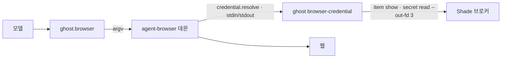

# 쓰기 브라우저와 Shade 로그인

2026-11-09 구현. 구조 원칙은 [architecture](architecture.md)를 따른다 — 「Removed」에 남겨 둔 「`ghost.browser` 확장을 `effects.propose`로 다시 들인다」를 이 문서대로 했다.

목표: Ghost가 사용자 계정으로 웹에서 행동한다 — 로그인, 폼 입력, 예약·전송·결제 직전까지. 바깥에 되돌릴 수 없는 영향이 가는 클릭은 소유자 승인(또는 소유자가 연 권한)을 거치고, 비밀번호는 모델에 닿지 않는다.

## 구성

| 구성 | 맡는 일 | 코드 |
| --- | --- | --- |
| agent-browser (vercel-labs, 0.41.x) | 브라우저 엔진. CLI → 세션별 데몬 → CDP. Host가 argv로 실행한다(셸 없음) | — |
| `AgentBrowser` (`BrowserPort`) | 실행·출력 제한·시간 제한·Ghost별 대기열·탭·플러그인 설정 | `apps/ghost-host/src/integrations/browser.ts` |
| `ghost.browser` | 모델 도구 6개 | `apps/ghost-host/src/tools/browser.ts` |
| `ghost browser-credential` | agent-browser 자격증명 플러그인(`agent-browser.plugin.v1`, `credential.read`) | `apps/ghost-host/src/integrations/browser-credential.ts` |
| Shade | 로그인 금고. 에이전트 CLI `shade`(XPC 브로커 경유) | 별도 저장소 `a7garden/shade` |



브라우저는 **Host(Mac)에서** 돈다. 컨테이너 안에서는 소유자가 2단계 인증을 할 화면이 없고, Shade XPC 브로커에도 닿지 않는다. 그래서 브라우저 도구는 Mac 도구처럼 새 Ghost의 기본 허용 목록(`DEFAULT_GHOST_TOOLS`)에 들어가지 않는다 — 소유자가 「설정 → 팀 → Ghost 설정 → 브라우저」에서 준다.

## 설정

`<root>/config.json`:

```json
{ "browser": { "executable": "/opt/homebrew/bin/agent-browser", "shade": "/Users/<나>/.local/bin/shade" } }
```

`shade`가 없거나 그 경로에 파일이 없으면 금고 로그인만 꺼지고 나머지 도구는 쓴다. Host는 시작할 때마다 `<root>/browser/`를 만든다.

```
browser/agent-browser.json     플러그인 설정(--config 로만 읽힌다)
browser/shade-credential       플러그인 래퍼(셸 스크립트 · Windows는 .cmd): ghost browser-credential --root … --shade …
browser/profiles/<ghostId>/    Ghost별 Chrome 프로필(로그인 쿠키) 0700
browser/grants/<token>.json    일회용 로그인 허락 0600, 60초
browser/scratch/               스크린샷 임시 파일
```

프로필은 상태 루트 안이라 샌드박스 폴더 연결 규칙(상태 루트와 겹치면 거부)이 이미 막는다 — `bash`로 쿠키를 읽을 수 없다.

## 세션과 탭

- **Ghost마다 브라우저 하나**: `--session ghost-<ghostId> --profile <root>/browser/profiles/<ghostId>`. Chrome 프로필은 한 번에 브라우저 하나만 연다(2026-11-09 실측: 같은 프로필로 두 번째 세션을 열면 잠금 파일에서 실패).
- **대화마다 탭 하나**: 이름표 `c<conversationId>`. 이름표는 데몬이 기억하므로 Host가 재시작해도 같은 탭을 찾는다. 탭이 없으면 새로 연다.
- **Ghost별 대기열**: 데몬의 활성 탭은 하나이고 ref(`@e3`)는 그 탭의 것이다. 「탭 전환 → 명령」을 한 차례로 묶어 같은 Ghost의 다른 대화가 끼어들지 못하게 한다.
- 끝난 Work의 탭은 그 Ghost의 다음 브라우저 호출 때 닫는다(5분에 한 번). 브라우저 자체는 agent-browser 데몬이 1시간 동안 명령이 없으면 닫는다.

## 도구

| 도구 | 종류 | 기록 | 비고 |
| --- | --- | --- | --- |
| `browser_open` | 이동 | 안 함 | `web_read`와 같은 주소 규칙(http(s), 사설·루프백·`*.local`·`*.ts.net` 거부) + Ghost 도메인 목록 |
| `browser_snapshot` | 읽기 | 안 함 | 상호작용 요소와 ref. 비밀번호 칸 값은 agent-browser가 `•••`로 가린다 |
| `browser_text` | 읽기 | 안 함 | 본문 또는 CSS 선택자 하나의 글, 24,000자 상한 |
| `browser_screenshot` | 읽기 | 안 함 | 모델에게 이미지로 보여 준다(텍스트 전용 모델은 생략 안내로 내려간다) |
| `browser_act` | 바꾸기 | 효과 | `click` · `fill` · `type` · `press` · `select` · `check` · `uncheck` |
| `browser_login` | 바꾸기 | 효과 | 허락된 Shade 항목으로 `auth login <token> --credential-provider shade --no-navigate --url <출처>` |

내주지 않는 것: `eval`, `get value`, `cookies`, `storage`, `state save`, `network`, `upload`, `plugin`, 관리 명령. 이 중 하나라도 있으면 채워 넣은 비밀번호를 다시 읽을 수 있다.

### 바꾸는 동작과 승인

- 대상은 ref가 아니라 **역할 · 이름 · 몇 번째**로 기록한다. ref는 스냅샷마다 번호가 바뀌고, 같은 Ghost의 다른 대화가 탭을 바꾸면 무효가 된다. 실행 직전에 새 스냅샷에서 같은 요소를 다시 찾는다. 모델은 자기 대화의 **마지막** 스냅샷에 있는 ref만 쓸 수 있다.
- `commit`(`payment` · `send` · `booking` · `publish` · `account` · `other`)이 있으면 기본값은 `effects.propose` → `approve_effect` 결정이다. 제안에는 현재 URL, 대상 요소, 그 순간의 스크린샷(산출물)을 담고, 승인 카드가 스크린샷을 보여 준다.
- 승인 후 실행기(`onApproved("browser_act")`)는 같은 출처인지, 요소가 아직 있는지, Ghost가 여전히 `browser_act`를 가졌는지 확인하고 실행한다. 하나라도 어긋나면 `NoEffect`로 거부한다(「화면이 바뀌어 실행하지 않았습니다」). 승인 기한은 24시간으로 Mac 명령과 같다.
- 선언 누락 대비: `commit` 없는 `click`이라도 대상이 단추·링크이고 이름에 결제·구매·주문·보내기·전송·송금·이체·예약·확정·게시·삭제·탈퇴·해지·제출·신청·가입(영어 포함)이 들어 있으면 `other`로 올린다. 휴리스틱일 뿐이다. 「로그인」·Enter 키처럼 걸리지 않는 것도 있어 검토자가 효과 목록을 함께 본다.
- 소유자가 `browser.commit: "never"`를 주면 승인 없이 실행하되 효과 기록은 그대로다(원칙 4).
- agent-browser가 명령 전에 거부하면(모르는 ref, 숨은 요소) `NoEffect`, 시간 초과처럼 결과를 모르면 기존대로 `unknown` → 소유자 대사. 브라우저 동작은 다시 실행하지 않는다.

### 도메인

`browser.domains`(빈 목록 = 공개 주소 전부)를 Ghost가 지킨다. `browser_open`의 대상과, 모든 `browser_act`·`browser_login` 직전의 현재 최상위 URL을 확인한다.

agent-browser의 `--allowed-domains`는 쓰지 못한다 — 프로필·state 복원과 함께 쓸 수 없다(agent-browser 규약). 그래서 페이지 안의 하위 요청까지는 막지 못하고, 권한 화면에 그 한계를 적어 두었다.

## Shade 연결

### 플러그인

agent-browser는 `credential.resolve` 요청 한 건마다 플러그인 프로세스를 하나 띄운다(2026-11-09 실측). 플러그인 환경은 **데몬**의 것을 물려받으므로 호출마다 다른 허락을 환경 변수로 넘길 수 없다. 그래서:

1. Host가 `browser/grants/<token>.json`(항목 UUID · 출처 · 60초 기한)을 쓰고, `<token>`을 `auth login`의 프로필 이름으로 넘긴다.
2. 플러그인이 허락 파일을 읽고 바로 지운다. 요청의 `itemRef`와 `url` 출처가 허락과 정확히 같아야 한다.
3. `shade item show <UUID> --json` — 금고의 항목이 아직 그 출처의 것인지 본다. 사용자 이름도 여기서 얻는다.
4. `shade secret read <UUID> --out-fd 3` — 값은 FD 3으로만 받는다. Shade는 인자에 비밀을 싣지 않고, `secret read`에는 출처 옵션이 없다(그래서 3단계가 필요하다).
5. `{ success: true, credential: { username, password, url } }`을 표준 출력으로 내고 끝낸다. 오류에는 Shade 오류 코드만 싣는다.

agent-browser는 플러그인 값을 프로세스 인자나 일반 출력에 넣지 않고, 플러그인 오류 문구도 자기 응답에서 뺀다. 모델은 「로그인 성공/실패」와 항목 제목만 본다.

### 권한

Shade의 에이전트 허가는 **금고 전체** 단위이고, 같은 사용자 권한으로 서명된 CLI를 실행할 수 있는 코드는 모두 같은 접근을 가진다(Shade STATUS). 그래서 Ghost가 좁힌다.

- `browser.logins: [{ itemId, origin, title }]` — Ghost마다 소유자가 고른 항목만. 지금은 권한 화면에 항목 ID와 사이트를 직접 넣는다(Shade 앱의 계정 정보). Shade 목록에서 고르는 화면은 남은 일이다.
- `browser_login`은 이 목록의 항목과 출처만 받는다. 모델이 UUID를 지어내도 거부한다.
- Shade 잠금 임대(최대 12시간)가 끝났으면 Shade 오류 코드가 실패로 돌아온다. 무인 실행 중 로그인이 막힐 수 있다.
- **위험한 조합**: Shade 에이전트 허가가 켜진 Mac에서 `host.approval: "never"` + `host.interpreters: true`인 Ghost는 셸로 `shade secret read --stdout`을 돌려 금고 전체를 읽을 수 있다. 권한 화면은 금고 로그인이 있는 Ghost에 이 조합이 켜지면 경고한다. 막을지는 소유자가 정한다(원칙 4).

### 카드 · 연락처는 하지 않는다

agent-browser 스냅샷은 비밀번호 칸만 가리고, **일반 입력 칸 값은 그대로 보여 준다**(2026-11-09 실측: 카드 번호 칸에 넣은 `4111…`이 스냅샷에 평문으로 나왔다). 금고의 카드 번호를 채우면 다음 스냅샷에서 모델이 읽는다. 그래서 Grok Bot Vault의 카드 · 연락처 채우기는 넣지 않았다. 하려면 스냅샷에서 해당 칸 값을 지우는 장치(agent-browser 쪽 변경 또는 Host의 후처리)가 먼저다.

## 권한 스키마 (`GhostPermissions.browser`)

```ts
browser?: {
  commit: "always" | "never",
  domains: string[],                                              // 최대 32, 저장할 때 소문자 hostname 으로
  logins: { itemId: string; origin: string; title: string }[],    // 최대 32, origin 은 https 만
}
```

선택 키다. 이전에 저장된 행에는 없으므로 `browserPermissionsOf`가 기본값 `{ commit: "always", domains: [], logins: [] }`을 채운다. 설정 행(`ghost.permissions:<id>`)에 그대로 들어가 스키마 변경이 없고, 이전 릴리스는 모르는 키를 읽지 않는다. 「모두 허용」은 브라우저를 바꾸지 않고, 「기본으로」는 도메인 · 로그인 목록을 남긴다(연결한 폴더와 같다).

## 확인한 것 (2026-11-09, Windows)

- Host 테스트 `test/browser.test.ts` 19개, UI 테스트(권한 도우미) 통과. 전체 Host 테스트의 실패 수는 손대기 전과 같다(Windows에서 원래 실패하는 셸 스크립트 · 줄끝 전제 123개).
- 실제 agent-browser 0.41.2와 공개 시험 사이트(the-internet.herokuapp.com/login), Shade CLI 규약을 따르는 가짜 금고로 끝까지: 허용 목록 밖 거부 → 열기 → 스냅샷 → 입력(기록) → 로그인 단추 승인 카드(스크린샷 포함) → 승인 후 다시 찾아 클릭 → 금고 로그인으로 보안 영역 진입. 허락 파일은 남지 않았고, 도구 결과 · 효과 · 결정에 비밀번호가 없었다.

## Mac에서 남은 확인

- 실제 Shade 브로커(금고 초기화 · 에이전트 허가 · 잠금 해제)로 합성 계정 로그인. 플러그인 래퍼가 설치된 `ghost` 바이너리(`/$bunfs` 단독 실행 파일)를 부르는지.
- Apple Silicon에서 agent-browser가 Chrome for Testing을 받는지(`agent-browser install`), LaunchAgent 환경(`PATH` · `HOME`)으로 데몬이 뜨는지.
- 설치판 Host · UI의 권한 화면과 승인 카드(스크린샷 표시).

## 남은 일

- 2단계 인증 · 캡차: 소유자가 같은 프로필로 창을 띄워 직접 로그인하는 화면. 지금은 손으로 한다 — 그 Ghost가 브라우저를 쓰지 않을 때 `agent-browser --session ghost-<ghostId> close` 후 `agent-browser --session ghost-<ghostId> --profile <root>/browser/profiles/<ghostId> --headed open <주소>`.
- Shade 항목을 목록에서 고르는 권한 화면(`shade items find --origin … --json`, 메타데이터만).
- 카드 · 연락처(위 「하지 않는다」).
