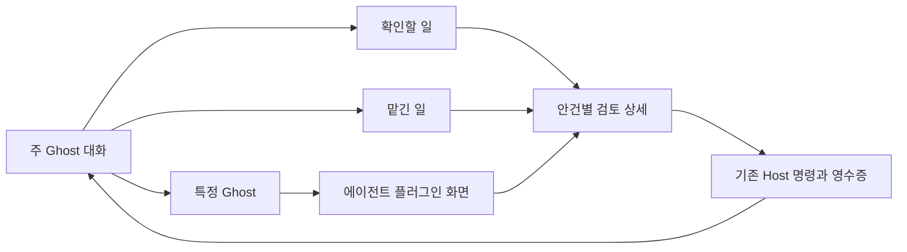

# 주 Ghost 대화와 에이전트별 검토 화면

2026-11-04 설계와 구현 상태. 데스크톱 Ghost의 기본 사용 흐름, 승인함, 에이전트별 화면의 경계를 정한다.

주 Ghost 대화와 공용 승인함, 문서 저장·외부 실행 검토 화면을 구현했다. Docket의
[플러그인 매니페스트](https://github.com/a7garden/docket/blob/main/examples/plugins/open-in-code/plugin.json)처럼
등록 정보가 기능과 화면을 연결한다. Ghost는 앱에 포함된 검토 화면을 등록하고 자체 Pi 런타임으로 대화한다.
Ghost별 화면 선택은 현재 브라우저의 작업실 설정에 저장한다. 외부 도구와 Ghost의 연결 권한은 Host에 저장한다.
외부 도구의 실행 범위와 Gmail 연결 순서는 [개인 연동](personal-integrations.md)을 따른다.
아래 개발·조사 등 전용 화면은 후속 설계다.

## 현재 화면에서 바꿀 점

- 새 실행은 이미 Lifetime 대화로 들어간다. 그런데 작업실 안에 역할 카드, 대화·맡긴 일·Ghost 관리 탭이 함께 있고, 바깥 사이드바에도 Ghost·맡긴 일·확인할 일이 반복된다. 주 Ghost에게 바로 말할 수는 있지만, 기본 화면이 대화보다 관제 화면처럼 보인다.
- [확인할 일](../apps/ghost-ui/src/client/inbox.ts)은 문서 저장 요청, 일부 이전 런타임 작업 상태, 완료 보고를 한 숫자에 합친다. 승인할 일, 실행 결과를 확인할 일, 읽을 보고를 구분하기 어렵다.
- [문서 저장](pdc-adoption.md), [봇 정의·수명주기](bot-provisioning.md), [기억 교정](../apps/ghost-ui/src/lifetime/MemorySourceReview.tsx)은 필요한 판단과 완료 조건이 서로 다르다. 화면은 공통 승인 버튼 하나로 일반화하기 어렵지만, 같은 승인함에서 찾고 동일한 방식으로 원래 대화에 돌아올 수 있다.

## 화면 구조

| 위치 | 화면과 동작 |
| --- | --- |
| 기본 화면 | **주 Ghost 대화**. 대화 기록과 아래쪽 입력창이 화면의 대부분을 차지한다. 주 Ghost에게 요청하면 담당 배정과 중간 진행, 최종 보고가 같은 대화로 돌아온다. 해당 대화에 관련 승인 요청이 생기면 안건을 여는 한 줄만 표시한다. |
| 공용 탐색 | **주 Ghost · 확인할 일 · 맡긴 일**. 검색과 설정은 기존 보조 위치를 사용한다. 승인 카운트는 현재 사용자의 결정이 필요한 안건 수다. 실행 실패와 미확정 결과는 확인할 일에서 별도 그룹으로 표시한다. |
| 에이전트 | 접힌 Ghost 목록에서 특정 에이전트를 열면 해당 Ghost의 대화와 일, 설치된 플러그인 화면을 본다. 작업·승인 상세의 담당자 링크로도 들어간다. 에이전트 선택은 기본 대화나 승인 처리의 선행 조건이 아니다. |
| 승인 상세 | 데스크톱에서는 오른쪽 상세 패널, 좁은 창에서는 전체 화면. 원래 위치와 선택을 복원한다. 안건 처리 중에도 주 Ghost 대화와 초안은 해당 대화에 남는다. |
| 맡긴 일 | 현재 보드는 작업을 찾아 들어가는 화면으로 쓴다. 대화에는 해당 작업의 상태와 링크만 표시한다. 자동 갱신으로 작업이 이동해도 열린 상세와 편집 포커스는 같은 목표 ID를 따른다. |

같은 작업에 계획 승인, 변경 적용 승인, 결과 확인이 따로 필요하면 별도 안건으로 표시한다. 이전 결정이 다음 안건을 자동 승인하지 않는다. 같은 안건을 대화와 승인함에서 열면 동일한 검토 상세와 상태를 본다. 목록은 안건별로 결정 대기, 승인 뒤 실행 대기, 결과 확인, 처리 완료를 구분한다. 여러 건을 이어 검토할 수 있고, 각 건의 적용 범위와 효과는 상세에서 확인한다.

## 플러그인 계약

**공용 셸**은 탐색, 상세 패널, 에이전트 식별, 로딩·오류·만료 표시, 키보드 포커스, 명령 전송과 영수증 조회를 맡는다. **플러그인**은 에이전트 탭과 안건에 맞는 상세 본문, 비교 화면, 입력 필드, 그리고 Host가 허용한 동작에 붙일 레이블을 제공한다. **Host**는 안건의 발행·대상·현재 판본, 실제 승인 권한과 상태 전이를 소유한다.

- 앱에 포함된 레지스트리에서 플러그인 ID, 버전, 지원하는 안건 종류, 표시 가능한 에이전트 탭을 등록한다. 소유자가 Ghost마다 플러그인을 선택할 수 있다. 역할 이름은 표시와 초기 추천에 쓰고, 실제 연결은 Host에 등록된 Ghost ID와 활성 정의 판본을 기준으로 한다.
- 승인함은 기존 원장을 읽기 전용으로 합친다. 각 안건은 원본 종류와 고유 ID, Ghost와 대화, 필요하면 Work, 현재 판본 또는 원본 해시, 권한 버전, 상태, 허용 동작을 참조한다. 목록에 원문이나 민감 자료를 미리 실어 보내지 않는다. 상세를 열 때 해당 안건에 필요한 읽기만 요청한다.
- 대화나 플러그인의 버튼은 원본 안건 ID를 열거나 등록된 의도를 셸에 전달한다. 셸이 기존 명령으로 변환하고 Host가 접근 권한, 판본·해시, 상태, 적용 대상을 다시 검사한다. 전송 결과가 불명확하면 원래 요청 ID로 영수증을 확인한다. 새 ID로 같은 효과를 자동 실행하지 않는다.
- 플러그인이 없거나 안건 형식이 맞지 않으면 공용 읽기 전용 상세와 원본 링크를 사용한다. 실행 중인 검토에서 등록 버전이나 대상 판본이 바뀌면 사용자가 최신 안건을 다시 읽을 때까지 결정을 잠근다.
- 첫 구현은 앱에 포함해 검수한 렌더러만 사용한다. 외부 플러그인을 허용하려면 별도 설계에서 서명과 배포, 격리 실행, 자료 접근 범위를 결정한다. 에이전트가 제안한 마크업이나 코드를 로드하는 경로는 두지 않는다.

| 화면 예시 | 플러그인에서 달라지는 검토 방식 |
| --- | --- |
| 개발 Ghost | 계획, 변경 파일, diff와 테스트 결과를 단계별로 보여준다. 방향 수정과 변경 적용을 각 안건의 허용 동작으로 연결한다. |
| 조사 Ghost | 인용 출처, 주장별 근거, 불확실한 부분을 함께 보여준다. 근거 보완과 보고 수용은 각각 현재 판본에 적용한다. |
| 운영 Ghost | 영향 범위, 실행 전후 상태, 복구 경로와 실제 영수증을 보여준다. 실행 전 승인과 실행 뒤 상태 확인을 구분한다. |
| 문서 저장 | 기존 PDC 원문과 제안의 차이, 새 문서인지 기존 문서 변경인지, 저장 대상을 보여준다. 기존 PDC 미리보기와 원문 보존, 읽기 전용 레거시, 저장 해시 검증을 재사용한다. |
| 봇 정의·기억 교정 | 봇 변경은 정의 차이와 평가 기록, 기억 교정은 해당 출처와 교체할 문장을 보여준다. 각각 기존 Host 검토·복구 규칙을 따른다. |

예시 플러그인은 재사용할 수 있다. 같은 개발 Ghost가 문서 플러그인으로 README 저장을 검토하거나, 조사 Ghost의 특정 화면에 프로젝트 전용 검토 구성을 붙일 수 있다.

## 구현 순서와 수용 조건

1. 주 Ghost 대화에 입력창, 대화 기록, 관련 승인 링크를 집중한다. 중복 진입점을 정리하고 기존 상세 링크를 이어준다. 앱을 새로 열어 상대 선택 없이 요청하고, 다른 화면을 열었다 돌아와 초안과 위치가 보존되는지 확인한다.
2. 문서 저장 안건을 먼저 공용 승인함과 플러그인 등록 방식으로 옮긴다. 대화와 승인함에서 같은 안건이 열리고, 승인 뒤 실행 대기와 실제 저장 완료가 구별되는지 확인한다. 권한 철회, 외부 원문 수정, 불명확한 영수증에서도 재시도 동작을 검증한다.
3. 입력과 검토 방식이 다른 플러그인을 두 개 이상 연결한다. 개발의 diff·테스트와 조사의 주장·근거가 다른 화면을 쓰면서, 같은 작업의 복수 승인과 잘못된 Ghost·안건·판본 조합을 Host가 각각 처리하는지 확인한다. 플러그인 없는 Ghost와 좁은 창에서 대체 화면, 뒤로 가기, 포커스 복원을 검증한다.
