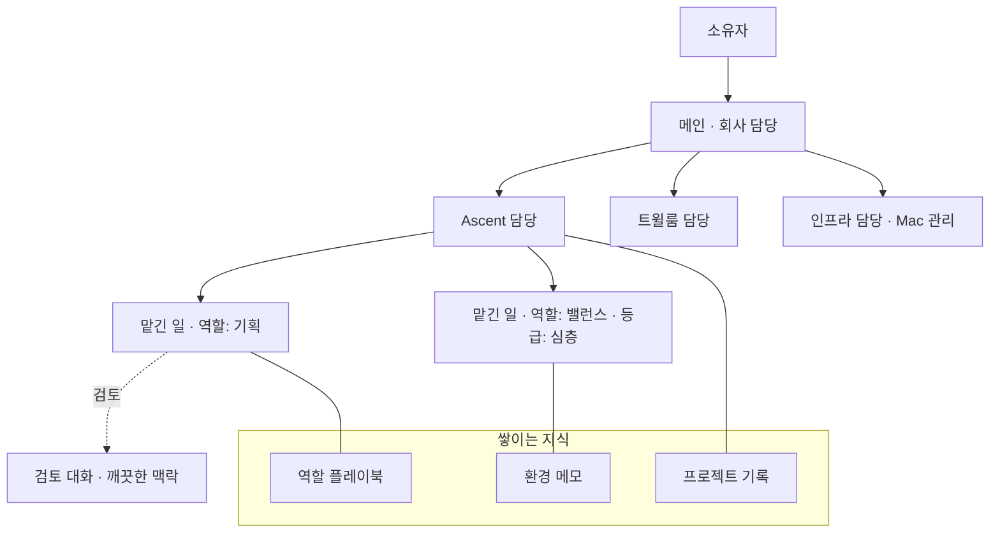

# Ghost 패러다임과 조직 구조: 조사와 설계 제안

상태: **권장 구성과 그 근거** (2026-11-12 작성). 구현 기준은 [기반 설계](ghost-infrastructure.md)다. 2026-11-12 소유자 결정에 따라 조직과 내부 구조는 코드로 고정하지 않고 사용자가 꾸린다. 그래서 이 문서의 담당제, 역할 플레이북, 목표 개수 같은 구조는 코드가 강제하지 않는다. 기본 Ghost가 조직을 꾸릴 때 읽는 안내서의 바탕이고, 3~5절의 측정과 근거는 그대로 유효하다. 일이 실제로 끝나게 하는 기반의 근거는 [실행 기반](ghost-execution.md)에 있다. 채택 전까지 정본은 [architecture](architecture.md)와 [current-priorities](current-priorities.md)다.

질문: Ghost를 비서가 아니라 실무자로, 여러 사업을 한 회사처럼 굴리려면 Ghost는 무엇이어야 하고, 프로젝트·목표·역할은 어떤 구조여야 하는가.

## 1. 결론

1. **Ghost는 역할이 아니라 담당이다.** Ghost를 가르는 기준을 "무엇을 잘하는가"에서 "무엇을 책임지는가"로 바꾼다. 프로젝트(사업)마다 담당 Ghost가 하나 있고, 메인은 회사 전체를 담당한다.
2. **역할은 Ghost가 아니라 플레이북이다.** 기획·밸런스·문서 작가 같은 역할은 일을 맡길 때 입히는 지침 묶음으로 남기고, 상주하는 Ghost로 두지 않는다.
3. **프로젝트는 문서 폴더가 아니라 사업 단위다.** 담당, 목표와 이정표, 맡긴 일, 프로젝트 기록, 저장소가 프로젝트에 속한다. 목표는 프로젝트별로 둔다.
4. **매트릭스는 채택하되 한 축만 사람을 둔다.** 프로젝트 축에는 담당 Ghost가 서고, 역할 축은 공유 자료(플레이북)다. 역할 Ghost와 프로젝트를 교차 배정하는 인력 매트릭스는 채택하지 않는다.
5. **지식은 Ghost가 아니라 세 곳에 쌓는다.** 프로젝트 기록(그 사업에서 알게 된 것), 역할 플레이북(일하는 방법), 환경 메모(이 설치에서 통하는 방법).

앞선 대화에서 "역할 Ghost는 두고 맡긴 일에 프로젝트만 붙이는 매트릭스"를 권했다. 아래 3절의 운영 데이터를 보고 그 판단을 바꿨다. Ghost 26명이 사실상 같은 기계이고 위임이 역할이 아니라 권한을 따라 흐른다는 사실은 그때 확인하지 않은 것이다.

## 2. 방법과 한계

- 내부: 운영 Host의 Owner API `/api/state`, `ledger.db`·`pi.db`·`memory.db`를 읽기 전용(`mode=ro`)으로 조회했다. 기간은 2026-11-07 11:48부터 2026-11-12 20:40까지이고 활동 대부분은 11-10 이후다. 가져오기 때 미완료로 들어온 맡긴 일 20건은 성공률 계산에서 뺐다.
- 외부: 1차 출처(논문 초록, 운영 주체의 보고서)를 직접 읽었다. 각 출처의 적용 한계는 4절 표에 적었다.
- 한계: 6일치 관측이고 대조군이 없다. 이 문서의 수치는 현재 구조의 증상을 보여 줄 뿐, 제안한 구조가 더 낫다는 증거가 아니다. 그 검증은 10절의 지표로 한다.

## 3. 운영 데이터가 보여 주는 것

| # | 관측 | 수치 |
| --- | --- | --- |
| F1 | 소유자는 메인하고만 이야기한다 | 소유자 메시지 78건 중 52건(67%)이 메인. 나머지 Ghost는 대부분 1건씩 |
| F2 | Ghost들은 거의 같은 기계다 | 활성 26명 중 24명이 `MiniMax-M3.1-Flash` 지정, 1명은 기본 모델, `심층`만 `gpt-6.1-sol`. 도구 목록의 차이는 `host_*`·`desktop_*`·`connection_*`·`toss_read` 계열과 `자산`의 좁힌 목록뿐. 페르소나는 246~1,099자 |
| F3 | 위임은 역할이 아니라 권한과 모델을 따라 흐른다 | 하위 맡긴 일 79건 중 33건이 `Mac 관리`(5건 완료), 17건이 `심층`(9건 완료). 둘을 합쳐 63% |
| F4 | 그 위임의 내용은 "자기 프로젝트 파일 읽기"다 | `Mac 관리`로 간 33건의 제목은 대부분 "저장소 원문 추출(읽기 전용)". `고객 응대`는 트윌룸 정책 문서를 읽으려고 8번 위임해 1번 성공했다 |
| F5 | 위임이 낀 일이 더 잘되지 않는다 | 루트 완료율: 단독 101/155(65%), 위임이 있는 트리 15/30(50%). 하위 맡긴 일 완료율 23/79(29%). 표본이 작아 방향만 본다 |
| F6 | 실패의 다수는 조직이 아니라 실행 기반에서 난다 | 실패 95건 중 63건이 `the deadline passed`이고, 그중 45건은 소유자 결정이나 하위 일을 기다리던 중이었다. 실패한 일의 63%가 모델 한도 오류를 맞았다. 원인 분석은 [실행 기반 2절](ghost-execution.md#2-실행-실패의-실제-원인) |
| F7 | 개인 기억은 쌓이지 않고, 쌓인 것은 프로젝트 지식이다 | 기억 파일이 기본 색인(153자)뿐인 Ghost 9명. 가장 많이 쌓은 `밸런스`(10개, 32,575자)의 내용은 Talking Stage 설계 수치다. 팀 노트 18개는 읽힌 횟수가 합쳐 2회 |
| F8 | 같은 환경 지식을 Ghost마다 따로 다시 발견한다 | 환경 적응 메모를 가진 Ghost 20명. 앞부분만 읽은 기준으로도 "컨테이너에 python·node 없음", "`document_read`가 해시를 주지 않아 수정 불가", 프로젝트 경로와 Space id가 여러 메모에 따로 적혀 있다 |
| F9 | 역할 이름의 Ghost가 실제로는 한 프로젝트에 묶여 있다 | 문서를 제안한 17명 중 13명이 사실상 한 프로젝트에서만 일했다(`기획`은 Ascent 25/25, `고객 응대`는 트윌룸 10/10) |
| F10 | 소유자의 승인은 판단이 아니라 통과다 | `approve_effect` 262건 중앙값 10초(승인 249, 거절 13). `document_review` 163건 중앙값 8초. 11-10~12 알림 하루 267~535건(2.10.1의 중복 알림 수정 이전 수치) |
| F11 | 지금의 프로젝트와 목표는 쓰이지 않는다 | `#프로젝트` 칩 0/284, 목표 0, 이정표 0. 문서 제안 163건은 모두 새 문서이고 저장소 9곳에 추적되지 않은 UUID 파일로 남았다 |

읽는 법: F2와 F3이 핵심이다. 지금 Ghost를 서로 다르게 만드는 것은 300자 남짓한 페르소나와 스킬 목록이고, 실제로 일을 갈라놓는 것은 "누가 Mac을 읽을 수 있는가"(`Mac 관리`)와 "누가 강한 모델을 쓰는가"(`심층`)다. 한 가지 개념(Ghost)에 역할, 프로젝트 소속, 권한, 모델 등급이라는 네 축이 겹쳐 있다. `개발`의 환경 메모에는 "① diff를 산출물로 낸다 ② 테스트는 심층이 돌린다 ③ Mac 적용과 커밋은 Mac 관리가 한다"는 작업 방식이 적혀 있다. 한 사람이 할 코드 수정 하나가 권한 때문에 세 Ghost의 인계로 쪼개진 것이다.

## 4. 외부 근거

| 출처 | 적용되는 내용 | 이 설계에서 쓴 곳 | 한계 |
| --- | --- | --- | --- |
| [Zheng 외, EMNLP Findings 2024](https://arxiv.org/abs/2311.10054) | 시스템 프롬프트의 페르소나 162종은 사실 질문 2,410개에서 성능을 높이지 못했고 효과는 무작위에 가까웠다 | 역할을 페르소나 한 문단으로 가르는 것은 성능 차이를 만들지 못한다 | 2023년 모델, 사실 질의. 도구를 쓰는 긴 작업은 측정하지 않았다 |
| [Cognition, 2026-04](https://cognition.com/blog/multi-agents-working) | 쓰기는 한 줄기로 두고 다른 에이전트는 판단을 보탤 때 다중 에이전트가 작동한다. 깨끗한 맥락의 검토자가 효과적이다. 약한 주 모델은 언제 강한 모델에 물어야 할지 모른다. 구조 없는 스웜은 채택되지 않는다 | 프로젝트당 쓰는 주체 하나, 검토는 별도 맥락, 등급 올림은 규칙으로 | 코딩 제품을 운영하는 회사의 보고. 대조 실험 수치는 일부만 공개 |
| [Anthropic 연구 시스템, 2025-06](https://www.anthropic.com/engineering/multi-agent-research-system) | 하위 에이전트의 이득은 별도 맥락과 병렬 탐색에서 온다. 토큰을 약 15배 쓴다. 맥락을 모두가 공유해야 하거나 의존이 많은 일에는 맞지 않는다 | 하위 일은 독립된 조각과 조사에 쓰고, 한 흐름의 일은 한 맥락에서 | 조사 과업 평가. Ghost의 성과를 예측하지 않는다 |
| [Anthropic 장기 실행 하네스, 2025-11](https://www.anthropic.com/engineering/effective-harnesses-for-long-running-agents) | 세션은 매번 기억 없이 시작한다. 진행 기록 파일과 git 이력, 실행 방법 스크립트를 환경에 남겨야 다음 세션이 이어간다. 에이전트는 일찍 끝났다고 선언한다 | 프로젝트 기록(상태·결정·실행 방법)을 Ghost가 아니라 프로젝트에 둔다 | 웹 앱 코딩 실험 |
| [Anthropic Agent Skills, 2025-10](https://www.anthropic.com/engineering/equipping-agents-for-the-real-world-with-agent-skills) | 용도별로 따로 만든 에이전트 대신, 범용 에이전트에 절차 지식 묶음을 필요할 때 얹는다 | 역할 = 플레이북 | 제품 설계 설명이며 비교 실험이 아니다 |
| [Li, 2026-01](https://arxiv.org/abs/2601.04748) | 다중 에이전트는 스킬을 고르는 단일 에이전트로 바꿀 수 있고 토큰과 지연이 줄어든다. 스킬이 많아지고 서로 비슷하면 선택 정확도가 급격히 떨어지며 계층화가 도움이 된다 | 역할 목록을 작게, 서로 구분되게 유지한다. 지금 비슷한 페르소나 25개 중에서 고르는 문제도 같은 한계에 걸린다 | 추론 벤치마크의 예비 결과 |
| [Xu 외, 2026-04](https://arxiv.org/abs/2604.01608) | 워크플로를 스킬로 옮길 때 능력 자원(도구, 기준)은 보존하는 편이 낫고, 절차 강제는 과업에 따라 해가 된다 | 플레이북에는 기준과 도구를 담고 고정 절차는 줄인다 | 구조화된 데이터 과학 과업 |
| [Kirchdorfer 외, 2026-07](https://arxiv.org/abs/2607.03228) | 조직 지식을 에이전트별 프롬프트나 검색에 넣으면 사일로와 규칙 중복이 생긴다. 공유되고 관리되는 조직 기억 계층이 필요하다 | F8의 중복을 환경 메모와 프로젝트 기록으로 모은다 | 조달 시나리오의 개념 증명 |
| [Cursor, 2026-01](https://cursor.com/blog/scaling-agents) | 동등한 에이전트의 자기 조율은 실패했다. 아무도 어려운 문제를 책임지지 않았다. 계획자와 작업자로 나누고 주기적으로 새 맥락에서 시작하자 풀렸다. 통합 담당 역할은 병목이 되어 뺐다 | 책임 주체를 명확히 하고, 실행은 맡긴 일마다 새 맥락에서 | 단일 코드베이스, 검증 기준이 분명한 과업 |
| [Project Vend 2, 2025-12](https://www.anthropic.com/research/project-vend-2) | 같은 모델의 CEO가 OKR로 압박한 것은 도움이 되지 않았다. 효과가 컸던 것은 절차와 도구였다. 별도 상품군을 맡은 에이전트는 잘 작동했다 | 관리 계층과 수치 목표를 늘리지 않는다. 분리는 사업 줄기를 따라 한다 | 실험 하나. "상품군별 분리가 효과적이었다"는 것은 보고서 문장에 대한 이 문서의 해석이다 |
| [Kim 외, 2025-12](https://arxiv.org/abs/2512.08296) | 조율의 이득은 과업이 쪼개지는지에 달렸다(+80.8%에서 -70.0%). 도구를 많이 쓰는 과업은 다중 에이전트 비용을 치른다. 중앙 검증이 없으면 오류가 퍼진다 | 위임은 기본값이 아니라 선택이다. 검증은 기존 순서를 유지한다 | 벤치마크 6종. 운영 상수가 아니다 |
| [Team Topologies](https://teamtopologies.com/key-concepts) | 흐름 정렬 팀이 사업 조각 하나를 끝까지 책임지고 다른 팀으로 넘기지 않는다. 플랫폼 팀은 서비스로 제공한다. 팀의 한계는 인지 부하다. 팀 사이 의존을 없앤다 | 프로젝트 담당 = 흐름 정렬, `Mac 관리` = 플랫폼 | 사람 조직의 실무 프레임워크. 에이전트에 대한 실증이 아니다 |

## 5. 사람 조직과 에이전트 조직은 희소한 것이 다르다

사람 회사가 직무로 사람을 나누는 이유는 숙련을 얻는 데 오래 걸리기 때문이다. 기획자를 디자이너로 바꾸려면 몇 년이 든다. 그래서 직무별 조직이 생기고, 여러 사업이 숙련자를 나눠 쓰려고 매트릭스를 만든다.

에이전트에게는 그 전제가 성립하지 않는다. 같은 모델이 지침만 바꾸면 기획도 하고 밸런스도 본다(F2). 대신 다음이 희소하다.

| 희소한 것 | 뜻 | 구조에 주는 답 |
| --- | --- | --- |
| 맥락 | 한 대화가 담을 수 있는 양과 주의. 길어지면 판단이 흐려진다 | 실행은 맡긴 일마다 새 맥락에서 |
| 쌓인 상황 지식 | 이 사업에서 무엇을 시도했고 무엇이 결정됐는가 | 프로젝트에 붙여 저장하고 매번 주입 |
| 책임의 연속성 | 누가 끝까지 붙들고 다음을 정하는가 | 프로젝트마다 지속되는 담당 하나 |
| 권한 | 누가 Mac을 읽고 쓰고, 무엇을 밖으로 보낼 수 있는가 | 담당과 프로젝트 범위에 붙인다 |
| 모델 지능과 비용 | 강한 모델은 비싸다 | 맡긴 일의 등급으로 고른다 |
| 소유자의 주의 | 하루 수백 건을 판단할 수 없다 | 프로젝트별로 묶고 전결 범위를 정한다 |
| 검증의 독립성 | 쓴 맥락과 다른 눈 | 깨끗한 맥락, 가능하면 다른 계열 모델 |

역할(숙련)은 이 목록에 없다. 그래서 역할로 Ghost를 가르면 희소하지 않은 것을 기준으로 지속 주체를 늘리게 되고, 정작 희소한 상황 지식과 권한은 잘못된 자리에 놓인다. F3, F7, F8, F9가 그 결과다.

## 6. 대안 평가

| 안 | 구조 | 판단 |
| --- | --- | --- |
| A. 현행 | 역할 Ghost 26명, 프로젝트는 문서 폴더 | 3절의 증상이 그대로 남는다 |
| B. 인력 매트릭스 | 역할 Ghost를 두고 프로젝트에 교차 배정, 프로젝트별 목표 | 프로젝트 목표와 프로젝트 지식 분리는 얻는다. 그러나 역할 Ghost가 각자 자율 계획과 기억을 가진 채 남아 F2·F3·F8이 유지되고, 소유자가 알아야 할 Ghost 수가 줄지 않는다. 역할 Ghost가 스스로 깨어날 때 어느 사업을 위해 깨는지 정할 근거가 없다 |
| C. 담당제 | 프로젝트마다 담당 Ghost, 역할은 플레이북, 프로젝트별 목표 | **권고.** 책임, 지식, 권한이 프로젝트 한 곳에 모인다. 두 축은 유지하되 역할 축은 인력이 아니라 자료다 |
| D. 단일 에이전트 | 메인 하나와 일회성 작업자 | 개념은 가장 적다. 그러나 사업 9개의 맥락과 자율 판단이 대화 하나에 섞이고, 사업별로 책임지고 보고할 주체가 없다 |

B와 C의 차이가 이 문서의 요점이다. 사람 조직의 직무 축은 희소한 숙련자를 기르고 나눠 쓰기 위해 있다. 에이전트의 숙련은 지침을 불러오면 생기므로 직무 축에 필요한 것은 사람이 아니라 잘 관리된 지침이다. C는 매트릭스에서 "두 상사" 문제를 없앤 형태다. 일하는 맥락은 프로젝트 담당 하나에게만 보고한다.

## 7. 제안하는 패러다임

세 층으로 나눈다.

1. **담당(Ghost).** 지속되는 책임 주체다. 수가 적다. 소유자와의 대화, 프로젝트 하나, 스스로 깨어나는 계획, 권한을 가진다.
2. **맡긴 일(Work).** 실행 단위이고 매번 새 맥락이다. 프로젝트, 역할 플레이북, 등급, 실행 대상, 완료 기준을 지닌다.
3. **지식.** 담당이나 맡긴 일보다 오래 남는다. 프로젝트 기록, 역할 플레이북, 환경 메모, 소유자 프로필.

Ghost를 만들지 말지는 다음으로 판단한다. 하나도 해당하지 않으면 그것은 Ghost가 아니라 플레이북이다.

- 지속되는 대상(사업, 이 Mac, 자산)의 결과를 책임지는가.
- 다른 Ghost에게 주면 안 되는 권한이 필요한가.
- 소유자가 "그건 어떻게 돼 가?"라고 물을 상대인가.

이 정의는 "모든 Ghost는 같은 종류의 지속형 봇"이라는 기존 원칙과 충돌하지 않는다. 종류는 여전히 하나이고 담당하는 범위만 다르다.

## 8. 개념

| 개념 | 뜻 | 지금의 무엇을 바꾸나 | 소유자가 다루나 |
| --- | --- | --- | --- |
| 프로젝트 | 사업 단위. 이름, 담당, 저장소 경로, 우선순위, 상태(진행·멈춤), 전결 설정 | `Space`를 대체. 문서 금고는 프로젝트의 자산 한 종류로 남는다 | 예 |
| 담당 | 프로젝트 하나를 책임지는 Ghost. 프로젝트마다 하나, 담당은 프로젝트 하나 | 역할 Ghost | 예 |
| 메인 | 회사 범위(프로젝트 없음)의 담당. 소유자의 입구, 사업 간 우선순위, 담당 만들기와 고치기 | 역할별 위임 대신 프로젝트별 연결 | 예 |
| 역할 | 플레이북. 이름, 한 줄 설명, 기준과 도구 사용법, 개정 이력. 맡긴 일에 붙는다 | 역할 Ghost의 페르소나와 `skills` | 가끔(설정) |
| 맡긴 일 | 지금과 같다. `projectId`, `roles`, `tier`가 추가된다 | 프로젝트 문맥을 brief 앞에 붙이던 방식 | 예 |
| 목표·이정표 | 지금과 같되 프로젝트에 속한다. 회사 범위 목표는 메인이 관리한다 | 팀 전체 3개 | 예 |
| 프로젝트 기록 | 상태(진행 중인 것), 결정과 이유, 실행 방법. Host 기억의 `/project/<id>/` | Ghost별 `/me/`에 흩어진 프로젝트 지식 | 열람·수정 가능 |
| 환경 메모 | 이 설치에서 통하는 방법. 한 벌 | Ghost 20명의 환경 적응 메모 중 공통 부분 | 열람·수정 가능 |
| 등급 | 맡긴 일의 모델 등급(일반·심층). 설정이 등급을 모델에 대응시킨다 | `심층` Ghost | 설정 한 번 |
| 전결 | 프로젝트에서 담당이 묻지 않고 할 수 있는 범위 | 건별 승인 카드 | 프로젝트당 한 번 |

넣지 않는 것: 부서, 직급, 담당 위의 관리 계층, 수치 목표와 마감, 에이전트끼리의 상시 대화 채널, 프로젝트 안의 하위 프로젝트. 책임의 깊이는 소유자 → 메인 → 담당 → 맡긴 일 트리로 고정한다.

## 9. 권장 규칙

아래는 담당제로 꾸릴 때 권하는 규칙이다. 코드가 강제하는 것은 [기반 설계](ghost-infrastructure.md)의 기본 요소와 바닥뿐이다.

### 책임과 실행

- 프로젝트마다 담당은 정확히 하나다. 담당을 바꿔도 프로젝트 기록, 목표, 맡긴 일은 프로젝트에 남는다.
- 프로젝트의 쓰기는 한 줄기다. 같은 저장소를 고치는 일은 담당이 순서를 정하고, 병렬은 서로 닿지 않는 조각과 조사·검토에만 쓴다.
- 담당은 자기 프로젝트 안에서 자기 자신에게 하위 일을 만들 수 있다(새 맥락, 다른 역할). "맡긴 일은 자기 Ghost에게 위임할 수 없다"는 현재 제한을 프로젝트 안에서 푼다. 트리 한도(일반 32, 자동 활동 16), 깊이, 마감은 그대로다.
- 다른 프로젝트가 필요한 일은 그 프로젝트의 담당에게 의뢰한다. 인프라 담당(`Mac 관리`)이 대표적이며, 이 경우에만 Ghost 사이 위임이 생긴다.
- 프로젝트가 없는 일(일회성 조사, 요약)은 메인이 회사 범위에서 역할을 붙여 맡긴다.

### 권한

- 담당은 자기 프로젝트 저장소 경로에 대한 읽기(`host_list`·`host_read`)를 기본으로 가진다. F4의 위임을 없애는 변경이다.
- 실행의 기본 환경은 Mac의 작업 공간이다. 일마다 자기 폴더와 워크트리를 쓰고, 쓰기는 그 안으로 제한된다. 컨테이너는 받은 코드를 돌릴 때만 쓴다. 작업 공간 밖을 바꾸는 PC 직접 실행은 지금처럼 소유자가 따로 허용한다. 근거와 세부는 [실행 기반 3절](ghost-execution.md#3-컨테이너는-필요한가).
- 권한은 지금처럼 대화 종류, Ghost 도구 목록, 맡긴 일 범위, 연동 허용의 교집합이고 여기에 프로젝트 경로가 더해진다. Mac을 여는 권한이 시간이 지나 자동 허용되지 않는다는 원칙은 유지한다.

### 전결

| 구분 | 예 | 결정 |
| --- | --- | --- |
| 자율 | 워크트리 브랜치의 수정과 커밋, 컨테이너 실행, 웹 조사, 산출물, 프로젝트 기록 | 담당. 기록만 남기고 카드를 띄우지 않는다 |
| 검토 | 프로젝트 본 브랜치로의 통합. 저장 데이터·보안·돈·공개 API·공개 글이 걸린 변경 | 깨끗한 맥락의 검토 통과. 후자는 메인의 확인을 더한다 |
| 소유자 | 배포와 릴리스, 메일·게시 등 외부 발신, 결제, 데이터 삭제, 자격 정보, 프로젝트 경로 밖 권한, 목표 등록 | 소유자만 |

근거는 F10이다. 실행 승인 요청의 95%가 승인됐고 응답 중앙값이 10초여서, 건별 카드는 통제보다 비용으로 작동하고 있다. 되돌릴 수 있는 것은 담당에게, 밖으로 나가거나 되돌릴 수 없는 것은 소유자에게 둔다. 소유자는 프로젝트별로 "통합도 소유자가"처럼 더 조일 수 있다.

### 지식과 주입

- 프로젝트 기록: 담당이 쓰고(내용 해시 비교 후 교체), Host가 정리한다. 그 프로젝트의 모든 깨움과 맡긴 일에 한도 내 색인이 들어간다.
- 환경 메모: 누구나 제안하고 메인이 합친다. 모든 대화에 들어간다. Ghost별 환경 적응 메모는 그 Ghost의 행동 교정만 남긴다.
- 역할 플레이북: 맡긴 일을 만들 때 고른 것만 그 대화에 들어간다. 결과가 같은 식으로 어긋나면 Ghost가 아니라 플레이북을 고친다. 목록은 서로 구분되는 이름으로 작게 유지한다(시작은 12개 안팎).
- 산출물은 맡긴 일의 산출물이나 저장소 커밋으로 남긴다. 새 문서를 프로젝트 저장소에 제안으로 쌓지 않는다.

### 목표

- 목표는 프로젝트에 속한다. 방향이지 할당량이나 마감이 아니고 어떤 권한도 주지 않는다는 현재 원칙을 유지한다.
- 프로젝트당 열린 목표는 2개까지, 회사 범위는 3개까지. 이정표는 담당이 세운다(예정 4개, 진행 2개, 완료는 수용된 맡긴 일이 있어야 함).
- 소유자가 직접 적거나 담당이 자기 프로젝트 목표를 제안하면 소유자만 등록한다. 거절하면 그 프로젝트의 제안은 3일 쉰다.
- 깨움과 맡긴 일에는 그 프로젝트의 목표만 들어간다. 회사 범위 목표는 "지키는 선"만 모든 곳에 들어간다. 9개 사업의 목표를 매번 다 넣지 않는다.
- 계층은 목표 → 이정표 → 맡긴 일 그대로다. 프로젝트는 목표의 상위 목표가 아니라 범위다.

### 자율과 자원

- 담당은 지금처럼 `plan_next`로 다음에 볼 때를 정한다. 지켜볼 저장소는 프로젝트에서 나오므로 따로 고르지 않는다.
- 깨울 때 들어가는 것: 프로젝트 기록 색인, 목표와 진행 중인 이정표, 지난번 이후 끝난 일, 프로젝트의 결정 대기.
- 메인이 깨어날 때는 프로젝트마다 한 줄 상태와 막힌 것, 사업 사이의 충돌만 본다.
- 소유자는 프로젝트의 우선순위 순서와 멈춤만 정한다. 동시 실행 한도는 우선순위 순으로 나눈다. 멈춘 프로젝트의 담당은 깨어나지 않는다.
- 등급: 담당의 조율 대화는 강한 등급, 맡긴 일 실행은 기본 등급으로 시작한다. 검토에서 반려된 일의 재시도와 되돌리기 어려운 결정의 근거 정리는 심층으로 올린다. 약한 모델이 스스로 올릴 때를 판단하게 두지 않는다.
- 검토 대화는 쓴 맥락을 받지 않는다. 가능하면 쓴 모델과 다른 계열을 쓴다.

### 소유자에게 보이는 것

프로젝트 화면 하나에 담당, 목표 줄, 진행 중인 일, 결정 대기, 최근 결과가 모인다. 확인할 일은 프로젝트별로 묶인다. 소유자는 프로젝트의 담당과 이야기하거나 메인에게 말하고, 메인은 "어느 사업의 일인가"로 연결한다. 역할 25개 중 누구에게 줄지를 고르는 일은 없어진다.

## 10. 검증 지표

채택 후 같은 질의로 다시 잰다. 기준값은 3절이다.

| 지표 | 지금 | 기대 방향 |
| --- | --- | --- |
| 권한·모델 때문에 생긴 하위 일의 비율 | 63% | 인프라 의뢰만 남는다 |
| 루트 맡긴 일 완료율 | 63% | 오른다. 단 마감 실패는 따로 봐야 한다 |
| 하위 맡긴 일 완료율 | 29% | 오른다 |
| 소유자 결정 건수와 중앙 응답 시간 | 하루 수백 건, 8~10초 | 건수는 줄고 건당 시간은 늘어난다 |
| 여러 곳에 중복된 환경 지식 | Ghost 20명의 메모 | 환경 메모 한 벌 |
| 저장소에 추적되지 않고 남은 산출 문서 | 163개 | 새로 생기지 않는다 |
| 프로젝트 기록이 깨움에서 읽힌 횟수 | 없음(팀 노트 2회) | 깨움마다 |

## 11. 이 문서 밖에서 다루는 것과 남는 한계

- **실행 기반의 실패.** 모델 한도, 마감 시계, 실행 환경은 조직 구조와 무관하게 실패를 만든다. [실행 기반](ghost-execution.md)이 원인과 설계를 다룬다. 구현 순서에서도 그쪽이 먼저다.
- **담당의 품질 한계.** 한 프로젝트의 판단이 담당 하나에 걸린다. 계약, 독립 평가, 실패 시 등급 올림으로 다루며 세부는 [실행 기반 5절](ghost-execution.md#5-담당의-품질-한계를-넘는-방법)에 있다. 완화이지 해소가 아니다.
- **역할 선택의 한계.** 플레이북이 많아지고 비슷해지면 고르는 정확도가 떨어진다. 목록을 작게 유지하는 것은 운영 규율이지 구조가 보장하지 않는다.
- **자체 증거의 부재.** 담당제가 Ghost에서 더 잘 작동한다는 측정은 아직 없다. 외부 근거는 대부분 코딩과 조사 과업이다.
- **비용.** 담당과 평가를 강한 모델로 올리면 차례당 비용이 오른다. Ghost 수와 불필요한 깨움이 줄어 상쇄될 것으로 보지만 측정 전의 추정이다.

## 12. 채택하면 바뀌는 기존 결정

기반 설계가 코드로 가져가는 것(실행 환경, 깨움의 맥락, 실행 시계, 자기 위임, 정책)과 권장 구성으로 남는 것(담당제, 목표의 귀속과 개수)이 섞여 있다. 어느 쪽인지는 [기반 설계 7절](ghost-infrastructure.md#7-앞선-문서의-항목이-가는-곳)에 있다.

| 기존 | 바뀌는 내용 |
| --- | --- |
| 팀은 일에서 자란다: 반복되는 일이 전담 역할을 원하면 메인이 Ghost를 만든다(2026-11-10) | 새 책임 범위가 생기면 담당 Ghost를 만들고, 반복되는 일하는 방식은 플레이북으로 만든다 |
| 팀 목표: 열린 목표 3개, 이정표는 메인이 관리(2026-11-11) | 목표는 프로젝트에 속하고 이정표는 담당이 관리한다. 회사 범위 3개는 남는다 |
| Space = PDC 문서 금고로 뒷받침되는 프로젝트. 모든 활성 Ghost가 읽고 제안 | 프로젝트는 사업 단위이고 문서 금고는 그 자산 중 하나다. 저장소 문서는 담당이 직접 읽고 커밋으로 고친다 |
| 맡긴 일은 자기 Ghost에게 위임할 수 없다 | 프로젝트 안에서는 허용한다 |
| Ghost가 지켜볼 Space를 스스로 고른다 | 담당의 프로젝트에서 정해진다 |
| 건별 승인 카드, 메인의 선검토와 시간 경과 자동 처리 | 프로젝트 전결 범위로 대체한다. 소유자 전용 결정은 그대로 남는다 |
| 맡긴 일의 기본 실행 환경은 컨테이너 | Mac의 작업 공간이 기본이고 컨테이너는 선택이다 |
| 자율 깨움과 결정 검토는 Ghost의 직접 대화에 쌓인다 | 깨움마다 새 맥락에서 돌고, 소유자에게 할 말만 직접 대화에 남는다 |
| 마감은 만든 시점부터의 벽시계 | 일하는 시간만 세는 실행 예산과, 소유자가 정했을 때만 있는 기한으로 나눈다 |

현재 Ghost 26명의 처리(초안):

- 담당으로 남거나 새로 서는 것: 메인(회사), `Mac 관리`(인프라), `자산`(자산), 그리고 Ghost·트윌룸·트윌룸 스튜디오·Talking Stage·Ascent·에이전트 오케스트라·Garden UI·Oximemo의 담당.
- 플레이북으로 옮기는 것: 기획, 밸런스, 콘텐츠 작가, 플레이테스터, 콘셉트, 3D 아트, 디자이너, 문서 작가, 리서치, 경쟁 분석, 보안 점검, 고객 응대, SNS, 이슈 정리, AI 소식, 레퍼런스, 수익성, 하네스 회고, 사용량, 기억 관리, 개발. 서로 비슷한 것(리서치·경쟁 분석·레퍼런스·AI 소식, 문서 작가·콘텐츠 작가·SNS)은 합친다.
- 등급과 절차로 옮기는 것: `심층`은 등급, `패널`은 여러 계열 모델에 같은 질문을 맡기는 절차.
- 역할 Ghost는 삭제하지 않고 은퇴 상태로 둔다. 과거 맡긴 일과 기억의 작성자가 유지된다. 프로젝트 지식이 담긴 개인 기억(`밸런스`의 Talking Stage 노트 등)은 프로젝트 기록으로 옮긴다.

## 13. 구현 순서

[기반 설계 10절](ghost-infrastructure.md#10-구현-순서)에 있다. 이 문서의 구조는 코드로 들어가지 않으므로 여기에 따로 순서를 두지 않는다. 지금 Ghost 26명과 프로젝트 9개를 12절의 초안처럼 재편할지는 기반이 갖춰진 뒤 소유자와 기본 Ghost가 대화로 정한다.
