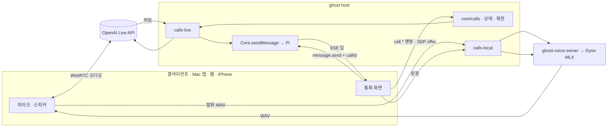

# 전화 (음성 통화)

상태: 앱 안 통화 구현(Host 2.27.0). 전화망 발신(전화 대행)은 소유자 결정(2026-11-23)으로 보류했다. 아래 "보류" 절이 그 설계다.

## 범위

Mac 앱·웹·iPhone에서 Ghost에게 전화를 건다. 엔진은 설정으로 고른다: 실시간(OpenAI GPT-Live) 또는 이 Mac의 로컬 음성(Whisper → Ghost → TTS). 통화 계층(상태·제한·기록·UI)은 하나다. 수신, 통화 녹음 보관, 영상 통화는 범위 밖이다.

## 구조

통화는 Ghost의 직접 대화에 붙는 세션이다. 새 대화 종류가 아니다. 말한 내용은 그 대화에 보통 메시지로 남고, 생각과 도구 사용은 항상 Ghost의 대화(Pi)가 한다. 엔진은 듣고 말하기만 맡는다.

### 통화 모델

`Call`(계약 `packages/ghost-contract/src/calls.ts`)은 `settings`의 `calls` 키에 최근 50건(진행 중인 통화는 항상)만 둔다. 원장 마이그레이션이 없어 릴리스를 되돌려도 저장소 지문이 바뀌지 않는다. 변경은 `call` 이벤트로 한 줄씩 나간다.

- 상태: `connecting` → `active` → `ended` / `failed`. 끝난 이유 `endReason`: `hangup`, `limit`, `interrupted`, `error`, `unavailable`.
- 한 Host에 진행 중인 통화는 하나다. 연결은 30초 안에 `active`가 돼야 하고, 통화는 15분에 끝난다. Host 재시작은 진행 중이던 통화를 `failed`(`interrupted`)로 닫고 다시 잇지 않는다.
- `seconds`: 엔진이 보고한 값, 없으면 응답~종료 시간. 종료 뒤 제공자가 최종 사용량을 늦게 알리면 `core.calls.recordUsage`가 닫힌 통화의 값만 고친다.
- 명령(멱등 requestId): `call.start { ghostId, engine? }`, `call.activate { callId }`, `call.end { callId }`, `voice.set { engine?, voice? }`. 엔진이 못 받는 상태면 `call.start`가 이유를 문장으로 거절한다. 조용히 다른 엔진으로 바꾸지 않는다(음성이 나가는 경로가 달라지기 때문).
- 말한 메시지는 기존 `message.send`에 `callId`를 실어 보낸다. Host는 그 통화가 이 대화에서 진행 중인지 제출 시점과 엔진의 최종 수락 시점에 다시 확인하며(통화가 끝난 뒤 쿼터 대기에서 풀린 발화가 들어가지 않는다), 모델에게 "이 답은 소리로 읽힌다"는 짧은 지시를 덧붙인다. 메시지에는 `callId`가 남는다.
- 엔진은 `core.calls.register(engine, port)`로 등록한다. `port.unavailable()`은 동기이므로 확인이 필요한 엔진은 백그라운드로 최신 상태를 유지한다. `serve`는 인증을 마친 `/api/calls/…` 요청을 받고, `hangup`은 통화가 끝난 뒤 한 번 불린다.

### realtime (`integrations/calls-live.ts`)

- 쓰려면 공급자 `openai`에 API 키가 있어야 한다(ChatGPT 로그인 같은 OAuth 자격으로는 Live API를 못 쓴다). 없으면 `call.start`가 설정 안내 문장으로 거절한다.
- 브라우저가 SDP offer를 만들어 `POST /api/calls/:id/offer`로 보내면 Host가 `POST /v1/live/sessions`(`transport.type: webrtc`)로 answer를 받아 돌려준다. 키와 세션 설정은 Host에만 있다.
- 위임은 클라이언트 위임이다. Host만 하나의 sideband WebSocket으로 위임 이벤트를 받아, 위임 id마다 한 번 Ghost 대화에 제출하고(`call:<callId>:<delegationId>`) 최종 답을 `session.commentary.append`로 돌려준다. 브라우저의 데이터 채널은 자막과 시작 신호만 받고 아무것도 발행하지 못한다(`allowed_client_events: []`). 통화당 위임 24회 상한.
- 사용 시간은 `session.closed`의 최종 `usage.seconds`다(WebRTC 시작 시 먼저 청구되는 15초는 사용 시간에서 차감된다).

### local (`integrations/calls-local.ts`)

- Host 설정 `voice.speechUrl`(기본 `http://127.0.0.1:62076`, loopback http만)의 `ghost-voice-server`를 쓴다. 10초마다 `/health`를 확인하고 두 모델이 모두 올라 있을 때만 통화를 받는다. 이 서버와 Dyno MLX(`:7730`)를 띄우는 일은 Host가 하지 않는다(별도 운영).
- 클라이언트가 VAD로 발화를 자르고 `POST /api/calls/:id/transcribe`(audio/wav) → 텍스트 → `message.send`(callId) → 답은 기존 SSE로 오고, 클라이언트가 문장마다 `POST /api/calls/:id/speech` → WAV를 재생 큐에 넣는다. 끼어들면 큐를 비우고 `message.cancel`을 보낸다.
- 서버 쪽 동시 업스트림 2건, 초과는 `unavailable`. 업스트림 오류 본문은 클라이언트로 전달하지 않는다.

## 클라이언트

- 통화 버튼은 대화 머리의 도구 줄(데스크톱) / 컴팩트 제목줄(휴대전화)에 있다. 통화 화면: 시간, 내 말과 Ghost 말의 자막, 마이크·스피커 끄기, 끊기, 최소화(제목줄 캡슐로 돌아가 계속 통화).
- 마이크는 사용자가 통화를 누른 동작 안에서만 요청한다. 브라우저의 에코 제거·잡음 억제·자동 이득을 켠다.
- iPhone 셸은 `NSMicrophoneUsageDescription`과 `requestMediaCapturePermissionFor`(마이크만, 페어링한 Host의 메인 프레임에만 허용)를 가진다. 화면을 끈 채 통화하는 것(백그라운드 오디오)은 지원하지 않는다. Mac 셸은 이미 마이크 권한이 연결돼 있다.
- 설정 › 음성: 통화 방식(실시간 / 이 Mac)과 목소리.

## 보류: 전화 대행

소유자 결정(2026-11-23): 앱 통화를 먼저 끝내고 SIP는 보류한다. 아래는 재개할 때의 설계이며 코드는 없다.

- `phone_call` 도구가 `{to, purpose, maxMinutes}`를 제안만 하고, 소유자 승인(`approve_effect`, `mail_send`와 같은 흐름) 뒤에 `effects.onApproved`가 현재 허용을 다시 확인하고 Live API `POST /v1/live/sessions`(`transport.type: sip`)로 발신한다. 응답은 "세션 초기화"일 뿐 "받았음"이 아니므로 sideband의 `transport.ringing/answered/failed`로 상태를 바꾼다.
- 결과를 모르면 효과는 `unknown`이고 같은 승인으로 다시 걸지 않는다. 통화 상대의 말은 신뢰하지 않는 입력이므로 통화용 위임은 읽기 전용 권한만 갖는다(호스트 명령·메일 발송·브라우저 쓰기·금고·다른 전화 없음). 첫 마디에 AI 비서라는 고지를 고정하고, 긴급번호·유료 정보 서비스 번호는 코드에서 거부한다. 동시 1통화와 시간·횟수 한도를 둔다.
- 필요한 것: TLS 시그널링과 SDES-SRTP를 지원하는 SIP 트렁크 계정과 발신 번호(`Connection`의 비밀로 저장). Twilio 기준 한국 지역 번호는 개인에게 발급되지 않고 사업자등록이 필요하며, 한국 휴대전화 번호는 개인도 신분증으로 신청할 수 있다고 안내돼 있다. 한국의 자동 음성 발신 동의·고지 규정은 이 문서가 판단하지 않으며 첫 실발신 전에 소유자가 확인해야 한다.
- 추가될 필드(`kind`, `phone`)는 그때 `Call`과 마이그레이션 없이 `settings`의 `calls` 항목에 더한다.

## 검증 기록

기록은 `docs/local-operations.md`에 둔다.
